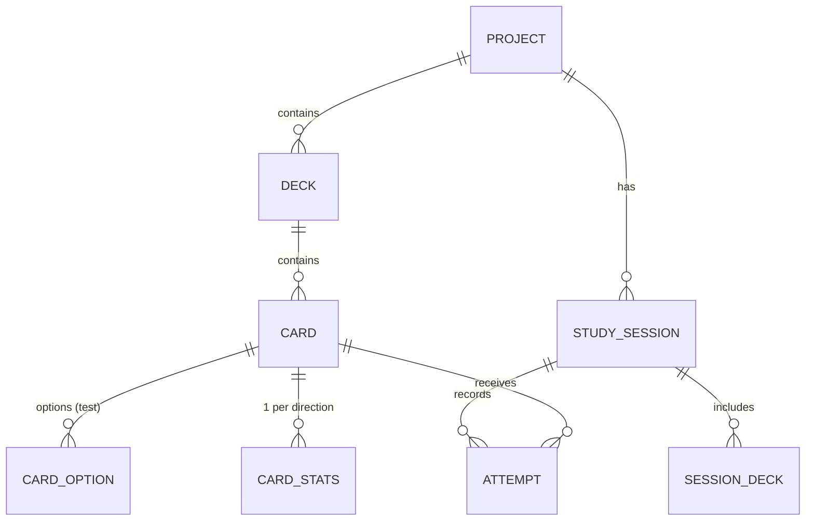
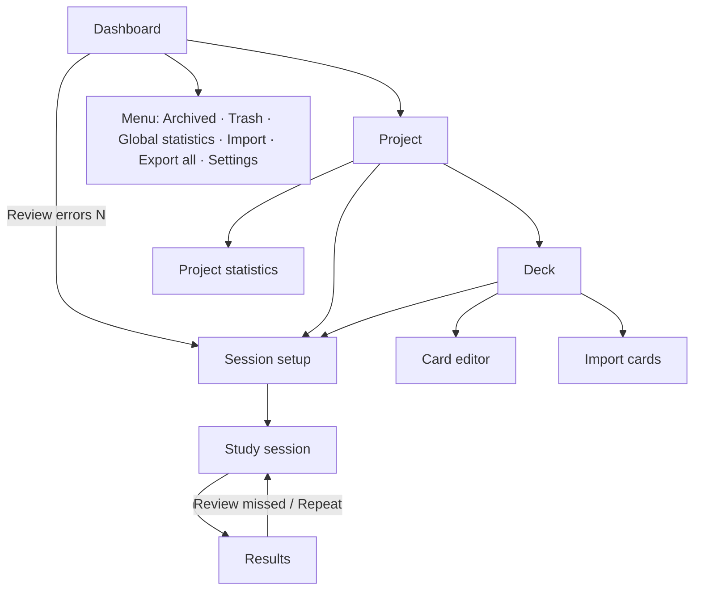

# EstudiCards — Functional and Technical Specification

> **Name:** EstudiCards ("Estudi" + "Cards"). As of 30/09/2026, no apps with this exact name were found on the App Store, Google Play or the web. Before publishing, check the stores and the trademark registries (OEPM / EUIPO) again.

| Field | Value |
|---|---|
| Document version | 1.2 |
| Date | 30/09/2026 |
| Scope | Version 1 (v1) |
| v1 platforms | Windows, macOS, Android, iOS |
| Technology | Flutter (Dart) |
| UI language | Spanish (see [§2.1](#21-ui-vocabulary)) |
| Documentation, code and tests language | English |
| Related documents | `DESIGN_BRIEF.md` (visual design), `design/` (design screenshots), `TASKS.md` (task plan), `AGENTS.md` / `CLAUDE.md` (instructions for coding agents) |

---

## Table of contents

1. [Summary and goals](#1-summary-and-goals)
2. [Glossary](#2-glossary)
3. [Technical architecture](#3-technical-architecture)
4. [Data model](#4-data-model)
5. [Screens and navigation](#5-screens-and-navigation)
6. [User stories and acceptance criteria](#6-user-stories-and-acceptance-criteria)
7. [Business rules](#7-business-rules)
8. [Import and export](#8-import-and-export)
9. [Non-functional requirements](#9-non-functional-requirements)
10. [Quality: TDD, tests and CI/CD](#10-quality-tdd-tests-and-cicd)
11. [Phased implementation plan](#11-phased-implementation-plan)
12. [Future goals (outside v1)](#12-future-goals-outside-v1)
13. [Decision log and assumptions](#13-decision-log-and-assumptions)

---

## 1. Summary and goals

EstudiCards is a flashcard app for desktop and mobile. Content is organised into **projects** that contain **decks** of **cards**. Users study with random sessions, with or without a timer, and review their mistakes based on the history of correct and wrong answers.

### 1.1 v1 goals

- Create, edit, archive and delete projects and decks, with a 15-day trash.
- Create two types of cards: **simple** (question → answer) and **test** (question with 2–6 options, one or several correct).
- **Language** projects with text-to-speech (system TTS), example sentence, notes and reverse mode.
- Configurable random study sessions: number of cards, decks, normal or errors-only mode, direction, per-question or global timer.
- Record every attempt and keep an error list per card and direction.
- Per-project and global statistics, daily streak and optional daily goal.
- Import and export: full backup, share a project or deck (JSON/CSV), and import cards from CSV with a template and an AI prompt.
- **100% offline**, no accounts or login.

### 1.2 Out of scope for v1

Login, cloud sync, web version, AI voices, spaced repetition, typing the answer, formulas and code, keyboard shortcuts and UI languages other than Spanish. See [section 12](#12-future-goals-outside-v1).

### 1.3 Target user

A single user who studies syllabi (public exams, school subjects, certifications) or languages, and switches between computer and phone, moving their data with exported files.

---

## 2. Glossary

| Term | Definition |
|---|---|
| **Project** | Top-level container (e.g. "Inglés B2"). Defines the type (general or language) and the languages, which its decks inherit. |
| **Deck** | Group of cards inside a project (e.g. "Verbos irregulares"). |
| **Card** | Unit of study. It can be *simple* or *test*. |
| **Simple card** | Has a front (question, word or sentence) and a back (answer or translation). The user self-grades it with "Acerté" (got it) or "Fallé" (missed it). |
| **Test card** | Question with 2–6 options and one or several correct ones. The app grades it automatically when the user taps "Comprobar" (check). |
| **Direction** | *Normal* (question → answer) or *reverse* (answer → question). Reverse only exists in language projects. |
| **Session** | One round of study with a specific configuration. |
| **Attempt** | The result of one card within a session: correct, wrong or unanswered. |
| **Error / error list** | A card is "in errors" for a direction if it was answered wrong and has not yet been answered correctly twice in a row. |
| **Trash** | Where deleted projects and decks stay for 15 days before being permanently deleted. |
| **Archived** | A project hidden from the dashboard without deleting it. |
| **Streak** | Number of consecutive days with at least one card answered. |

### 2.1 UI vocabulary

The app UI is in **Spanish**. This document quotes UI labels in Spanish, exactly as they must appear in `app_es.arb`. Main labels:

| Spanish UI label | Meaning |
|---|---|
| Proyecto / Baraja / Tarjeta | Project / Deck / Card |
| Tipo test | Test type (toggle in the card editor) |
| Permitir varias correctas | Allow multiple correct answers |
| Girar | Flip |
| Acerté / Fallé | Got it / Missed it |
| Comprobar / Siguiente | Check / Next |
| Ver respuesta | Show answer |
| Dejar para el final | Leave for later (move to the end of the queue) |
| Solo errores | Errors only |
| Priorizar las más falladas | Prioritise the most missed |
| Repetir falladas al final | Repeat missed cards at the end |
| Repasar errores (N) | Review errors (N) |
| Repasar falladas ahora | Review missed cards now |
| Repetir sesión / Volver | Repeat session / Back |
| En pausa / Continuar / Salir | Paused / Resume / Exit |
| No respondidas | Unanswered |
| Guardar / Guardar y añadir otra | Save / Save and add another |
| Deshacer | Undo |
| Papelera / Archivados / Ajustes | Trash / Archived / Settings |
| Vaciar papelera / Eliminar definitivamente | Empty trash / Delete permanently |
| Exportar todo / Restaurar copia | Export all / Restore backup |
| Reemplazar todo / Fusionar | Replace all / Merge |
| Importar tarjetas / Descargar plantilla / Copiar prompt para IA | Import cards / Download template / Copy AI prompt |
| Frase de ejemplo / Notas / Explicación | Example sentence / Notes / Explanation |

---

## 3. Technical architecture

### 3.1 Stack

| Piece | Choice | What it is for (explained) |
|---|---|---|
| Framework | **Flutter** (stable) + **Dart 3** | A single codebase for Windows, macOS, Android and iOS. Flutter draws the whole UI itself, so it looks the same on every platform. |
| Database | **Drift** on SQLite (`drift`, `drift_flutter`) | SQLite is a database in a single file, on the device. Drift lets you write tables and queries in Dart with type checking, and handles migrations when the schema changes. |
| State | **Riverpod** (`flutter_riverpod`) | Connects data to screens: when something changes in the database, the screens that show it update automatically. |
| Navigation | **go_router** | Defines routes (`/project/:id`, `/deck/:id`…) and back navigation. |
| IDs | `uuid` (v4) | Globally unique identifiers. They allow exporting and importing without ID clashes. |
| Voice | `flutter_tts` | Uses the operating system's speech engine. Free, offline, no AI. |
| Files | `file_picker`, `share_plus`, `path_provider` | Pick files to import, share through the native menu (WhatsApp, email…) and save to disk. |
| Images | `image_picker` (mobile), `file_picker` (desktop), `image` (resizing in pure Dart) | Add images to cards and compress them on every platform. |
| CSV | `csv` | Read and write CSV. |
| Charts | `fl_chart` | Statistics charts. |
| UI strings | `flutter_localizations` + ARB files (`intl`) | All UI strings in one file, so the app can be translated in the future. |
| Unit and widget tests | `flutter_test`, `mocktail`, `fake_async` | Tests for business rules and isolated screens. `mocktail` creates test doubles; `fake_async` controls time in timer tests. |
| Integration tests | `integration_test` (Flutter SDK) | Full flows inside the real app, with a database. |
| E2E tests | `patrol` | Full flows in the real app that also interact with native system dialogs (file picker, share sheet, permissions). |
| Git hooks | Lefthook (`lefthook.yml`) | Runs formatting, analysis and tests automatically before each commit and push. |
| CI/CD | GitHub Actions (`.github/workflows/`) | Runs all tests on every PR and builds the installers when a version is released. |

> The exact version of each package is pinned when the project is created (latest compatible stable). No need to decide them now.

### 3.2 Layers and folder structure

The code is organised **by feature** (feature-first) with three layers:

- **data:** Drift tables, DAOs and repositories.
- **domain:** models and pure business rules. They do not depend on Flutter and can be covered by unit tests.
- **presentation:** screens, widgets and Riverpod providers.

```
lib/
├── main.dart
├── app/                     # MaterialApp, theme, router, localisation
│   ├── router.dart
│   ├── theme/               # colour tokens, typography, light/dark theme
│   └── l10n/                # app_es.arb
├── core/                    # shared utilities
│   ├── db/                  # AppDatabase (Drift), migrations
│   ├── ids.dart             # UUID generation
│   ├── clock.dart           # injectable clock (for timer and trash tests)
│   ├── files/               # save/share, images
│   └── widgets/             # reusable components
└── features/
    ├── projects/            # dashboard, project, archived, trash
    ├── decks/               # deck and card list
    ├── cards/               # card editor and preview
    ├── study/               # configuration, session engine, results
    ├── stats/               # statistics, errors, streak
    ├── import_export/       # JSON, CSV, template, AI prompt
    └── settings/            # settings
test/                        # unit and widget tests (mirrors lib/)
│   └── fixtures/            # sample CSV and JSON files for tests
integration_test/            # integration tests (one flow per epic)
.github/workflows/           # CI (ci.yml) and CD (release.yml)
lefthook.yml                 # git hooks
```

> Patrol E2E tests live in `patrol_test/`, Patrol's default folder (decided in T0.9).

### 3.3 Responsive layout

| Window width | Layout |
|---|---|
| < 600 dp (mobile) | Stack navigation: Dashboard → Project → Deck. The dashboard menu is in a side drawer. |
| 600–839 dp (tablet) | Like mobile, with larger margins and a two-column card editor. |
| ≥ 840 dp (desktop) | Fixed sidebar with the project list (and links to Archived, Trash, Statistics and Settings); the project or deck content on the right. In the editor, the preview is on the right. |

### 3.4 File storage

- Database: `<app documents>/estudicards.sqlite`.
- Images: `<app documents>/images/<uuid>.jpg`. Only the relative path is stored in the database.
- Images are resized to at most 1600 px on the long side and saved as JPEG at quality 80.

### 3.5 Platforms and distribution

- **v1:** Android, iOS, Windows and macOS.
- **Sharing:** on mobile, the native share menu (`share_plus`). On desktop, "Save as…" (`file_picker`), because sharing straight to WhatsApp does not work the same way on desktop.
- **Voice (TTS):** depends on the voices installed on the system. If the voice for a language is missing, the app says so and explains how to install it.

---

## 4. Data model

All IDs are UUID v4 strings. All dates are stored in UTC as ISO 8601 text (e.g. `2026-10-04T12:30:15.123Z`).

Every foreign key (`→ table.id`) deletes in cascade: permanently deleting a row also deletes the rows that depend on it (rule [7.1](#71-trash-and-deletion)). SQLite enforces foreign keys only when they are switched on, so the app enables them every time it opens the database.

### 4.1 Diagram



### 4.2 Tables

#### `projects`

| Field | Type | Notes |
|---|---|---|
| id | TEXT PK | UUID |
| name | TEXT | Required, 1–60 characters |
| description | TEXT? | Up to 300 characters |
| color | TEXT | Key from the project palette (e.g. `orange`, `blue`) |
| icon | TEXT | Emoji or icon key |
| type | TEXT | `general` \| `language` |
| source_lang | TEXT? | BCP-47 (e.g. `en-GB`). Only if `type = language` |
| target_lang | TEXT? | BCP-47 (e.g. `es-ES`). Only if `type = language` |
| is_favorite | BOOL | Default `false` |
| is_archived | BOOL | Default `false` |
| archived_at | DATETIME? | When it was archived; null when not archived (schema version 2) |
| deleted_at | DATETIME? | Not null = in the trash |
| last_used_at | DATETIME? | Updated when the project is opened or studied |
| created_at / updated_at | DATETIME | |

#### `decks`

| Field | Type | Notes |
|---|---|---|
| id | TEXT PK | UUID |
| project_id | TEXT FK | → projects.id |
| name | TEXT | Required, 1–60 characters |
| description | TEXT? | |
| color | TEXT? | Null = inherits the project colour |
| deleted_at | DATETIME? | Not null = in the trash |
| last_used_at | DATETIME? | |
| created_at / updated_at | DATETIME | |

#### `cards`

| Field | Type | Notes |
|---|---|---|
| id | TEXT PK | UUID |
| deck_id | TEXT FK | → decks.id |
| type | TEXT | `simple` \| `test` |
| question | TEXT | Required. Supports `**bold**` and `*italic*` |
| question_image | TEXT? | Relative path |
| answer | TEXT? | Required if `simple`. Not used in `test` |
| answer_image | TEXT? | In `test` it is shown with the explanation |
| explanation | TEXT? | `test` only, optional |
| allow_multiple | BOOL | `test` only. Allows several correct options |
| example | TEXT? | Language projects only |
| notes | TEXT? | Language projects only |
| created_at / updated_at | DATETIME | |

#### `card_options`

| Field | Type | Notes |
|---|---|---|
| id | TEXT PK | UUID |
| card_id | TEXT FK | → cards.id, cascade delete |
| text | TEXT | Required |
| is_correct | BOOL | |
| position | INT | Order while editing (shuffled when studying) |

#### `card_stats` (one row per card and direction)

| Field | Type | Notes |
|---|---|---|
| card_id | TEXT FK | Composite PK with `direction` |
| direction | TEXT | `normal` \| `reverse` |
| correct_count | INT | First attempts only |
| wrong_count | INT | First attempts only |
| consecutive_correct | INT | Correct answers in a row since the last miss |
| in_error_list | BOOL | See rule [7.4](#74-error-list) |
| last_result | TEXT? | `correct` \| `wrong` |
| last_attempt_at | DATETIME? | |

> This is a derived table: it can be recalculated from `attempts`. It is stored so that lists and the dashboard are fast.

#### `study_sessions`

| Field | Type | Notes |
|---|---|---|
| id | TEXT PK | UUID |
| project_id | TEXT FK | A session never mixes projects |
| mode | TEXT | `normal` \| `errors` |
| direction | TEXT | `normal` \| `reverse` |
| requested_count | INT? | Null = all |
| prioritize_failed | BOOL | |
| repeat_failed | BOOL | |
| timer_type | TEXT | `none` \| `per_card` \| `global` |
| timer_seconds | INT? | Per card: 5–120. Global: 60–7200 |
| status | TEXT | `in_progress` \| `completed` \| `abandoned` \| `time_up` |
| started_at / ended_at | DATETIME | |
| active_duration_ms | INT | Excludes paused time |
| correct_total / wrong_total / unanswered_total | INT | First attempts only |

#### `session_decks`

| Field | Type |
|---|---|
| session_id | TEXT FK |
| deck_id | TEXT FK |

#### `attempts`

| Field | Type | Notes |
|---|---|---|
| id | TEXT PK | UUID |
| session_id | TEXT FK | |
| card_id | TEXT FK | Cascade delete when the card is deleted |
| direction | TEXT | `normal` \| `reverse` |
| result | TEXT | `correct` \| `wrong` \| `unanswered` |
| source | TEXT | `self_eval` \| `test_check` \| `timeout` \| `revealed` \| `session_end` |
| is_first_attempt | BOOL | `false` for the repeats of "Repetir falladas al final" |
| selected_option_ids | TEXT? | JSON with the ticked options (test only) |
| response_time_ms | INT? | From when the card is shown until it is answered, excluding pauses |
| answered_at | DATETIME | |

#### `settings` (key–value)

| Key | Default value |
|---|---|
| `theme_mode` | `system` (`light` \| `dark` \| `system`) |
| `card_text_scale` | `1.0` (0.8–1.6) |
| `daily_goal` | null (off) or number of cards |
| `last_session_config:<projectId>` | JSON with the last configuration used in that project |

### 4.3 Recommended indexes

- `decks(project_id, deleted_at)`
- `cards(deck_id)`
- `attempts(card_id, direction, answered_at)` and `attempts(session_id)`
- `card_stats(in_error_list)`

---

## 5. Screens and navigation

### 5.1 Navigation map



### 5.2 Screens

| ID | Screen | Main content | Actions |
|---|---|---|---|
| P01 | **Dashboard** | Header with streak and daily goal progress. Search by title. Project list: favourites first, then by last use. Each project card shows icon, colour, name, number of decks and cards, % correct, date last studied and number of errors. | Create project (floating button). ⋮ menu per project: Edit, Share, Favourite, Archive, Delete. "Repasar errores (N)" button if N > 0. General menu. |
| P02 | **Create/edit project** | Name, description, colour, icon, type. If language: source and target language. | Save, Cancel. When editing: reset project statistics. |
| P03 | **Project** | Header with the project details. **Barajas** (decks) and **Estadísticas** (statistics) tabs. Each deck shows name, colour, number of cards, % correct and number of errors. | New deck, Study, Review errors, Edit project, Share project, Import as new deck. ⋮ menu per deck: Edit, Share, Reset statistics, Delete. |
| P04 | **Create/edit deck** | Name, description, colour (project colour by default). | Save, Cancel. |
| P05 | **Deck** | Card list: question, type icon (simple/test) and % correct. Search by question and answer. Sort by creation date, alphabetically or most missed. | Add card, Study this deck, Review errors, Import cards, Download template, Copy AI prompt, Share deck. Multi-select: Copy to…, Move to…, Delete. |
| P06 | **Card editor** | Question (+ image). **Tipo test** toggle. Simple: Answer (+ image). Test: list of 2–6 options, "Permitir varias correctas" check, correct-answer selector(s) and Explanation (+ image). Language: Example sentence and Notes. Flippable **preview** below (mobile) or on the right (desktop). | Save, Save and add another, Cancel. When editing: Delete card, Reset statistics. |
| P07 | **Import** | Step 1: choose file. Step 2: choose destination (depending on where it was launched). Step 3: preview with cards to create, duplicates and rows with errors. | Confirm import, Cancel. |
| P08 | **Session setup** | Decks (multi-select + "Todo el proyecto"), number of cards (10, 20, 50, All, Custom), mode (Normal / Errors only), direction (Normal / Reverse, language only), "Priorizar las más falladas", "Repetir falladas al final", timer (None / Per question / Global) with its value. Shows how many cards are available. | Start. |
| P09 | **Study session** | Progress bar ("7 / 20"), ✓/✗ counter, timer (if any), card in the centre. | See section [7.3](#73-study-session). Buttons: Pause, Exit. |
| P10 | **Pause** (overlay) | Completely hides the card. Shows "En pausa" and the time. | Resume, Exit. |
| P11 | **Results** | % correct, correct/wrong/unanswered, total and average time. Lists: **missed** (question + correct answer) and **unanswered**. Subtle celebration if ≥ 80%. | Review missed now, Repeat session, Back. |
| P12 | **Project statistics** (tab of P03) | Chart of correct/wrong per day (30 days), % correct per deck, top 10 most missed cards, session history (opens the details). | Open session, open card. |
| P13 | **Global statistics** | Current and best streak, cards answered today / 7 days / 30 days, 30-day chart across all projects, summary per project. **No error review.** | Open project. |
| P14 | **Archived** | List of archived projects. | Unarchive, Delete. |
| P15 | **Trash** | Deleted projects and decks, with the days they have left. | Restore, Delete permanently (with confirmation), Empty trash. |
| P16 | **Settings** | Theme, card text size, daily goal, TTS voice status, Export all, Restore backup, About. | — |

### 5.3 Required empty states

- Dashboard with no projects: illustration + "Crea tu primer proyecto" + button.
- Project with no decks: "Crea una baraja para empezar a añadir tarjetas".
- Deck with no cards: "Añade tu primera tarjeta" + "o importa desde CSV" + "Descargar plantilla".
- Session setup with no available cards (e.g. "Solo errores" with no errors): message and the Start button disabled.
- Search with no results, empty trash, no archived projects, statistics with no data.

---

## 6. User stories and acceptance criteria

Format: **US-XX — As a user, I want… so that…**, followed by its acceptance criteria (AC).

### Epic A — Projects

**US-01 — Create project.** I want to create a project to organise a study topic.
- AC1. The name is required (1–60 characters); everything else is optional except the type, which defaults to "General".
- AC2. If the type is "Idioma" (language), source and target languages are requested; both are required.
- AC3. On save, it appears on the dashboard and the project opens.

**US-02 — Edit project.** From the dashboard ⋮ menu and from the project screen.
- AC1. All fields can be changed.
- AC2. Changing the type from "Idioma" to "General" asks for confirmation and warns that voice, reverse mode and the example and notes fields will be hidden. The data is not deleted.

**US-03 — Delete project.**
- AC1. Confirmation dialog showing how many decks and cards it contains.
- AC2. After confirming, a snackbar with "Deshacer" (undo) for 5 seconds.
- AC3. If not undone, the project goes to the trash with its decks and cards.

**US-04 — Trash.**
- AC1. Shows deleted projects and decks with the days remaining (15 − days elapsed).
- AC2. Restoring puts the item back in place with all its cards and statistics.
- AC3. After 15 days it is permanently deleted, together with its cards, attempts and images.
- AC4. "Eliminar definitivamente" and "Vaciar papelera" ask for confirmation.

**US-05 — Favourites, archive and search.**
- AC1. Favourites appear at the top; within each group, sorted by last use.
- AC2. Archiving hides the project from the dashboard and from search; it is listed under "Archivados".
- AC3. Search filters by project title as the user types, ignoring case and accents.

### Epic B — Decks

**US-06 — Create, edit and delete a deck.**
- AC1. Name required. Colour optional; the project colour by default.
- AC2. Deleting asks for confirmation showing the number of cards, offers "Deshacer" for 5 s, and then the deck goes to the trash.

**US-07 — Copy and move cards.**
- AC1. In the deck, multi-select is activated with a long press (mobile) or checkboxes (desktop).
- AC2. "Mover a…" and "Copiar a…" only list decks from the same project.
- AC3. Moving keeps the ID and the statistics. Copying creates new cards (new ID, options copied) with no history.

### Epic C — Cards

**US-08 — Create a simple card.**
- AC1. Question and answer required; images optional.
- AC2. In language projects, "Frase de ejemplo" and "Notas" appear (optional).
- AC3. Bold and italic are available in the text field toolbar.
- AC4. The preview updates while typing and flips when tapped.

**US-09 — Create a test card.**
- AC1. Turning on the "Tipo test" toggle replaces the Answer field with the options list (minimum 2, maximum 6) and the "Explicación" field.
- AC2. Without "Permitir varias correctas", the selector is single-choice. With it on, multiple checkboxes.
- AC3. Validation: at least 2 non-empty options and at least 1 correct. If "Permitir varias correctas" is off, exactly 1.
- AC4. Turning off "Permitir varias correctas" with several ticked asks which one to keep.

**US-10 — Save and add another.**
- AC1. Saves the card, clears the form and keeps the type (simple/test) and the "Permitir varias correctas" state.
- AC2. Shows a short "Tarjeta guardada" snackbar and focuses the question field.

**US-11 — Edit and delete a card.**
- AC1. Editing keeps the statistics. "Reiniciar estadísticas" deletes them after confirmation.
- AC2. Deleting asks for confirmation, offers "Deshacer" for 5 s, and then deletes the card, its attempts and its images. It does not go to the trash.

**US-12 — Card list.**
- AC1. Search looks in the question, answer and options.
- AC2. Sort: creation date (default, newest first), alphabetical or most missed.

**US-13 — Voice (TTS).**
- AC1. In language projects, the question and answer text each have a speaker button that reads it in its language.
- AC2. If the system lacks the voice, a notice with instructions is shown and the button is disabled.

### Epic D — Study session

**US-14 — Session setup.** See P08.
- AC1. The last configuration used in that project is loaded by default.
- AC2. The number of available cards for the current selection is shown live.
- AC3. If the requested number exceeds the available cards, all of them are used and this is indicated.

**US-15 — Study a simple card.**
- AC1. The front is shown. Tapping the card or "Girar" flips it with a 3D animation.
- AC2. On the back, "Acerté" and "Fallé" appear. On mobile the user can also swipe right (correct) or left (wrong), with haptic feedback.

**US-16 — Study a test card.**
- AC1. Options in random order. The user selects one or several and taps "Comprobar".
- AC2. Correct options are marked green with ✓ and wrongly ticked ones red with ✗. The explanation is shown if there is one.
- AC3. It is correct only if the ticked set matches the correct set exactly.
- AC4. "Siguiente" (next) button.

**US-17 — "Ver respuesta" and "Dejar para el final".** See [7.3](#73-study-session).

**US-18 — Timers.** See [7.5](#75-timers).

**US-19 — Pause and exit.**
- AC1. Pausing hides the card and freezes the timer.
- AC2. If the app goes to the background, it pauses automatically.
- AC3. "Salir" asks for confirmation, saves what has been answered and goes to Results.

**US-20 — Results.** See P11.
- AC1. "Repasar falladas ahora" starts a session with only the cards missed in this session, same direction and timer.
- AC2. "Repetir sesión" uses the same configuration with a new random selection.

### Epic E — Statistics and errors

**US-21 — Review errors.** From the deck, the project or the dashboard "Repasar errores (N)" shortcut.
- AC1. Only includes cards in the error list for the chosen direction, within a single project.
- AC2. A card leaves the list after being answered correctly twice in a row.

**US-22 — Statistics.** See P12 and P13.

**US-23 — Streak and daily goal.**
- AC1. A day counts towards the streak if at least one card was answered (correct or wrong).
- AC2. The daily goal is optional; the dashboard shows the day's progress.

### Epic F — Import and export

**US-24 — Export all.** Generates a full JSON backup. See [8.2](#82-json).
**US-25 — Restore backup.** If there is data, asks "Reemplazar todo" or "Fusionar". See [8.4](#84-import-rules).
**US-26 — Share project or deck.** Choose JSON (for the app) or CSV (for Excel/Sheets). No statistics.
**US-27 — Import.** As a new project (dashboard), as a new deck (project) or adding to an existing deck (deck). Always with a preview.
**US-28 — Template and AI prompt.** "Descargar plantilla" saves a sample CSV. "Copiar prompt para IA" copies the prompt in [8.5](#85-ai-prompt) to the clipboard.

---

## 7. Business rules

### 7.1 Trash and deletion

| Item | On delete | Recoverable |
|---|---|---|
| Project | Confirmation → "Deshacer" 5 s → trash for 15 days | Yes, from the Trash |
| Deck | Confirmation → "Deshacer" 5 s → trash for 15 days | Yes, from the Trash. If its project is also in the trash, the project is restored too. |
| Card | Confirmation → "Deshacer" 5 s → permanent deletion | Only during those 5 s |

- Items older than 15 days are purged when the app starts and every time the Trash screen is opened. Nothing runs in the background: `deleted_at` is stored, and each check compares it with the injectable clock. The second check covers an app left open for several days, so the Trash never shows an expired item. The remaining days (15 − days elapsed) are calculated when shown, not stored.
- Permanent deletion cascades: decks, cards, options, statistics, attempts and images. Sessions of a deleted project are also deleted.
- Items in the trash do not appear in search, statistics or sessions.

### 7.2 Card selection

1. **Base set:** cards from the chosen decks, not deleted.
2. **"Solo errores" mode:** filtered by `in_error_list = true` for the chosen direction.
3. **Selection:**
   - Without "Priorizar": uniform random sampling without replacement.
   - With "Priorizar las más falladas": weighted random sampling without replacement. Weight 3 if in errors, 2 if never studied in that direction, 1 otherwise.
4. **Order:** the resulting queue is always shuffled (Fisher–Yates). It is never shown in creation order.
5. **Test options:** shuffled every time the card is shown.

### 7.3 Study session

Buttons shown depending on the card state (no keyboard shortcuts in v1):

| State | Simple card | Test card |
|---|---|---|
| Unanswered | Girar · Ver respuesta · Dejar para el final | Comprobar (enabled when something is selected) · Ver respuesta · Dejar para el final |
| Answered / flipped | Acerté · Fallé | Siguiente |

- **Ver respuesta (show answer):** flips the card (or reveals the correct options in a test) and records a **wrong** answer (`source = revealed`). Then "Siguiente".
- **Dejar para el final (leave for later):** moves the card to the end of the queue without recording anything. It can be repeated. When shown again, its per-question timer restarts from zero.
- **Repetir falladas al final** (if on): each missed card is added again at the end of the queue until it is answered correctly. These repeats are recorded with `is_first_attempt = false` and do not count in statistics or the error list.
- **Progress:** "n / total" counts resolved original cards. Pending repeats are shown separately ("+3 repasos").
- **End of session:** when no cards remain, when the global timer runs out, or on exit. Unresolved cards (pending or left for later) are recorded as `unanswered` (`source = session_end`).
- **Reverse direction:** only affects simple cards in language projects (the answer is shown and the user guesses the question). Test cards are always shown in the normal direction and recorded as `normal`.

### 7.4 Error list

Per card and direction, applying **first attempts only**:

- **Wrong:** `wrong_count++`, `consecutive_correct = 0`, `in_error_list = true`.
- **Correct:** `correct_count++`, `consecutive_correct++`. If `in_error_list` and `consecutive_correct ≥ 2` → `in_error_list = false`.
- **Unanswered:** nothing changes.
- The threshold of 2 correct answers in a row is fixed in v1.
- **Reset statistics** (card, deck or project) deletes its attempts and `card_stats` rows. Past sessions keep their totals.

### 7.5 Timers

They are **mutually exclusive**: no timer, per question or global.

| Type | Range | When it runs out |
|---|---|---|
| Per question | 5–120 s (steps of 5) | The card flips (or the correct options are revealed) and a **wrong** answer is recorded (`source = timeout`). Waits for "Siguiente". |
| Global | 1–120 min | The session ends (`status = time_up`). Unresolved cards are recorded as `unanswered` and appear under "No respondidas". |

- The timer freezes while paused and while the app is in the background.
- Visual warning in the last 5 s (per question) or the last minute (global).

### 7.6 Percentages and metrics

- **% correct** = correct / (correct + wrong), using first attempts and both directions. With no data, "—" is shown.
- **Pending errors** of a project or deck = number of (card, direction) pairs with `in_error_list = true`.
- **Average time** = mean of `response_time_ms` over answered attempts.
- **Streak** = consecutive calendar days (local time) up to today with at least one correct or wrong answer. If there is no activity yet today, yesterday's streak still stands.

### 7.7 Last use

`last_used_at` of the project (and the deck) is updated when it is opened, studied and when cards are added.

---

## 8. Import and export

### 8.1 Operations summary

| Operation | Where | Format | Includes statistics |
|---|---|---|---|
| Export all | Dashboard menu / Settings | JSON (`kind: backup`) | Yes |
| Restore backup | Settings | JSON (`kind: backup`) | Yes |
| Share project | Project / dashboard ⋮ menu | JSON (`kind: project`) or CSV with a `deck` column | No |
| Share deck | Deck / deck ⋮ menu | JSON (`kind: deck`) or CSV | No |
| Import as new project | Dashboard | JSON `project`/`deck` or CSV | — |
| Import as new deck | Project | JSON `deck` or CSV | — |
| Add to existing deck | Deck | JSON `deck` or CSV | — |
| Download template | Deck (and empty state) | CSV | — |

File names: `estudicards-backup-YYYY-MM-DD.json`, `<project>.json`, `<project>-<deck>.json` / `.csv`.

### 8.2 JSON

Common structure:

```json
{
  "format": "estudicards",
  "version": 1,
  "kind": "backup | project | deck",
  "exportedAt": "2026-09-30T10:00:00Z",
  "appVersion": "1.0.0",
  "data": { }
}
```

Contents of `data` depending on `kind`:

- **deck:** `{ "language": {"source": "en-GB", "target": "es-ES"} | null, "deck": Deck }`
- **project:** `{ "project": Project }` with its decks and cards nested.
- **backup:** `{ "projects": [Project], "sessions": [...], "sessionDecks": [...], "attempts": [...], "cardStats": [...], "settings": {...} }`. Includes archived projects and projects in the trash.

Example of a shared deck (card contents are user data, here in Spanish):

```json
{
  "format": "estudicards", "version": 1, "kind": "deck",
  "exportedAt": "2026-09-30T10:00:00Z", "appVersion": "1.0.0",
  "data": {
    "language": { "source": "en-GB", "target": "es-ES" },
    "deck": {
      "id": "7b0f…", "name": "Verbos irregulares", "description": null, "color": null,
      "cards": [
        {
          "id": "c1a2…", "type": "simple",
          "question": "to bring", "answer": "traer (brought, brought)",
          "example": "Can you **bring** me some water?", "notes": null,
          "questionImage": null, "answerImage": null
        },
        {
          "id": "d3b4…", "type": "test", "allowMultiple": true,
          "question": "¿Qué verbos son irregulares?",
          "explanation": "*Walk* y *play* son regulares.",
          "options": [
            { "id": "o1", "text": "go", "isCorrect": true },
            { "id": "o2", "text": "walk", "isCorrect": false },
            { "id": "o3", "text": "eat", "isCorrect": true },
            { "id": "o4", "text": "play", "isCorrect": false }
          ]
        }
      ]
    }
  }
}
```

**Images:** embedded as `{ "mime": "image/jpeg", "data": "<base64>" }` instead of the path. CSV does not support images.

### 8.3 CSV

- **Encoding:** UTF-8. A BOM is added on export so that Excel displays accents and "ñ" correctly.
- **Separator:** `;` on export (the default in Spanish-locale Excel). On import, `;` or `,` is detected automatically.
- **Quoting:** RFC 4180. Fields containing the separator, quotes or line breaks are wrapped in double quotes.
- **Header row required** as the first row, with these names (order does not matter; optional columns can be omitted). **Column names are in English and are part of the file format**; they are not translated with the UI:

| Column | Required | Description |
|---|---|---|
| `question` | Yes | Question text, word or sentence |
| `answer` | For simple cards | Answer or translation. Ignored for test cards |
| `option1` … `option6` | For test cards | If `option1` and `option2` have text, the card is a test card |
| `correct` | For test cards | Number(s) of the correct options, separated by `\|` (e.g. `1` or `1\|3`) |
| `explanation` | No | Test cards only |
| `example` | No | Language projects only |
| `notes` | No | Language projects only |
| `deck` | No | Only when importing as a new project: groups rows into decks with that name. Without it, a deck named "Importadas" is created. Ignored in other cases. |

- If `correct` has more than one number, the card is created with "Permitir varias correctas" on.
- `**bold**` and `*italic*` are supported in the text.

Downloadable template (`estudicards_template.csv`; the rows are sample content):

```csv
question;answer;option1;option2;option3;option4;option5;option6;correct;explanation;example;notes
to bring;traer (brought, brought);;;;;;;;;Can you bring me some water?;Verbo irregular
¿Capital de Australia?;;Sídney;Canberra;Melbourne;;;;2;Canberra es la capital desde 1913.;;
¿Qué números son primos?;;2;4;7;9;;;1|3;El 4 y el 9 tienen divisores distintos de 1 y de sí mismos.;;
```

### 8.4 Import rules

1. **Validation:** `format` and `version` (JSON) or the header row (CSV) are checked. An invalid file shows a clear error and imports nothing.
2. **Preview:** number of new cards, number of duplicates that will be skipped, and a list of rows with errors (shown in the UI as, e.g., "Fila 7: falta la respuesta"). Rows with errors are skipped; the rest is imported if the user confirms.
3. **IDs:**
   - As a new project or new deck: **new IDs** are generated for everything, avoiding clashes.
   - Adding to an existing deck: the card ID is kept unless it already exists in the database, in which case a new one is generated.
4. **Duplicates** (only when adding to an existing deck): a card is skipped if the target deck already has one with the same ID, or with the same question and answer (or options) after normalising (trimmed whitespace, case-insensitive).
5. **Final summary** (UI): "12 añadidas, 3 omitidas por duplicadas, 1 con errores".
6. **Project type:** when importing a language JSON as a new project, it is created as a language project with its languages. When importing a CSV as a new project, the user is asked for the type.
7. **Restore full backup:**
   - Empty database: everything is imported as is.
   - With data: the user chooses **Reemplazar todo** (replace all; explicit confirmation; deletes current data) or **Fusionar** (merge by ID; if it exists in both, the one with the most recent `updated_at` wins; attempts are merged by ID and then `card_stats` is recalculated).
8. Every import runs in **a single transaction**: either everything confirmed is imported or nothing is.

### 8.5 AI prompt

Text copied by the "Copiar prompt para IA" button. It is in English so that it works with any AI; the user replaces the square brackets:

```text
Generate [NUMBER] flashcards about [TOPIC] in CSV format to import into the EstudiCards app.
Write the content of the cards in [LANGUAGE].

Format rules:
- Separator: semicolon (;). Encoding: UTF-8.
- First row, exactly this header:
  question;answer;option1;option2;option3;option4;option5;option6;correct;explanation;example;notes
- Simple card: fill in "question" and "answer"; leave the options and "correct" empty.
- Multiple-choice card: fill in "question", 2 to 6 options, and in "correct" the number(s) of the correct options separated by | (for example: 2 or 1|3). Leave "answer" empty. "explanation" is optional.
- "example" and "notes" are optional (useful for language learning).
- If a text contains a semicolon or a line break, wrap it in double quotes.
- You may use **bold** and *italic*.

I want about [PERCENTAGE]% multiple-choice cards. Level: [LEVEL].
Return only the CSV, with no explanations and no code blocks.
```

---

## 9. Non-functional requirements

| Area | Requirement |
|---|---|
| Offline | Every v1 feature works without a connection. The app makes no network requests. |
| Privacy | No accounts, analytics or telemetry. Data only leaves the device when the user exports or shares it. |
| Performance | Cold start < 2 s on a mid-range phone. Smooth lists (60 fps) with 5,000 cards per deck. Starting a session < 300 ms. |
| Integrity | Critical writes (answering, importing, deleting) in transactions. Each answer is saved immediately, so nothing is lost if the app closes. |
| Accessibility | Minimum WCAG AA contrast. Correct and wrong always shown with an icon (✓/✗) as well as colour. Respects the system text size. Adjustable card text size (80–160%). Touch targets ≥ 48 dp. Semantic labels for screen readers. |
| Responsiveness | Correct layout from 360 dp to 1920 px wide, in portrait and landscape. |
| Theme | Light and dark; follows the system by default. |
| Localisation | All UI strings in ARB (`app_es.arb`), in Spanish. No UI text hard-coded. |
| Quality | Developed with TDD. `flutter analyze` with no warnings and formatted code. Minimum coverage 90% in `domain/` and 70% overall. See [section 10](#10-quality-tdd-tests-and-cicd). |

---

## 10. Quality: TDD, tests and CI/CD

### 10.1 Test-driven development (TDD)

Every feature is developed with the **red → green → refactor** cycle:

1. **Red:** write the test that describes the expected behaviour (based on the user story's acceptance criteria) and run it to **see it fail** for the right reason.
2. **Green:** write the minimum code for the test to pass.
3. **Refactor:** improve the code without changing its behaviour, with every test green.

Rules:
- No business logic is written without a test that failed first.
- Every task in `TASKS.md` states which tests to write first.
- A bug is fixed by first writing a test that reproduces it.
- Test descriptions and code are in English (`test('marks the card as an error when answered wrong', ...)`).

### 10.2 Test pyramid

| Level | Tool | Where | What it covers | When it runs |
|---|---|---|---|---|
| **Unit** | `flutter_test` / `test` | `test/**/domain/`, `test/**/data/` | Pure business rules (section 7), CSV/JSON parsers and validation, repositories with in-memory Drift. | Pre-push and CI |
| **Widget** | `flutter_test` | `test/**/presentation/` | Each screen and component in isolation: states (empty, loading, error), editor validation, card flip, buttons shown per state. | Pre-push and CI |
| **Integration** | `integration_test` | `integration_test/` | One flow per epic with the full app and a real database (temporary file). | CI (Android and Windows) |
| **E2E** | `patrol` | Patrol folder | Critical user flows, including native dialogs. | CI (Android) |

Coverage targets: **≥ 90% in `domain/`**, **≥ 70% overall**. CI fails if they are not met.

Minimum E2E flows for v1:

| ID | Flow |
|---|---|
| E2E-01 | First use: create a language project → create a deck → add 3 cards → study → see results. |
| E2E-02 | Multiple-answer test card: create it → answer it wrong → it appears in errors → answer it correctly twice in a row → it leaves the errors. |
| E2E-03 | Timers: an expired per-question timer counts as wrong; an expired global timer ends the session and shows the unanswered cards. |
| E2E-04 | Import a CSV with the native file picker → preview with duplicates and errors → import. |
| E2E-05 | Export all → delete data → restore backup → the data is identical. |
| E2E-06 | Delete a project → undo; delete it again → restore it from the trash. |
| E2E-07 | Share a deck: the native share sheet opens (Android). |
| E2E-08 | Switch to dark theme and change the card text size; both persist after restarting the app. |

### 10.3 Conventions for testable code

- **Time:** every access to the current time goes through the injectable clock (`core/clock.dart`). Tests use a fake clock and `fake_async` to advance timers without waiting.
- **Randomness:** selection and shuffling receive an injectable `Random`; tests use a fixed seed for reproducible results.
- **Database:** unit and widget tests use in-memory Drift; integration tests use a temporary file.
- **Stable keys:** elements that tests interact with have a `Key` with a fixed English name (e.g. `Key('study.flip')`, `Key('cardEditor.save')`).
- **Fixtures:** sample CSV and JSON files in `test/fixtures/` (valid, with duplicates, with errors, with accents and `;` separator).

### 10.4 Git hooks with Lefthook

Lefthook is a language-agnostic tool (the equivalent of Husky, which is Node.js-based). It is installed once per machine and then `lefthook install` activates the repository hooks.

```yaml
# lefthook.yml
pre-commit:
  parallel: true
  commands:
    format:
      glob: "*.dart"
      run: dart format --output=none --set-exit-if-changed {staged_files}
    analyze:
      run: flutter analyze
pre-push:
  commands:
    tests:
      run: flutter test
```

- **pre-commit:** formatting and analysis (fast, a few seconds).
- **pre-push:** unit and widget tests. Integration and E2E tests are left to CI because they take longer.

### 10.5 CI/CD with GitHub Actions

Workflow: each task, or group of related tasks, on its own branch (`feature/T2.3-card-editor`, `feature/T1.1-T1.4-repositories`), a PR to `main`, and a PR is only merged with CI green. `main` is not technically protected: GitHub does not offer branch protection for private repositories on the free plan, so this rule is followed by discipline (see §13.1).

**`ci.yml`** — on every PR and every push to `main`:

| Job | Runner | Steps |
|---|---|---|
| `quality` | Ubuntu | Install Flutter (stable, cached) → `pub get` → `build_runner` → `gen-l10n` → check formatting → `flutter analyze` → `flutter test --coverage` → check coverage thresholds → publish the report. |
| `integration-windows` | Windows | `flutter test integration_test -d windows`. |
| `e2e-android` | Ubuntu with Android emulator | Integration tests and Patrol E2E tests on an emulator. |

**`release.yml`** — when a `v*` tag is created (e.g. `v1.0.0`):

| Job | Runner | Output |
|---|---|---|
| Android | Ubuntu | Signed APK (the signing key is stored as a repository secret). |
| Windows | Windows | Executable packaged as a `.zip`. |
| macOS | macOS | Packaged app. |

The artifacts are attached to a GitHub *Release*. Publishing to the App Store and Google Play is part of the [future goals](#12-future-goals-outside-v1): it requires developer accounts and iOS signing.

> If the repository is private, macOS minutes consume 10 times more of the free quota than Linux minutes; that is why macOS is only used for releases.

### 10.6 Definition of done for any task

- The tests listed in the task were written first and were seen failing.
- All tests pass locally and in CI.
- `flutter analyze` with no warnings and code formatted.
- Coverage within the thresholds.
- The UI matches the design (`design/`) in light and dark, and on mobile and desktop where applicable.
- UI strings in `app_es.arb`, none hard-coded.
- The task is ticked in `TASKS.md` and the PR merged.

---

## 11. Phased implementation plan

Each phase can be built, tested and used on its own. "Done when" says when to move to the next one. The task breakdown is in [`TASKS.md`](TASKS.md).

| Phase | Content | Done when |
|---|---|---|
| **0. Foundation** | Create the Flutter project for the 4 platforms, folder structure, analysis rules, Lefthook, CI on GitHub Actions, Patrol setup, light/dark theme with the brief's tokens, router, localisation and the Drift database with all tables. | The app starts on Windows and Android with an empty screen and the right theme, the hooks work and CI is green with a first test at each level. |
| **1. Projects and decks** | P01–P04, P14, P15: projects and decks CRUD, favourites, archive, search, trash with 15-day purge, undo. Responsive layout (sidebar on desktop). | Projects and decks can be created, edited, archived, deleted and restored. Trash tests. |
| **2. Cards** | P05–P06: simple and test card editor (one or several correct), flippable preview, images, bold/italic, TTS, language fields, "Save and add another", list with search and sorting, multi-select, copy/move, delete with undo. | Every card type can be created and the preview matches the design. |
| **3. Study session** | P08–P11: setup, session engine (pure domain with tests), selection and shuffling, gestures, buttons, "Show answer", "Leave for later", repeat missed cards, timers, pause, results, attempt recording. | Every combination of settings can be studied. Engine and timer tests. |
| **4. Statistics and errors** | `card_stats`, error list, "Errors only" mode, "Review errors (N)", P12–P13, streak, daily goal, reset statistics. | Dashboard and statistics numbers match the attempts. Tests for rules 7.4 and 7.6. |
| **5. Import and export** | JSON (backup, project, deck), CSV, template, AI prompt, import preview, duplicates, restore (replace/merge), sharing and "Save as". | Exporting everything on one device and restoring on another leaves identical data. A CSV generated by an AI with the prompt imports with no errors. |
| **6. Polish** | Animations (3D flip, flashes, celebration), haptics, empty states, accessibility, app icons, testing on the 4 platforms and packaging. | Full review on mobile and desktop, light and dark. |

---

## 12. Future goals (outside v1)

- **Login and cloud sync** between devices.
- **Web version** (Flutter supports it) and **Linux**.
- **AI voices** in the cloud (Google Cloud TTS, Azure, ElevenLabs). They need internet and cost money.
- **Spaced repetition** (SM-2 or FSRS): the `attempts` history already supports it.
- **"Type the answer" mode**, with accent- and case-tolerant comparison.
- **Maths formulas (LaTeX) and code blocks** in cards.
- **Keyboard shortcuts** on desktop.
- **Configurable threshold** of consecutive correct answers to leave the error list.
- **More UI languages.**
- **Import from Anki** and other formats.
- **Recorded audio** on cards.
- **Publishing to the App Store and Google Play** (developer accounts, iOS signing, store listings).
- **Visual regression tests** (*golden tests*) for the main screens.
- **Check and register the name** (stores, domain and trademark) before publishing.

---

## 13. Decision log and assumptions

### 13.1 Decisions made with the owner

| Area | Decision |
|---|---|
| Platform | Windows, macOS, Android, iOS. Flutter. No login. 100% offline. |
| Data | Local only. Export all (with statistics) and share a project/deck (without statistics) as JSON or CSV. Import as a new project, a new deck or by adding to a deck. |
| Structure | Project → Decks → Cards. Type and languages set on the project. No tags. |
| Deletion | Projects and decks go to a 15-day trash. Cards are deleted directly, with undo. Expired items are purged on app start and again when the Trash screen is opened (no background process). |
| Dashboard | Sorted by last use, favourites on top, archive, search by title, streak, "Review errors (N)" per project. |
| Cards | Simple or test (2–6 options, check to allow several correct). Explanation on test cards. Image, system TTS, bold/italic. Example and notes for languages. |
| Study | Random selection (option to prioritise missed cards), always shuffled, shuffled options. Self-grading. Multiple answer with no partial credit. Mutually exclusive timers. Pause hides the card. "Show answer" and "Leave for later". Buttons only, no shortcuts. |
| Errors | A card enters when answered wrong; leaves after 2 correct in a row (fixed). Per direction. Never mixes projects. |
| Design | Minimal, orange as the main colour, light/dark, sidebar on desktop. Plus Jakarta Sans typeface. Icon: two cards with a ✓. |
| Languages | UI in Spanish. Documentation, code, tests, commits, CSV column names and the AI prompt in English. Coding agents talk to the owner in Spanish. |
| Quality | Mandatory TDD. Unit, widget, integration (`integration_test`) and E2E (Patrol) tests. Lefthook for git hooks. GitHub Actions for CI/CD; integration and E2E tests on Android and Windows. |
| Branch protection | The repository stays private on the free plan, which does not allow protecting `main`. CI still runs on every PR and shows red on failures, but a red PR could technically be merged: never merge one. The owner plans to make the repository public once the app is roughly half built; at that point, protect `main` (require a PR and a green `quality` job). Decided in T0.3. |

### 13.2 Analyst assumptions (open to review)

1. Test cards are always studied in the normal direction, even in a reverse session.
2. Archived projects cannot be studied until unarchived and do not count for the dashboard "Review errors" shortcut. They do count in the global statistics.
3. Unanswered cards do not affect statistics, errors or the streak.
4. The results screen celebration appears at 80% correct or more.
5. On desktop, "Share" saves the file with "Save as…" instead of a share menu.
6. Images are compressed to 1600 px / JPEG 80 and travel as base64 inside the JSON.
7. The pre-commit format check (§10.4) uses `dart format --output=none`: it only reports badly formatted files and does not rewrite them, so the working copy never silently differs from what was staged. The developer runs `dart format .` and stages again.
8. **Database (T0.4):**
   - All tables live in `lib/core/db/tables.dart` and the database in `lib/core/db/app_database.dart`, instead of spreading the tables over each feature's `data/` folder. The tables reference each other, and keeping them together avoids imports between features. DAOs and repositories still go in each feature's `data/`.
   - Code generated by `build_runner` (`*.g.dart`) is **not committed**: it is in `.gitignore`, every developer generates it after cloning or pulling, and CI generates it before analysing. Generated files are also left out of the coverage thresholds, and `tables.dart` is marked `coverage:ignore-file` because it is only read by the generator.
   - Drift data classes end in `Row` (`ProjectRow`, `CardRow`…) to avoid clashing with Flutter widgets (`Card`) and with the domain models.
   - Columns with a fixed set of values (`type`, `status`, `direction`…) are plain TEXT for now; the domain models that later tasks add will map them to Dart enums.
   - Deleting a deck permanently also deletes its `session_decks` rows; the session and its totals stay.
9. **Time, randomness and IDs (T0.5):**
   - `core/clock.dart` defines a `Clock` interface with `SystemClock` (real, UTC) and `FakeClock` (for tests; only accepts UTC times). `core/random.dart` has `createRandom({seed})`. `core/ids.dart` has `newId()` (UUID v4).
   - They are plain Dart for now. Riverpod is not in the project yet, so the providers that hand them to the app (`clockProvider`, `randomProvider`) are added with Riverpod, and tests override them with the fake or seeded versions.
   - A test (`test/core/no_direct_time_or_random_test.dart`) fails if any file in `lib/` other than `clock.dart` and `random.dart` calls `DateTime.now()`, `DateTime.timestamp()`, `Random()` or `Random.secure()`.
10. **Theme (T0.6):**
    - The colour tokens live in `lib/app/theme/app_colors.dart` as a `ThemeExtension` (`AppColors.of(context)`); spacing and radii in `dimensions.dart`; the project palette in `project_palette.dart` (an enum whose name is the key stored in `projects.color`; an unknown key falls back to orange).
    - Material's `colorScheme.primary` is the brief's `primary-strong`, because Material fills buttons, switches and focused fields with `primary`. The brief's `primary` (the accent) is `colorScheme.secondary` and `AppColors.primary`.
    - Added tokens not listed in the brief: `onPrimaryStrong`, `onSuccess` and `onError` (white in light, `#1C1917` in dark, as in the screenshots), and `chartCorrect` / `chartWrong` (brief §3.1, chart colours).
    - Light `text-muted` changed from `#78716C` to `#736C67` (decided with the owner): the original gave 4.25:1 on `surface-variant`, below AA. A test checks AA contrast for text on every surface and on primary-strong, success and error, in both themes.
    - Plus Jakarta Sans ships as static TTF files (400, 500, 600, 700, 800, plus italic 400 and 700) in `assets/fonts/`, with its SIL OFL licence registered in the app's licence list.
    - Until the router arrived (T0.8), the home screen was `ThemePreviewScreen`, a developer screen with the tokens; T0.8 removed it.
11. **UI strings (T0.7):**
    - `l10n.yaml` generates `AppLocalizations` from `lib/app/l10n/app_es.arb` into `lib/app/l10n/generated/`, which is not committed (same convention as `*.g.dart`): `flutter pub get` creates it (`generate: true`) and CI runs `flutter gen-l10n`. The generated classes are left out of the coverage thresholds.
    - The app's locale is fixed to `es` whatever the device language, and Flutter's own strings (dialog buttons, date pickers) are in Spanish through `GlobalMaterialLocalizations`.
    - Every key has an `@key` entry with a `description`; counts use ICU plurals (`{count, plural, =1{1 tarjeta} other{{count} tarjetas}}`).
12. **Navigation (T0.8):**
    - Routes are nested so the path describes the screen stack and the back button works on mobile: `/` (P01) → `/project/:projectId` (P03) → `/project/:projectId/deck/:deckId` (P05) → `…/card/new` and `…/card/:cardId` (P06). Also `/project/:projectId/study` (P08), `/session/:sessionId` (P09), `/results/:sessionId` (P11), `/import` (P07), `/statistics` (P13), `/archived` (P14), `/trash` (P15) and `/settings` (P16). Paths are built with `AppRoutes` in `lib/app/router.dart`. Unknown paths show a "not found" screen with a button back to the dashboard.
    - P02 and P04 (create/edit project and deck) are a bottom sheet or dialog, not routes. P10 (pause) is an overlay and P12 (project statistics) a tab of P03.
    - The study session (P09) covers the whole window, without the sidebar, as in `design/escritorio-claro/sesion.png`; the other screens, including results, sit next to the sidebar on desktop.
    - The desktop sidebar has the logo, project search, "Inicio", the "Proyectos" header and the bottom links. The project list and search work from phase 1, and the daily goal card from phase 4. On mobile and tablet the same links are in a drawer opened from the dashboard.
    - Icons are Material rounded/outlined icons, close to the brief's Lucide style, so no icon package is added. The logo is drawn in code from `assets/branding/marca-sin-placa.svg`, so no SVG package is needed.
13. **Integration and E2E tests (T0.9):**
    - Integration tests are in `integration_test/` and E2E tests in `patrol_test/`. `patrol test` generates `patrol_test/test_bundle.dart`, which is not committed.
    - Patrol's native setup is done for Android (`PatrolJUnitRunner` with the test orchestrator, and `MainActivityTest.java`). The iOS and macOS setup needs Xcode, so it is done on a Mac when those platforms are tested.
    - `patrol_cli` is installed per machine (`dart pub global activate patrol_cli`), not as a project dependency. CI pins its version.
    - CI runs `integration-windows` (Windows runner) and `e2e-android` (Android emulator, API 34) only after `quality` passes. On a private repository, Windows minutes count double against the free quota, and these two jobs take most of each run's minutes. This is one more reason to make the repository public later (§13.1).
14. **App icons (T0.10):**
    - Generated with `flutter_launcher_icons` (dev dependency) from `flutter_launcher_icons.yaml`. Run `dart run flutter_launcher_icons` again after changing the images. The generated platform files are committed.
    - Android: adaptive icon with the `#C2410C` background, the `android-primer-plano.png` foreground with the default 16% inset (so the mark fills about half the shape, as in the brand sheet), and the monochrome layer for themed icons. iOS: `icono-cuadrado-sin-esquinas.png` without alpha.
    - Windows uses `windows-sin-placa.png` (the mark without the plate, cropped from the Android foreground), and macOS uses `macos-con-margen.png` (the plate scaled to 824 px on a 1024 px canvas, following Apple's grid; without the shadow). Both were derived from the approved images in T0.10. The Windows `.ico` holds a single 256 px image; Windows scales it down, and it stays legible at 16 px.
    - The tool also rewrites a setting in `ios/Runner.xcodeproj/project.pbxproj` (`ASSETCATALOG_COMPILER_GENERATE_SWIFT_ASSET_SYMBOL_EXTENSIONS`). That change is wrong and must be reverted after each run.
    - The app's display name is "EstudiCards" on Android, iOS and the Windows window. On macOS it is still `estudicards`, because changing `PRODUCT_NAME` also renames the built `.app` and needs testing on a Mac. The iOS 18 dark and tinted icons also wait for a Mac.
15. **Repositories (T1.1, T1.4):**
    - Each feature's `data/` has a DAO (Drift queries only) and a repository (validation, IDs, clock, and conversion from Drift rows to domain models). Screens and providers only use repositories.
    - Validation lives in the domain input classes (`ProjectInput.validate()`), so the editors can reuse it to enable the Save button. Saving an invalid input throws `InvalidProjectException` with the list of errors.
    - Names and descriptions are stored without surrounding spaces; a name of only spaces counts as empty, and an empty description is stored as null. Lengths are counted in Dart characters (UTF-16 units), as Drift does.
    - Dashboard order: favourites first, then by `last_used_at` descending; a project never used counts from its `created_at`, and ties are sorted by name.
    - Favourite and archive changes update `updated_at`; marking a project as used only updates `last_used_at`.
    - A deck's `color` stays null in the database while it inherits; the `Deck` model returns the resolved colour plus `inheritsColor`, so a deck follows its project's colour if the project changes. Saving a deck with no colour makes it inherit again.
    - A project's decks are listed oldest first (by `created_at`, then by name).
16. **Dashboard (T1.2):**
    - Riverpod (`flutter_riverpod`) is used without code generation. `lib/core/providers.dart` has `databaseProvider` and `clockProvider`; each feature has its own providers in `presentation/` (e.g. `projectsRepositoryProvider`). The `Random` provider is added when the first feature uses it. `main.dart` wraps the app in a `ProviderScope`.
    - Header until phase 4 (decided with the owner): a greeting by local time ("Buenos días" 6:00–13:59, "Buenas tardes" 14:00–20:59, "Buenas noches" 21:00–5:59) and the streak at "0 días". The daily goal ring stays hidden, since the goal is off by default.
    - Buttons whose feature comes in a later task are hidden until that task, not shown disabled (decided with the owner): "Importar" (phase 5), and "Compartir" (phase 5), "Archivar" (T1.9) and "Eliminar" (T1.8) in the ⋮ menu.
    - Until phase 4 the project card shows "— aciertos" with an empty bar and "Sin errores pendientes"; the date it was last studied is hidden.
    - The search filters as the user types, ignoring case and accents, and matches anywhere in the name. The dashboard field (mobile and tablet) and the sidebar field (desktop) share the same search, so the sidebar search also filters the desktop grid.
    - Mobile: "Favoritos" and "Recientes" headings, each shown only when it has projects. Desktop: a grid of 3 columns (2 when the content is narrower than 900 px) ending with a dashed "Nuevo proyecto" tile. Tablet uses the mobile layout with a maximum width of 640 px.
    - Opening a project from the dashboard or the sidebar marks it as used (R 7.7).
    - Project icons: `globe`, `scales`, `flask`, `book`, `cards`, `layers`, `star` and `sparkles` (`ProjectIcon`); an unknown key falls back to `book`.
    - Widget tests start the app with `test/helpers/test_app.dart`: an in-memory database opened with `closeStreamsSynchronously` (otherwise Drift leaves a timer pending when a watched query stops, and the test fails) and a `FakeClock`. Inside a widget test, read the database with plain queries (`get`, `getById`), not with `watch…().first`: a watched query waits for the test's fake time to move and the test hangs.
17. **Create and edit project (T1.3):**
    - The form is a bottom sheet on mobile (< 600 dp) and a dialog on tablet and desktop. After creating, the new project opens (US-01 AC3); after editing, the form just closes.
    - A new project starts as orange, with the `book` icon and type "General".
    - The confirmation when switching from "Idioma" to "General" (US-02 AC2) only appears when editing a project stored as a language project. While creating one, switching back just hides the language selectors.
    - Name and description stop accepting text at 60 and 300 characters instead of showing an error; the Save button stays disabled until the input is valid (`ProjectInput.validate()`).
    - Languages offered (decided with the owner): Español, Inglés (R. U.), Inglés (EE. UU.), Francés, Alemán, Italiano, Portugués, Portugués (Brasil), Catalán, Gallego, Euskera, Neerlandés, Chino and Japonés (`lib/features/projects/domain/languages.dart`). A stored code outside the list (e.g. from an import) is still shown, with the code as its name.
    - Colours and icons have Spanish names in the ARB for screen readers. The icon picker keeps 48 px touch targets, so on a phone its 8 icons take two rows (the design fits them in one row with smaller squares).
18. **Project screen (T1.5):**
    - Metrics until phase 4 (decided with the owner): the real number of cards, "—" for % correct and 0 errors, in the normal text colour. Deck rows show "N tarjetas · — aciertos" with no errors chip.
    - The "Estadísticas" tab exists on mobile and tablet and shows an empty state until phase 4 (decided with the owner). On desktop there are no tabs: the decks sit next to a "Últimos 30 días" summary card with the same empty state; the chart and "Más falladas" arrive in phase 4.
    - Hidden until their phase, following assumption 16: "Estudiar" (phase 3), "Repasar errores" (phase 4; it only appears with errors anyway), and "Compartir" and "Importar" (phase 5). The ⋮ menu has "Editar proyecto" and the favourite toggle; "Archivar" and "Eliminar" arrive with T1.9 and T1.8.
    - The header shows the languages ("Inglés → Español", language projects only) and the description, joined by " · ". On desktop it also shows the card count and % correct, replacing the metric boxes, plus an "Inicio › name" breadcrumb.
    - Opening a deck marks it as used (R 7.7). An unknown project ID shows "Este proyecto ya no existe" with a button back to the dashboard.
19. **Create and edit deck (T1.6):**
    - Same frame as the project form: a bottom sheet on mobile and a dialog on tablet and desktop, with name, description and colour. The shared pieces are in `lib/features/projects/presentation/form_parts.dart`.
    - Colour (decided with the owner): a first option "Del proyecto", chosen by default, followed by the 12 colours. "Del proyecto" stores no colour, so the deck follows its project's colour if it changes; picking it again when editing makes the deck inherit again.
    - "Nueva baraja" is a dashed button under the list on mobile and tablet, and a button next to the "Barajas" heading on desktop. After creating, the user stays on the project screen with the new deck in the list (US-06 does not ask to open it).
    - The deck ⋮ menu has "Editar"; "Compartir", "Reiniciar estadísticas" and "Eliminar" arrive with their tasks.
20. **Trash logic (T1.7):**
    - The trash is its own feature (`lib/features/trash/`): `trash_rules.dart` (`daysLeft`, `isExpired`) and `TrashRepository`. Moving to the trash sets `deleted_at`; restoring sets it back to null, which is also what "Deshacer" does.
    - Days left = 15 − whole days elapsed, never below 0; an item is purged once 15 full days have passed (e.g. deleted at 9:00 on the 1st, purged from 9:00 on the 16th).
    - A project in the trash keeps its decks as they are. Its card count, like the dashboard's, leaves out decks that are in the trash themselves, which are listed as separate items. Restoring a deck whose project is in the trash also restores the project; the project's other trashed decks stay in the trash.
    - Permanent deletion relies on the foreign keys' `ON DELETE CASCADE` (decks, cards, options, statistics, sessions, session decks and attempts), inside one transaction. Image files are deleted after the transaction, so a failed write never loses an image.
    - Image files are deleted through the `ImageFiles` interface (`core/files/image_files.dart`). Cards cannot have images until T2.6, so the app uses `NoImageFiles` until then and T2.6 provides the real images folder.
    - The purge runs when the app starts (`EstudiCardsApp`, without waiting for it) and when the Trash screen opens (T1.8).
21. **Delete with undo and Trash screen (T1.8):**
    - "Eliminar" moves the item to the trash right after the confirmation, and "Deshacer" restores it; the result is the same as waiting 5 seconds before moving it, and nothing is lost if the app closes meanwhile. The snackbar lasts 5 seconds: Flutter keeps a snackbar with an action until it is closed unless `persist: false` is given.
    - Projects are deleted from the dashboard ⋮ menu and from the project screen ⋮ menu (decided with the owner); from the project screen the app goes back to the dashboard and shows "Deshacer" there. Decks are deleted from their ⋮ menu on the project screen.
    - The confirmation dialog (`core/widgets/confirm_dialog.dart`) follows `design/movil-claro/dialogos.png`: an icon, title, explanation, "Cancelar" and a red confirm button.
    - An item is urgent, with an amber label, when it has 3 days or fewer left (decided with the owner). "Se elimina hoy" is shown for 0 days.
    - On a phone the days-left label goes above "Eliminar definitivamente" and "Restaurar", which do not fit on the same line at 390 px; from 360 px of card width they share one line. The trash hides expired items even before the purge finishes. The Trash screen keeps a maximum width of 640 px on tablet and desktop.
    - "Eliminar definitivamente" and "Vaciar papelera" ask for confirmation (US-04 AC4). "Restaurar" acts at once, without a message.
22. **Archived (T1.9):**
    - Schema version 2 adds `projects.archived_at` (decided with the owner) to show "Archivado el 2 sept". It is the first migration: `onUpgrade` adds the column when `from < 2`, and `test/core/db/migration_test.dart` opens a version 1 database and checks it. Projects archived before the upgrade keep `is_archived` but have no date, so the date is not shown and they go last. Unarchiving clears `archived_at`.
    - The date is the day and the short month from `intl` in Spanish, in local time. `intl` writes September as "sept" (the design shows "sep"); both are correct Spanish abbreviations.
    - "Archivar" is in the dashboard ⋮ menu and the project screen ⋮ menu (decided with the owner). From the project screen the app goes back to the dashboard. Archiving asks nothing, since it deletes nothing, and shows "«name» se ha archivado" with "Deshacer" for 5 seconds (decided with the owner).
    - The Archived screen lists archived projects not in the trash, the most recently archived first, with "Desarchivar" and "Eliminar". "Eliminar" works as on the dashboard (confirmation, trash, "Deshacer"). A project restored from the trash goes back to Archived if it was archived.
    - The bottom row of the Trash and Archived cards shares `AdaptiveActionsRow` (`core/widgets/`), and both "Deshacer" snackbars share `showUndoSnackBar`.
23. **Phase 1 wrap-up tests:**
    - `integration_test/projects_flow_test.dart` (create project → deck → archive → unarchive → delete → restore from the trash) and `patrol_test/trash_test.dart` (E2E-06) start the app with an in-memory database (`appWithTestDatabase()` in `integration_test/app_flow.dart`), so they never touch the data of the app installed on the device or computer.
    - The helpers in `app_flow.dart` drive the app the way a user does on any screen size: the sidebar on desktop, and the side menu and back button on a phone. Both tests passed on Windows and on an Android emulator before the PR.
    - `integration_test/app_test.dart` is the only `_test.dart` file in that folder. On desktop, `flutter test integration_test` starts the app once per test file and fails to start it a second time, so each flow lives in `integration_test/flows/` and `app_test.dart` calls it.
    - Migration steps must be safe to repeat. Drift saves the new schema version only after the whole opening finishes, so an app closed in between runs the step again on its next start. A step that adds a column checks first that it is missing (`_hasColumn`); `migration_test.dart` covers that case.
    - The startup purge is `startupPurgeProvider` (a `FutureProvider`). The app starts it without waiting, and the startup integration test waits for it before the next test closes the real database.
