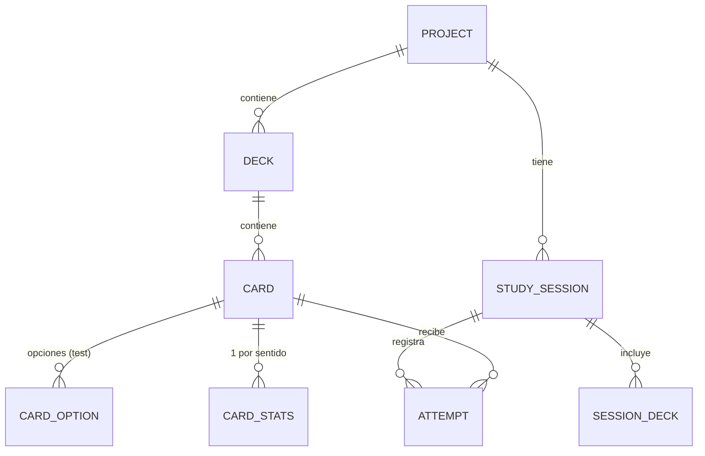
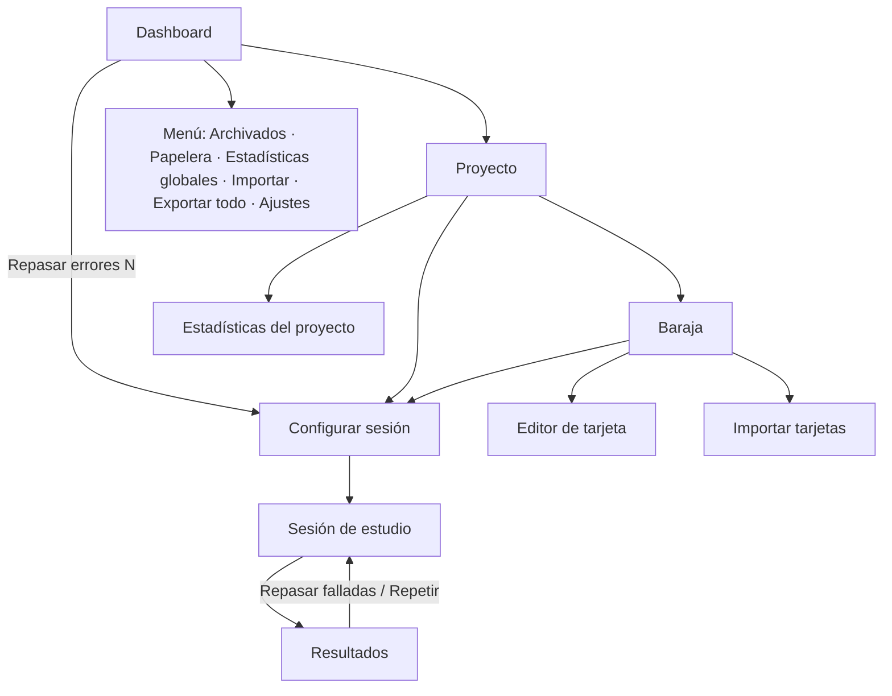

# EstudiCards — Especificación funcional y técnica

> **Nombre:** EstudiCards ("Estudi" + "Cards"). A 30/09/2026 no se han encontrado apps con ese nombre exacto en App Store, Google Play ni la web. Antes de publicar, comprobar de nuevo las tiendas y el registro de marcas (OEPM / EUIPO).

| Campo | Valor |
|---|---|
| Versión del documento | 1.0 |
| Fecha | 30/09/2026 |
| Alcance | Versión 1 (v1) |
| Plataformas v1 | Windows, macOS, Android, iOS |
| Tecnología | Flutter (Dart) |
| Idioma de la interfaz | Español |
| Documentos relacionados | `DESIGN_BRIEF.md` (diseño visual), `AGENTS.md` / `CLAUDE.md` (instrucciones para agentes de código) |

---

## Índice

1. [Resumen y objetivos](#1-resumen-y-objetivos)
2. [Glosario](#2-glosario)
3. [Arquitectura técnica](#3-arquitectura-técnica)
4. [Modelo de datos](#4-modelo-de-datos)
5. [Pantallas y navegación](#5-pantallas-y-navegación)
6. [Historias de usuario y criterios de aceptación](#6-historias-de-usuario-y-criterios-de-aceptación)
7. [Reglas de negocio](#7-reglas-de-negocio)
8. [Importación y exportación](#8-importación-y-exportación)
9. [Requisitos no funcionales](#9-requisitos-no-funcionales)
10. [Plan de implementación por fases](#10-plan-de-implementación-por-fases)
11. [Próximos objetivos (fuera de la v1)](#11-próximos-objetivos-fuera-de-la-v1)
12. [Registro de decisiones y supuestos](#12-registro-de-decisiones-y-supuestos)

---

## 1. Resumen y objetivos

EstudiCards es una app de tarjetas de estudio (flashcards) para escritorio y móvil. Permite organizar el contenido en **proyectos** que contienen **barajas** de **tarjetas**, estudiar con sesiones aleatorias con o sin temporizador, y repasar los errores a partir del historial de aciertos y fallos.

### 1.1 Objetivos de la v1

- Crear, editar, archivar y eliminar proyectos y barajas, con papelera de 15 días.
- Crear tarjetas de dos tipos: **simple** (pregunta → respuesta) y **test** (pregunta con 2–6 opciones, una o varias correctas).
- Proyectos de tipo **idioma** con voz (TTS del sistema), frase de ejemplo, notas y modo inverso.
- Sesiones de estudio aleatorias configurables: número de tarjetas, barajas, modo normal o solo errores, sentido, temporizador por pregunta o general.
- Registrar cada intento y mantener una lista de errores por tarjeta y sentido.
- Estadísticas por proyecto y globales, racha diaria y objetivo diario opcional.
- Importar y exportar: copia de seguridad completa, compartir proyecto o baraja (JSON/CSV) e importar tarjetas desde CSV con plantilla y prompt para IA.
- Funcionamiento **100% offline**, sin cuentas ni login.

### 1.2 Fuera de alcance de la v1

Login, sincronización en la nube, versión web, voces de IA, repetición espaciada, escribir la respuesta, fórmulas y código, atajos de teclado e idiomas de interfaz distintos del español. Ver [sección 11](#11-próximos-objetivos-fuera-de-la-v1).

### 1.3 Usuario objetivo

Un único usuario que estudia temarios (oposiciones, asignaturas, certificaciones) o idiomas, y alterna entre el ordenador y el móvil moviendo sus datos mediante ficheros exportados.

---

## 2. Glosario

| Término | Definición |
|---|---|
| **Proyecto** | Contenedor de nivel superior (p. ej. "Inglés B2"). Define el tipo (general o idioma) y los idiomas, que heredan sus barajas. |
| **Baraja** | Grupo de tarjetas dentro de un proyecto (p. ej. "Verbos irregulares"). |
| **Tarjeta** | Unidad de estudio. Puede ser *simple* o *test*. |
| **Tarjeta simple** | Tiene anverso (pregunta, palabra o frase) y reverso (respuesta o traducción). Se evalúa con "Acerté" o "Fallé". |
| **Tarjeta test** | Pregunta con 2–6 opciones y una o varias correctas. La app corrige automáticamente al pulsar "Comprobar". |
| **Sentido** | *Normal* (pregunta → respuesta) o *inverso* (respuesta → pregunta). El inverso solo existe en proyectos de idioma. |
| **Sesión** | Una partida de estudio con una configuración concreta. |
| **Intento** | El resultado de una tarjeta dentro de una sesión: acierto, fallo o sin responder. |
| **Error / lista de errores** | Una tarjeta está "en errores" para un sentido si se falló y aún no se ha acertado 2 veces seguidas. |
| **Papelera** | Lugar donde quedan los proyectos y barajas eliminados durante 15 días antes de borrarse definitivamente. |
| **Archivado** | Proyecto oculto del dashboard sin borrarlo. |
| **Racha** | Número de días consecutivos con al menos una tarjeta respondida. |

---

## 3. Arquitectura técnica

### 3.1 Stack

| Pieza | Elección | Para qué sirve (explicado) |
|---|---|---|
| Framework | **Flutter** (stable) + **Dart 3** | Un solo código para Windows, macOS, Android e iOS. Flutter dibuja toda la interfaz, así que se ve igual en todas las plataformas. |
| Base de datos | **Drift** sobre SQLite (`drift`, `drift_flutter`) | SQLite es una base de datos en un solo fichero, dentro del dispositivo. Drift permite escribir las tablas y consultas en Dart con comprobación de tipos, y gestiona las migraciones cuando cambie el esquema. |
| Estado | **Riverpod** (`flutter_riverpod`) | Conecta los datos con las pantallas: cuando algo cambia en la base de datos, las pantallas que lo muestran se actualizan solas. |
| Navegación | **go_router** | Define las rutas (`/proyecto/:id`, `/baraja/:id`…) y la navegación atrás. |
| IDs | `uuid` (v4) | Identificadores únicos globales. Permiten exportar e importar sin choques de IDs. |
| Voz | `flutter_tts` | Usa el motor de voz del sistema operativo. Gratis, offline, sin IA. |
| Ficheros | `file_picker`, `share_plus`, `path_provider` | Elegir ficheros para importar, compartir por el menú nativo (WhatsApp, email…) y guardar en disco. |
| Imágenes | `image_picker` (móvil), `file_picker` (escritorio), `image` (redimensionado en Dart puro) | Añadir imágenes a las tarjetas y comprimirlas en todas las plataformas. |
| CSV | `csv` | Leer y escribir CSV. |
| Gráficas | `fl_chart` | Gráficas de estadísticas. |
| Textos | `flutter_localizations` + ficheros ARB (`intl`) | Todos los textos de la interfaz en un fichero, para poder traducir en el futuro. |
| Tests | `flutter_test`, `mocktail` | Pruebas automáticas de reglas de negocio y pantallas. |

> Las versiones concretas de cada paquete se fijan al crear el proyecto (última estable compatible). No hace falta decidirlas ahora.

### 3.2 Capas y estructura de carpetas

Se organiza **por funcionalidad** (feature-first) con tres capas:

- **data:** tablas de Drift, DAOs y repositorios.
- **domain:** modelos y reglas de negocio puras. No dependen de Flutter y se pueden probar con tests unitarios.
- **presentation:** pantallas, widgets y providers de Riverpod.

```
lib/
├── main.dart
├── app/                     # MaterialApp, tema, router, localización
│   ├── router.dart
│   ├── theme/               # tokens de color, tipografía, tema claro/oscuro
│   └── l10n/                # app_es.arb
├── core/                    # utilidades comunes
│   ├── db/                  # AppDatabase (Drift), migraciones
│   ├── ids.dart             # generación de UUID
│   ├── clock.dart           # reloj inyectable (para tests de timers y papelera)
│   ├── files/               # guardar/compartir, imágenes
│   └── widgets/             # componentes reutilizables
└── features/
    ├── projects/            # dashboard, proyecto, archivados, papelera
    ├── decks/               # baraja y lista de tarjetas
    ├── cards/               # editor de tarjeta y vista previa
    ├── study/               # configuración, motor de sesión, resultados
    ├── stats/               # estadísticas, errores, racha
    ├── import_export/       # JSON, CSV, plantilla, prompt IA
    └── settings/            # ajustes
test/                        # espejo de lib/
```

### 3.3 Diseño adaptable

| Ancho de ventana | Diseño |
|---|---|
| < 600 dp (móvil) | Navegación en pila: Dashboard → Proyecto → Baraja. El menú del dashboard va en un cajón lateral. |
| 600–839 dp (tablet) | Como móvil, con más márgenes y el editor de tarjeta a dos columnas. |
| ≥ 840 dp (escritorio) | Barra lateral fija con la lista de proyectos (y accesos a Archivados, Papelera, Estadísticas y Ajustes); a la derecha, el contenido del proyecto o baraja. En el editor, la vista previa va a la derecha. |

### 3.4 Almacenamiento de ficheros

- Base de datos: `<app documents>/estudicards.sqlite`.
- Imágenes: `<app documents>/images/<uuid>.jpg`. En la base de datos solo se guarda la ruta relativa.
- Las imágenes se redimensionan a un máximo de 1600 px en el lado mayor y se guardan en JPEG con calidad 80.

### 3.5 Plataformas y distribución

- **v1:** Android, iOS, Windows y macOS.
- **Compartir:** en móvil se usa el menú nativo (`share_plus`). En escritorio se usa "Guardar como…" (`file_picker`), ya que compartir directamente a WhatsApp no está disponible igual en escritorio.
- **Voz (TTS):** depende de las voces instaladas en el sistema. Si falta la voz del idioma, la app lo avisa y explica cómo instalarla.

---

## 4. Modelo de datos

Nombres de tablas y campos en inglés (código); descripciones en español. Todos los IDs son UUID v4 en texto. Todas las fechas se guardan en UTC (ISO 8601 o epoch en milisegundos).

### 4.1 Diagrama



### 4.2 Tablas

#### `projects`

| Campo | Tipo | Notas |
|---|---|---|
| id | TEXT PK | UUID |
| name | TEXT | Obligatorio, 1–60 caracteres |
| description | TEXT? | Hasta 300 caracteres |
| color | TEXT | Clave de la paleta de proyectos (p. ej. `orange`, `blue`) |
| icon | TEXT | Emoji o clave de icono |
| type | TEXT | `general` \| `language` |
| source_lang | TEXT? | BCP-47 (p. ej. `en-GB`). Solo si `type = language` |
| target_lang | TEXT? | BCP-47 (p. ej. `es-ES`). Solo si `type = language` |
| is_favorite | BOOL | Por defecto `false` |
| is_archived | BOOL | Por defecto `false` |
| deleted_at | DATETIME? | No nulo = en papelera |
| last_used_at | DATETIME? | Se actualiza al abrir el proyecto o estudiar |
| created_at / updated_at | DATETIME | |

#### `decks`

| Campo | Tipo | Notas |
|---|---|---|
| id | TEXT PK | UUID |
| project_id | TEXT FK | → projects.id |
| name | TEXT | Obligatorio, 1–60 caracteres |
| description | TEXT? | |
| color | TEXT? | Nulo = hereda el del proyecto |
| deleted_at | DATETIME? | No nulo = en papelera |
| last_used_at | DATETIME? | |
| created_at / updated_at | DATETIME | |

#### `cards`

| Campo | Tipo | Notas |
|---|---|---|
| id | TEXT PK | UUID |
| deck_id | TEXT FK | → decks.id |
| type | TEXT | `simple` \| `test` |
| question | TEXT | Obligatorio. Admite `**negrita**` y `*cursiva*` |
| question_image | TEXT? | Ruta relativa |
| answer | TEXT? | Obligatorio si `simple`. No se usa en `test` |
| answer_image | TEXT? | En `test` se muestra con la explicación |
| explanation | TEXT? | Solo `test`, opcional |
| allow_multiple | BOOL | Solo `test`. Permite varias correctas |
| example | TEXT? | Solo proyectos de idioma |
| notes | TEXT? | Solo proyectos de idioma |
| created_at / updated_at | DATETIME | |

#### `card_options`

| Campo | Tipo | Notas |
|---|---|---|
| id | TEXT PK | UUID |
| card_id | TEXT FK | → cards.id, borrado en cascada |
| text | TEXT | Obligatorio |
| is_correct | BOOL | |
| position | INT | Orden al editar (en estudio se barajan) |

#### `card_stats` (una fila por tarjeta y sentido)

| Campo | Tipo | Notas |
|---|---|---|
| card_id | TEXT FK | PK compuesta con `direction` |
| direction | TEXT | `normal` \| `reverse` |
| correct_count | INT | Solo primeros intentos |
| wrong_count | INT | Solo primeros intentos |
| consecutive_correct | INT | Aciertos seguidos desde el último fallo |
| in_error_list | BOOL | Ver regla [7.4](#74-lista-de-errores) |
| last_result | TEXT? | `correct` \| `wrong` |
| last_attempt_at | DATETIME? | |

> Es una tabla derivada: se puede recalcular a partir de `attempts`. Se guarda para que las listas y el dashboard sean rápidos.

#### `study_sessions`

| Campo | Tipo | Notas |
|---|---|---|
| id | TEXT PK | UUID |
| project_id | TEXT FK | Una sesión nunca mezcla proyectos |
| mode | TEXT | `normal` \| `errors` |
| direction | TEXT | `normal` \| `reverse` |
| requested_count | INT? | Nulo = todas |
| prioritize_failed | BOOL | |
| repeat_failed | BOOL | |
| timer_type | TEXT | `none` \| `per_card` \| `global` |
| timer_seconds | INT? | Por tarjeta: 5–120. General: 60–7200 |
| status | TEXT | `in_progress` \| `completed` \| `abandoned` \| `time_up` |
| started_at / ended_at | DATETIME | |
| active_duration_ms | INT | Excluye el tiempo en pausa |
| correct_total / wrong_total / unanswered_total | INT | Solo primeros intentos |

#### `session_decks`

| Campo | Tipo |
|---|---|
| session_id | TEXT FK |
| deck_id | TEXT FK |

#### `attempts`

| Campo | Tipo | Notas |
|---|---|---|
| id | TEXT PK | UUID |
| session_id | TEXT FK | |
| card_id | TEXT FK | Borrado en cascada al borrar la tarjeta |
| direction | TEXT | `normal` \| `reverse` |
| result | TEXT | `correct` \| `wrong` \| `unanswered` |
| source | TEXT | `self_eval` \| `test_check` \| `timeout` \| `revealed` \| `session_end` |
| is_first_attempt | BOOL | `false` en las repeticiones de "Repetir falladas" |
| selected_option_ids | TEXT? | JSON con las opciones marcadas (solo test) |
| response_time_ms | INT? | Desde que se muestra la tarjeta hasta que se responde, sin pausas |
| answered_at | DATETIME | |

#### `settings` (clave–valor)

| Clave | Valor por defecto |
|---|---|
| `theme_mode` | `system` (`light` \| `dark` \| `system`) |
| `card_text_scale` | `1.0` (0.8–1.6) |
| `daily_goal` | nulo (desactivado) o número de tarjetas |
| `last_session_config:<projectId>` | JSON con la última configuración usada en ese proyecto |

### 4.3 Índices recomendados

- `decks(project_id, deleted_at)`
- `cards(deck_id)`
- `attempts(card_id, direction, answered_at)` y `attempts(session_id)`
- `card_stats(in_error_list)`

---

## 5. Pantallas y navegación

### 5.1 Mapa de navegación



### 5.2 Pantallas

| ID | Pantalla | Contenido principal | Acciones |
|---|---|---|---|
| P01 | **Dashboard** | Cabecera con racha y progreso del objetivo diario. Buscador por título. Lista de proyectos: favoritos primero, después por último uso. Cada tarjeta de proyecto muestra icono, color, nombre, nº de barajas y tarjetas, % de aciertos, fecha del último estudio y nº de errores. | Crear proyecto (botón flotante). Menú ⋮ por proyecto: Editar, Compartir, Favorito, Archivar, Eliminar. Botón "Repasar errores (N)" si N > 0. Menú general. |
| P02 | **Crear/editar proyecto** | Nombre, descripción, color, icono, tipo. Si es idioma: idioma origen y destino. | Guardar, Cancelar. En edición: Reiniciar estadísticas del proyecto. |
| P03 | **Proyecto** | Cabecera con datos del proyecto. Pestañas **Barajas** y **Estadísticas**. Cada baraja muestra nombre, color, nº de tarjetas, % de aciertos y nº de errores. | Nueva baraja, Estudiar, Repasar errores, Editar proyecto, Compartir proyecto, Importar como baraja nueva. Menú ⋮ por baraja: Editar, Compartir, Reiniciar estadísticas, Eliminar. |
| P04 | **Crear/editar baraja** | Nombre, descripción, color (por defecto el del proyecto). | Guardar, Cancelar. |
| P05 | **Baraja** | Lista de tarjetas: pregunta, icono de tipo (simple/test) y % de aciertos. Buscador por pregunta y respuesta. Ordenar por fecha de creación, alfabético o más falladas. | Añadir tarjeta, Estudiar esta baraja, Repasar errores, Importar tarjetas, Descargar plantilla, Copiar prompt para IA, Compartir baraja. Selección múltiple: Copiar a…, Mover a…, Eliminar. |
| P06 | **Editor de tarjeta** | Pregunta (+ imagen). Toggle **Tipo test**. Simple: Respuesta (+ imagen). Test: lista de 2–6 opciones, check "Permitir varias correctas", selector de correcta(s) y Explicación (+ imagen). Idioma: Frase de ejemplo y Notas. **Vista previa** girable abajo (móvil) o a la derecha (escritorio). | Guardar, Guardar y añadir otra, Cancelar. En edición: Eliminar tarjeta, Reiniciar estadísticas. |
| P07 | **Importar** | Paso 1: elegir fichero. Paso 2: elegir destino (según dónde se lanzó). Paso 3: vista previa con tarjetas a crear, duplicadas y filas con errores. | Confirmar importación, Cancelar. |
| P08 | **Configurar sesión** | Barajas (selección múltiple + "Todo el proyecto"), nº de tarjetas (10, 20, 50, Todas, Personalizado), modo (Normal / Solo errores), sentido (Normal / Inverso, solo idioma), "Priorizar las más falladas", "Repetir falladas al final", timer (Sin timer / Por pregunta / General) con su valor. Muestra cuántas tarjetas hay disponibles. | Empezar. |
| P09 | **Sesión de estudio** | Barra de progreso ("7 / 20"), contador ✓/✗, timer (si hay), tarjeta en el centro. | Ver sección [7.3](#73-sesión-de-estudio). Botones: Pausa, Salir. |
| P10 | **Pausa** (superposición) | Oculta completamente la tarjeta. Muestra "En pausa" y el tiempo. | Continuar, Salir. |
| P11 | **Resultados** | % de aciertos, aciertos/fallos/sin responder, tiempo total y medio. Listas: **Falladas** (pregunta + respuesta correcta) y **No respondidas**. Celebración discreta si ≥ 80%. | Repasar falladas ahora, Repetir sesión, Volver. |
| P12 | **Estadísticas del proyecto** (pestaña de P03) | Gráfica de aciertos/fallos por día (30 días), % de aciertos por baraja, top 10 de tarjetas más falladas, historial de sesiones (se abre para ver el detalle). | Abrir sesión, abrir tarjeta. |
| P13 | **Estadísticas globales** | Racha actual y récord, tarjetas respondidas hoy / 7 días / 30 días, gráfica de 30 días de todos los proyectos, resumen por proyecto. **Sin repaso de errores.** | Abrir proyecto. |
| P14 | **Archivados** | Lista de proyectos archivados. | Desarchivar, Eliminar. |
| P15 | **Papelera** | Proyectos y barajas eliminados, con los días que les quedan. | Restaurar, Eliminar definitivamente (con confirmación), Vaciar papelera. |
| P16 | **Ajustes** | Tema, tamaño de texto de las tarjetas, objetivo diario, estado de las voces TTS, Exportar todo, Restaurar copia, Acerca de. | — |

### 5.3 Estados vacíos obligatorios

- Dashboard sin proyectos: ilustración + "Crea tu primer proyecto" + botón.
- Proyecto sin barajas: "Crea una baraja para empezar a añadir tarjetas".
- Baraja sin tarjetas: "Añade tu primera tarjeta" + "o importa desde CSV" + "Descargar plantilla".
- Configurar sesión sin tarjetas disponibles (p. ej. "Solo errores" sin errores): mensaje y botón Empezar desactivado.
- Búsqueda sin resultados, papelera vacía, archivados vacío, estadísticas sin datos.

---

## 6. Historias de usuario y criterios de aceptación

Formato: **HU-XX — Como usuario, quiero… para…**, seguido de sus criterios de aceptación (CA).

### Épica A — Proyectos

**HU-01 — Crear proyecto.** Quiero crear un proyecto para organizar un tema de estudio.
- CA1. El nombre es obligatorio (1–60 caracteres); el resto es opcional salvo el tipo, que por defecto es "General".
- CA2. Si el tipo es "Idioma", se piden idioma origen y destino; ambos obligatorios.
- CA3. Al guardar aparece en el dashboard y se abre el proyecto.

**HU-02 — Editar proyecto.** Desde el menú ⋮ del dashboard y desde la pantalla del proyecto.
- CA1. Se pueden cambiar todos los campos.
- CA2. Cambiar el tipo de "Idioma" a "General" pide confirmación y avisa de que se ocultan la voz, el modo inverso y los campos de ejemplo y notas. Los datos no se borran.

**HU-03 — Eliminar proyecto.**
- CA1. Diálogo de confirmación que indica cuántas barajas y tarjetas contiene.
- CA2. Tras confirmar, aviso con "Deshacer" durante 5 segundos.
- CA3. Si no se deshace, el proyecto pasa a la papelera con sus barajas y tarjetas.

**HU-04 — Papelera.**
- CA1. Muestra proyectos y barajas eliminados con los días restantes (15 − días transcurridos).
- CA2. Restaurar devuelve el elemento a su lugar con todas sus tarjetas y estadísticas.
- CA3. Al pasar 15 días se borra definitivamente, junto con sus tarjetas, intentos e imágenes.
- CA4. "Eliminar definitivamente" y "Vaciar papelera" piden confirmación.

**HU-05 — Favoritos, archivar y buscar.**
- CA1. Los favoritos aparecen arriba; dentro de cada grupo, orden por último uso.
- CA2. Archivar oculta el proyecto del dashboard y del buscador; está en "Archivados".
- CA3. El buscador filtra por título de proyecto mientras se escribe, sin distinguir mayúsculas ni acentos.

### Épica B — Barajas

**HU-06 — Crear, editar y eliminar baraja.**
- CA1. Nombre obligatorio. Color opcional; por defecto el del proyecto.
- CA2. Eliminar pide confirmación con el nº de tarjetas, ofrece "Deshacer" 5 s y después la baraja va a la papelera.

**HU-07 — Copiar y mover tarjetas.**
- CA1. En la baraja se activa la selección múltiple con pulsación larga (móvil) o casillas (escritorio).
- CA2. "Mover a…" y "Copiar a…" muestran solo las barajas del mismo proyecto.
- CA3. Mover conserva el ID y las estadísticas. Copiar crea tarjetas nuevas (nuevo ID, opciones copiadas) sin historial.

### Épica C — Tarjetas

**HU-08 — Crear tarjeta simple.**
- CA1. Pregunta y respuesta obligatorias; imágenes opcionales.
- CA2. En proyectos de idioma aparecen "Frase de ejemplo" y "Notas" (opcionales).
- CA3. Negrita y cursiva disponibles en la barra del campo de texto.
- CA4. La vista previa se actualiza mientras se escribe y se gira al pulsarla.

**HU-09 — Crear tarjeta test.**
- CA1. Al activar el toggle "Tipo test", el campo Respuesta se sustituye por la lista de opciones (mínimo 2, máximo 6) y el campo "Explicación".
- CA2. Sin "Permitir varias correctas", el selector es de opción única. Con él activado, casillas múltiples.
- CA3. Validación: al menos 2 opciones no vacías y al menos 1 correcta. Si "Permitir varias correctas" está desactivado, exactamente 1.
- CA4. Desactivar "Permitir varias correctas" con varias marcadas pide elegir cuál se queda.

**HU-10 — Guardar y añadir otra.**
- CA1. Guarda la tarjeta, limpia el formulario y mantiene el tipo (simple/test) y el estado de "Permitir varias correctas".
- CA2. Muestra un aviso breve "Tarjeta guardada" y pone el foco en la pregunta.

**HU-11 — Editar y eliminar tarjeta.**
- CA1. Editar conserva las estadísticas. "Reiniciar estadísticas" las borra tras confirmar.
- CA2. Eliminar pide confirmación, ofrece "Deshacer" 5 s y después borra la tarjeta, sus intentos y sus imágenes. No pasa por la papelera.

**HU-12 — Lista de tarjetas.**
- CA1. Busca en pregunta, respuesta y opciones.
- CA2. Orden: creación (por defecto, más recientes primero), alfabético o más falladas.

**HU-13 — Voz (TTS).**
- CA1. En proyectos de idioma, el texto de la pregunta y de la respuesta tiene un botón de altavoz que lo lee en su idioma correspondiente.
- CA2. Si el sistema no tiene la voz, se muestra un aviso con instrucciones y el botón aparece desactivado.

### Épica D — Sesión de estudio

**HU-14 — Configurar sesión.** Ver P08.
- CA1. Por defecto se carga la última configuración usada en ese proyecto.
- CA2. Se muestra en tiempo real el nº de tarjetas disponibles para la selección actual.
- CA3. Si el nº pedido supera las disponibles, se usan todas y se indica.

**HU-15 — Estudiar tarjeta simple.**
- CA1. Se muestra el anverso. Pulsar la tarjeta o "Girar" la gira con animación 3D.
- CA2. En el reverso aparecen "Acerté" y "Fallé". En móvil también se puede deslizar a la derecha (acierto) o a la izquierda (fallo), con vibración.

**HU-16 — Estudiar tarjeta test.**
- CA1. Opciones en orden aleatorio. Se seleccionan (una o varias) y se pulsa "Comprobar".
- CA2. Se marcan en verde con ✓ las correctas y en rojo con ✗ las marcadas incorrectamente. Se muestra la explicación si existe.
- CA3. Es acierto solo si el conjunto marcado coincide exactamente con el conjunto correcto.
- CA4. Botón "Siguiente".

**HU-17 — "Ver respuesta" y "Dejar para el final".** Ver [7.3](#73-sesión-de-estudio).

**HU-18 — Timers.** Ver [7.5](#75-temporizadores).

**HU-19 — Pausa y salir.**
- CA1. La pausa oculta la tarjeta y congela el timer.
- CA2. Si la app pasa a segundo plano, se pausa automáticamente.
- CA3. "Salir" pide confirmación, guarda lo respondido y lleva a Resultados.

**HU-20 — Resultados.** Ver P11.
- CA1. "Repasar falladas ahora" inicia una sesión solo con las falladas de esta sesión, mismo sentido y timer.
- CA2. "Repetir sesión" usa la misma configuración con una nueva selección aleatoria.

### Épica E — Estadísticas y errores

**HU-21 — Repasar errores.** Desde la baraja, el proyecto o el acceso "Repasar errores (N)" del dashboard.
- CA1. Solo incluye tarjetas en la lista de errores del sentido elegido, dentro de un único proyecto.
- CA2. Una tarjeta sale de la lista al acertarla 2 veces seguidas.

**HU-22 — Estadísticas.** Ver P12 y P13.

**HU-23 — Racha y objetivo diario.**
- CA1. Un día cuenta para la racha si se respondió (acierto o fallo) al menos una tarjeta.
- CA2. El objetivo diario es opcional; el dashboard muestra el progreso del día.

### Épica F — Importar y exportar

**HU-24 — Exportar todo.** Genera una copia de seguridad JSON con todo. Ver [8.2](#82-json).
**HU-25 — Restaurar copia.** Si hay datos, pregunta "Reemplazar todo" o "Fusionar". Ver [8.4](#84-reglas-de-importación).
**HU-26 — Compartir proyecto o baraja.** Elige formato JSON (para la app) o CSV (para Excel/Sheets). Sin estadísticas.
**HU-27 — Importar.** Como proyecto nuevo (dashboard), como baraja nueva (proyecto) o añadiendo a una baraja existente (baraja). Siempre con vista previa.
**HU-28 — Plantilla y prompt para IA.** "Descargar plantilla" guarda un CSV de ejemplo. "Copiar prompt para IA" copia al portapapeles el prompt de [8.5](#85-prompt-para-ia).

---

## 7. Reglas de negocio

### 7.1 Papelera y borrado

| Elemento | Al eliminar | Recuperable |
|---|---|---|
| Proyecto | Confirmación → "Deshacer" 5 s → papelera 15 días | Sí, desde Papelera |
| Baraja | Confirmación → "Deshacer" 5 s → papelera 15 días | Sí, desde Papelera. Si su proyecto también está en la papelera, se restaura el proyecto. |
| Tarjeta | Confirmación → "Deshacer" 5 s → borrado definitivo | Solo durante los 5 s |

- La purga de elementos con más de 15 días se ejecuta al abrir la app.
- El borrado definitivo elimina en cascada: barajas, tarjetas, opciones, estadísticas, intentos e imágenes. Las sesiones de un proyecto borrado también se eliminan.
- Los elementos en papelera no aparecen en búsquedas, estadísticas ni sesiones.

### 7.2 Selección de tarjetas

1. **Conjunto base:** tarjetas de las barajas elegidas, no eliminadas.
2. **Modo "Solo errores":** se filtra por `in_error_list = true` en el sentido elegido.
3. **Selección:**
   - Sin "Priorizar": muestreo aleatorio uniforme sin repetición.
   - Con "Priorizar las más falladas": muestreo aleatorio ponderado sin repetición. Peso 3 si está en errores, 2 si nunca se ha estudiado en ese sentido, 1 en el resto.
4. **Orden:** la cola resultante se baraja siempre (Fisher–Yates). Nunca se muestra en orden de creación.
5. **Opciones de test:** se barajan cada vez que se muestra la tarjeta.

### 7.3 Sesión de estudio

Botones visibles según el estado de la tarjeta (no hay atajos de teclado en la v1):

| Estado | Tarjeta simple | Tarjeta test |
|---|---|---|
| Sin responder | Girar · Ver respuesta · Dejar para el final | Comprobar (activo si hay selección) · Ver respuesta · Dejar para el final |
| Respondida / girada | Acerté · Fallé | Siguiente |

- **Ver respuesta:** gira la tarjeta (o revela las correctas en test) y registra **fallo** (`source = revealed`). Luego "Siguiente".
- **Dejar para el final:** mueve la tarjeta al final de la cola sin registrar nada. Puede repetirse. Al volver a mostrarse, su timer por pregunta empieza de cero.
- **Repetir falladas al final** (si está activo): cada tarjeta fallada se añade de nuevo al final de la cola hasta acertarla. Estas repeticiones se registran con `is_first_attempt = false` y no cuentan en estadísticas ni en la lista de errores.
- **Progreso:** "n / total" cuenta tarjetas originales resueltas. Si hay repeticiones pendientes, se indica aparte ("+3 repasos").
- **Fin de sesión:** cuando no quedan tarjetas, al agotarse el timer general o al salir. Las tarjetas no resueltas (pendientes o dejadas para el final) se registran como `unanswered` (`source = session_end`).
- **Sentido inverso:** solo afecta a las tarjetas simples de proyectos de idioma (se muestra la respuesta y se adivina la pregunta). Las tarjetas test se muestran siempre en sentido normal y se registran como `normal`.

### 7.4 Lista de errores

Por cada tarjeta y sentido, aplicando **solo primeros intentos**:

- **Fallo:** `wrong_count++`, `consecutive_correct = 0`, `in_error_list = true`.
- **Acierto:** `correct_count++`, `consecutive_correct++`. Si `in_error_list` y `consecutive_correct ≥ 2` → `in_error_list = false`.
- **Sin responder:** no cambia nada.
- El umbral de 2 aciertos seguidos es fijo en la v1.
- **Reiniciar estadísticas** (tarjeta, baraja o proyecto) borra sus intentos y filas de `card_stats`. Las sesiones pasadas conservan sus totales.

### 7.5 Temporizadores

Son **excluyentes**: sin timer, por pregunta o general.

| Tipo | Rango | Al agotarse |
|---|---|---|
| Por pregunta | 5–120 s (pasos de 5) | La tarjeta se gira (o se revelan las correctas) y se registra **fallo** (`source = timeout`). Se espera a "Siguiente". |
| General | 1–120 min | La sesión termina (`status = time_up`). Las no resueltas se registran como `unanswered` y aparecen en "No respondidas". |

- El timer se congela en pausa y cuando la app está en segundo plano.
- Aviso visual en los últimos 5 s (por pregunta) o el último minuto (general).

### 7.6 Porcentajes y métricas

- **% de aciertos** = aciertos / (aciertos + fallos), con primeros intentos y ambos sentidos. Sin datos se muestra "—".
- **Errores pendientes** de un proyecto o baraja = nº de pares (tarjeta, sentido) con `in_error_list = true`.
- **Tiempo medio** = media de `response_time_ms` de los intentos respondidos.
- **Racha** = días naturales consecutivos (hora local) hasta hoy con al menos un acierto o fallo. Si hoy aún no hay actividad, la racha de ayer sigue vigente.

### 7.7 Último uso

`last_used_at` del proyecto (y de la baraja) se actualiza al abrirlo, al estudiar y al añadir tarjetas.

---

## 8. Importación y exportación

### 8.1 Resumen de operaciones

| Operación | Dónde | Formato | Incluye estadísticas |
|---|---|---|---|
| Exportar todo | Menú del dashboard / Ajustes | JSON (`kind: backup`) | Sí |
| Restaurar copia | Ajustes | JSON (`kind: backup`) | Sí |
| Compartir proyecto | Proyecto / menú ⋮ del dashboard | JSON (`kind: project`) o CSV con columna `baraja` | No |
| Compartir baraja | Baraja / menú ⋮ de la baraja | JSON (`kind: deck`) o CSV | No |
| Importar como proyecto nuevo | Dashboard | JSON `project`/`deck` o CSV | — |
| Importar como baraja nueva | Proyecto | JSON `deck` o CSV | — |
| Añadir a baraja existente | Baraja | JSON `deck` o CSV | — |
| Descargar plantilla | Baraja (y estado vacío) | CSV | — |

Nombres de fichero: `estudicards-copia-AAAA-MM-DD.json`, `<proyecto>.json`, `<proyecto>-<baraja>.json` / `.csv`.

### 8.2 JSON

Estructura común:

```json
{
  "format": "estudicards",
  "version": 1,
  "kind": "backup | project | deck",
  "exportedAt": "2026-09-30T10:00:00Z",
  "appVersion": "1.0.0",
  "data": { }
}
```

Contenido de `data` según `kind`:

- **deck:** `{ "language": {"source": "en-GB", "target": "es-ES"} | null, "deck": Deck }`
- **project:** `{ "project": Project }` con sus barajas y tarjetas anidadas.
- **backup:** `{ "projects": [Project], "sessions": [...], "sessionDecks": [...], "attempts": [...], "cardStats": [...], "settings": {...} }`. Incluye proyectos archivados y en papelera.

Ejemplo de una baraja compartida:

```json
{
  "format": "estudicards", "version": 1, "kind": "deck",
  "exportedAt": "2026-09-30T10:00:00Z", "appVersion": "1.0.0",
  "data": {
    "language": { "source": "en-GB", "target": "es-ES" },
    "deck": {
      "id": "7b0f…", "name": "Verbos irregulares", "description": null, "color": null,
      "cards": [
        {
          "id": "c1a2…", "type": "simple",
          "question": "to bring", "answer": "traer (brought, brought)",
          "example": "Can you **bring** me some water?", "notes": null,
          "questionImage": null, "answerImage": null
        },
        {
          "id": "d3b4…", "type": "test", "allowMultiple": true,
          "question": "¿Qué verbos son irregulares?",
          "explanation": "*Walk* y *play* son regulares.",
          "options": [
            { "id": "o1", "text": "go", "isCorrect": true },
            { "id": "o2", "text": "walk", "isCorrect": false },
            { "id": "o3", "text": "eat", "isCorrect": true },
            { "id": "o4", "text": "play", "isCorrect": false }
          ]
        }
      ]
    }
  }
}
```

**Imágenes:** van incrustadas como `{ "mime": "image/jpeg", "data": "<base64>" }` en lugar de la ruta. El CSV no admite imágenes.

### 8.3 CSV

- **Codificación:** UTF-8. Al exportar se añade BOM para que Excel muestre bien acentos y eñes.
- **Separador:** al exportar `;` (Excel en español). Al importar se detecta automáticamente `;` o `,`.
- **Comillas:** estándar RFC 4180. Los campos con separador, comillas o saltos de línea van entre comillas dobles.
- **Cabecera obligatoria** en la primera fila, con estos nombres (el orden da igual; las columnas opcionales pueden omitirse):

| Columna | Obligatoria | Descripción |
|---|---|---|
| `pregunta` | Sí | Texto de la pregunta, palabra o frase |
| `respuesta` | Si es simple | Respuesta o traducción. Se ignora en tarjetas test |
| `opcion1` … `opcion6` | Para test | Si `opcion1` y `opcion2` tienen texto, la tarjeta es de tipo test |
| `correctas` | Para test | Nº de las opciones correctas, separados por `\|` (p. ej. `1` o `1\|3`) |
| `explicacion` | No | Solo test |
| `ejemplo` | No | Solo proyectos de idioma |
| `notas` | No | Solo proyectos de idioma |
| `baraja` | No | Solo al importar como proyecto nuevo: agrupa las filas en barajas con ese nombre. Sin ella se crea una baraja "Importadas". Se ignora en los demás casos. |

- Si `correctas` tiene más de un número, la tarjeta se crea con "Permitir varias correctas" activado.
- Se admite `**negrita**` y `*cursiva*` en los textos.

Plantilla descargable (`plantilla_estudicards.csv`):

```csv
pregunta;respuesta;opcion1;opcion2;opcion3;opcion4;opcion5;opcion6;correctas;explicacion;ejemplo;notas
to bring;traer (brought, brought);;;;;;;;;Can you bring me some water?;Verbo irregular
¿Capital de Australia?;;Sídney;Canberra;Melbourne;;;;2;Canberra es la capital desde 1913.;;
¿Qué números son primos?;;2;4;7;9;;;1|3;El 4 y el 9 tienen divisores distintos de 1 y de sí mismos.;;
```

### 8.4 Reglas de importación

1. **Validación:** se comprueba `format` y `version` (JSON) o la cabecera (CSV). Un fichero no válido muestra un error claro y no importa nada.
2. **Vista previa:** nº de tarjetas nuevas, nº de duplicadas que se omitirán y lista de filas con errores ("Fila 7: falta la respuesta"). Las filas con error se omiten; el resto se importa si el usuario confirma.
3. **IDs:**
   - Como proyecto nuevo o baraja nueva: se generan **IDs nuevos** para todo, evitando choques.
   - Añadir a baraja existente: se conserva el ID de la tarjeta salvo que ya exista en la base de datos, en cuyo caso se genera uno nuevo.
4. **Duplicados** (solo al añadir a baraja existente): se omite una tarjeta si en la baraja destino ya existe otra con el mismo ID, o con la misma pregunta y respuesta (u opciones) tras normalizar (sin espacios sobrantes, sin distinguir mayúsculas).
5. **Resumen final:** "12 añadidas, 3 omitidas por duplicadas, 1 con errores".
6. **Tipo de proyecto:** al importar un JSON de idioma como proyecto nuevo, se crea como proyecto de idioma con sus idiomas. Al importar CSV como proyecto nuevo, se pregunta el tipo.
7. **Restaurar copia completa:**
   - Base de datos vacía: se importa todo tal cual.
   - Con datos: el usuario elige **Reemplazar todo** (confirmación explícita; borra lo actual) o **Fusionar** (por ID; si existe en ambos, gana el de `updated_at` más reciente; los intentos se unen por ID y después se recalcula `card_stats`).
8. Todas las importaciones se ejecutan en **una transacción**: o se importa todo lo confirmado o nada.

### 8.5 Prompt para IA

Texto que copia el botón "Copiar prompt para IA" (el usuario sustituye los corchetes):

```text
Genera [NÚMERO] tarjetas de estudio sobre [TEMA] en formato CSV para importarlas en la app EstudiCards.

Reglas del formato:
- Separador: punto y coma (;). Codificación UTF-8.
- Primera fila, exactamente esta cabecera:
  pregunta;respuesta;opcion1;opcion2;opcion3;opcion4;opcion5;opcion6;correctas;explicacion;ejemplo;notas
- Tarjeta simple: rellena "pregunta" y "respuesta"; deja vacías las opciones y "correctas".
- Tarjeta tipo test: rellena "pregunta", de 2 a 6 opciones y en "correctas" el número de las opciones correctas separados por | (ejemplo: 2 o 1|3). Deja "respuesta" vacía. "explicacion" es opcional.
- "ejemplo" y "notas" son opcionales (útiles para idiomas).
- Si un texto contiene punto y coma o saltos de línea, ponlo entre comillas dobles.
- Puedes usar **negrita** y *cursiva*.

Quiero aproximadamente [PORCENTAJE]% de tarjetas tipo test. Nivel: [NIVEL].
Devuelve solo el CSV, sin explicaciones ni bloques de código.
```

---

## 9. Requisitos no funcionales

| Área | Requisito |
|---|---|
| Offline | Todas las funciones de la v1 funcionan sin conexión. La app no hace peticiones de red. |
| Privacidad | Sin cuentas, sin analíticas ni telemetría. Los datos solo salen del dispositivo cuando el usuario exporta o comparte. |
| Rendimiento | Arranque en frío < 2 s en un móvil de gama media. Listas fluidas (60 fps) con 5.000 tarjetas por baraja. Iniciar una sesión < 300 ms. |
| Integridad | Escrituras críticas (responder, importar, borrar) en transacciones. Una respuesta se guarda en el momento, de modo que si la app se cierra no se pierde. |
| Accesibilidad | Contraste mínimo WCAG AA. Acierto y fallo siempre con icono (✓/✗) además del color. Respeta el tamaño de texto del sistema. Tamaño de texto de tarjetas ajustable (80–160%). Áreas táctiles ≥ 48 dp. Etiquetas semánticas para lectores de pantalla. |
| Adaptabilidad | Diseño correcto de 360 dp a 1920 px de ancho y en orientación vertical y horizontal. |
| Tema | Claro y oscuro; por defecto sigue el sistema. |
| Localización | Todos los textos en ARB (`app_es.arb`). Ningún texto de interfaz escrito directamente en el código. |
| Calidad | `flutter analyze` sin avisos. Tests unitarios para selección de tarjetas, motor de sesión, timers, lista de errores, racha, papelera y parsers JSON/CSV. |

---

## 10. Plan de implementación por fases

Cada fase se puede construir, probar y usar por separado. "Hecho cuando" indica cuándo pasar a la siguiente.

| Fase | Contenido | Hecho cuando |
|---|---|---|
| **0. Base** | Crear el proyecto Flutter para las 4 plataformas, estructura de carpetas, tema claro/oscuro con los tokens del brief, router, localización y base de datos Drift con todas las tablas. | La app arranca en Windows y Android con una pantalla vacía y el tema correcto. |
| **1. Proyectos y barajas** | P01–P04, P14, P15: CRUD de proyectos y barajas, favoritos, archivar, buscador, papelera con purga a 15 días, "Deshacer". Diseño adaptable (barra lateral en escritorio). | Se pueden crear, editar, archivar, borrar y restaurar proyectos y barajas. Tests de papelera. |
| **2. Tarjetas** | P05–P06: editor de tarjeta simple y test (una o varias correctas), vista previa girable, imágenes, negrita/cursiva, TTS, campos de idioma, "Guardar y añadir otra", lista con búsqueda y orden, selección múltiple, copiar/mover, eliminar con "Deshacer". | Se pueden crear todos los tipos de tarjeta y la vista previa coincide con el diseño. |
| **3. Sesión de estudio** | P08–P11: configuración, motor de sesión (dominio puro con tests), selección y barajado, gestos, botones, "Ver respuesta", "Dejar para el final", repetir falladas, timers, pausa, resultados, registro de intentos. | Se puede estudiar con todas las combinaciones de configuración. Tests del motor y de los timers. |
| **4. Estadísticas y errores** | `card_stats`, lista de errores, modo "Solo errores", "Repasar errores (N)", P12–P13, racha, objetivo diario, reiniciar estadísticas. | Los números del dashboard y las estadísticas coinciden con los intentos. Tests de las reglas 7.4 y 7.6. |
| **5. Importar y exportar** | JSON (backup, project, deck), CSV, plantilla, prompt para IA, vista previa de importación, duplicados, restaurar (reemplazar/fusionar), compartir y "Guardar como". | Exportar todo en un dispositivo y restaurar en otro deja los datos idénticos. Un CSV generado por IA con el prompt se importa sin errores. |
| **6. Pulido** | Animaciones (giro 3D, destellos, celebración), vibración, estados vacíos, accesibilidad, iconos de la app, pruebas en las 4 plataformas y empaquetado. | Revisión completa en móvil y escritorio, en claro y oscuro. |

---

## 11. Próximos objetivos (fuera de la v1)

- **Login y sincronización en la nube** entre dispositivos.
- **Versión web** (Flutter la soporta) y **Linux**.
- **Voces de IA** en la nube (Google Cloud TTS, Azure, ElevenLabs). Requieren internet y tienen coste.
- **Repetición espaciada** (SM-2 o FSRS): el historial de `attempts` ya lo permite.
- **Modo "Escribir la respuesta"**, con comparación tolerante a acentos y mayúsculas.
- **Fórmulas matemáticas (LaTeX) y bloques de código** en las tarjetas.
- **Atajos de teclado** en escritorio.
- **Umbral configurable** de aciertos seguidos para salir de la lista de errores.
- **Otros idiomas de interfaz.**
- **Importar desde Anki** y otros formatos.
- **Audio grabado** en las tarjetas.
- **Verificar y registrar el nombre** (tiendas, dominio y marca) antes de publicar.

---

## 12. Registro de decisiones y supuestos

### 12.1 Decisiones tomadas con el usuario

| Sección | Decisión |
|---|---|
| Plataforma | Windows, macOS, Android, iOS. Flutter. Sin login. 100% offline. |
| Datos | Solo locales. Exportar todo (con estadísticas) y compartir proyecto/baraja (sin estadísticas) en JSON o CSV. Importar como proyecto nuevo, baraja nueva o añadiendo a una baraja. |
| Estructura | Proyecto → Barajas → Tarjetas. Tipo e idiomas en el proyecto. Sin etiquetas. |
| Borrado | Proyectos y barajas a papelera 15 días. Tarjetas borrado directo con "Deshacer". |
| Dashboard | Orden por último uso, favoritos arriba, archivar, buscador por título, racha, "Repasar errores (N)" por proyecto. |
| Tarjetas | Simple o test (2–6 opciones, check para varias correctas). Explicación en test. Imagen, TTS del sistema, negrita/cursiva. Ejemplo y notas en idiomas. |
| Estudio | Selección aleatoria (opción de priorizar falladas), siempre desordenada, opciones barajadas. Autoevaluación. Multirespuesta sin parciales. Timers excluyentes. Pausa oculta la tarjeta. "Ver respuesta" y "Dejar para el final". Solo botones, sin atajos. |
| Errores | Entra al fallar; sale con 2 aciertos seguidos (fijo). Por sentido. Nunca mezcla proyectos. |
| Diseño | Minimalista, naranja como color principal, claro/oscuro, español, barra lateral en escritorio. |

### 12.2 Supuestos del analista (revisables)

1. Las tarjetas test se estudian siempre en sentido normal, aunque la sesión sea inversa.
2. Los proyectos archivados no se pueden estudiar sin desarchivarlos y no cuentan para el acceso "Repasar errores" del dashboard. Sí cuentan en las estadísticas globales.
3. Las respuestas "sin responder" no afectan a estadísticas, errores ni racha.
4. La celebración de la pantalla de resultados aparece con un 80% de aciertos o más.
5. En escritorio "Compartir" guarda el fichero con "Guardar como…" en lugar del menú de compartir.
6. Las imágenes se comprimen a 1600 px / JPEG 80 y viajan en base64 dentro del JSON.
