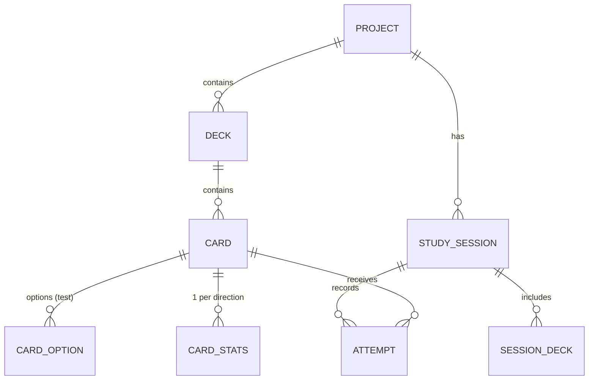
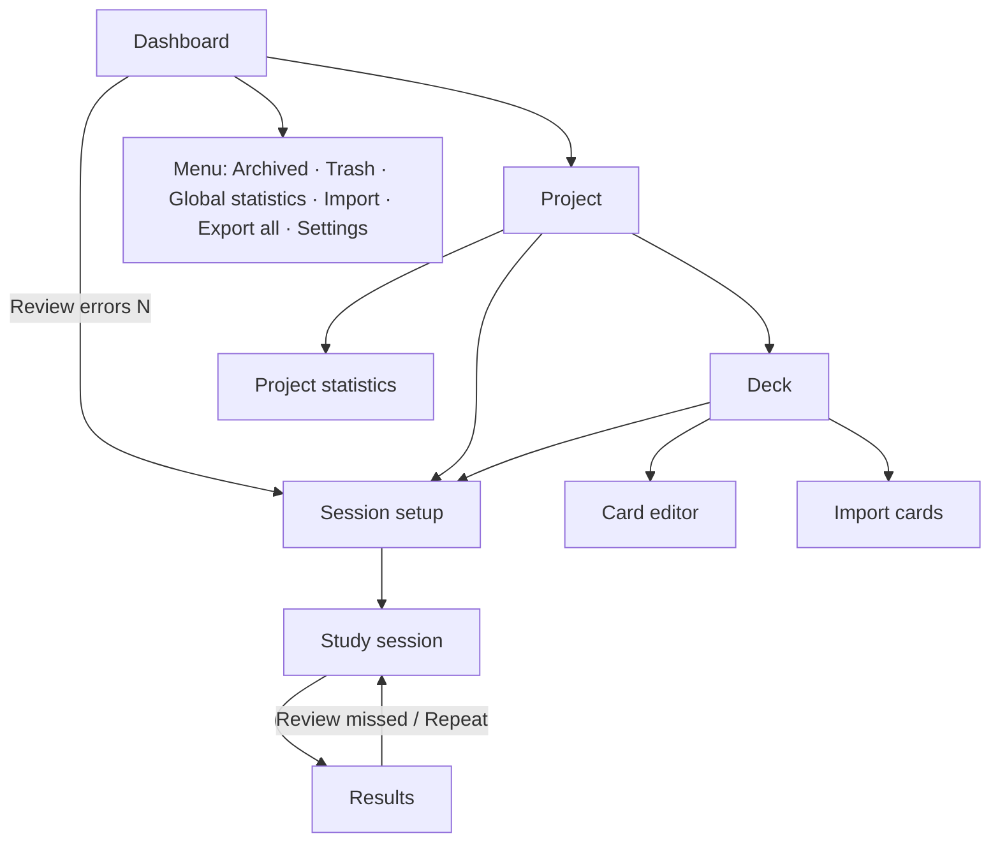

# EstudiCards — Functional and Technical Specification

> **Name:** EstudiCards ("Estudi" + "Cards"). As of 30/09/2026, no apps with this exact name were found on the App Store, Google Play or the web. Before publishing, check the stores and the trademark registries (OEPM / EUIPO) again.

| Field | Value |
|---|---|
| Document version | 1.2 |
| Date | 30/09/2026 |
| Scope | Version 1 (v1) |
| v1 platforms | Windows, macOS, Android, iOS |
| Technology | Flutter (Dart) |
| UI language | Spanish (see [§2.1](#21-ui-vocabulary)) |
| Documentation, code and tests language | English |
| Related documents | `DESIGN_BRIEF.md` (visual design), `design/` (design screenshots), `TASKS.md` (task plan), `AGENTS.md` / `CLAUDE.md` (instructions for coding agents) |

---

## Table of contents

1. [Summary and goals](#1-summary-and-goals)
2. [Glossary](#2-glossary)
3. [Technical architecture](#3-technical-architecture)
4. [Data model](#4-data-model)
5. [Screens and navigation](#5-screens-and-navigation)
6. [User stories and acceptance criteria](#6-user-stories-and-acceptance-criteria)
7. [Business rules](#7-business-rules)
8. [Import and export](#8-import-and-export)
9. [Non-functional requirements](#9-non-functional-requirements)
10. [Quality: TDD, tests and CI/CD](#10-quality-tdd-tests-and-cicd)
11. [Phased implementation plan](#11-phased-implementation-plan)
12. [Future goals (outside v1)](#12-future-goals-outside-v1)
13. [Decision log and assumptions](#13-decision-log-and-assumptions)

---

## 1. Summary and goals

EstudiCards is a flashcard app for desktop and mobile. Content is organised into **projects** that contain **decks** of **cards**. Users study with random sessions, with or without a timer, and review their mistakes based on the history of correct and wrong answers.

### 1.1 v1 goals

- Create, edit, archive and delete projects and decks, with a 15-day trash.
- Create two types of cards: **simple** (question → answer) and **test** (question with 2–6 options, one or several correct).
- **Language** decks with text-to-speech (system TTS), example sentence, notes and reverse mode. A project can mix general and language decks.
- Configurable random study sessions: number of cards, decks, normal or errors-only mode, direction, per-question or global timer.
- Record every attempt and keep an error list per card and direction.
- Per-project and global statistics, daily streak and optional daily goal.
- Import and export: full backup, share a project or deck (JSON/CSV), and import cards from CSV with a template and an AI prompt.
- **100% offline**, no accounts or login.

### 1.2 Out of scope for v1

Login, cloud sync, web version, AI voices, spaced repetition, typing the answer, formulas and code, keyboard shortcuts and UI languages other than Spanish. See [section 12](#12-future-goals-outside-v1).

### 1.3 Target user

A single user who studies syllabi (public exams, school subjects, certifications) or languages, and switches between computer and phone, moving their data with exported files.

---

## 2. Glossary

| Term | Definition |
|---|---|
| **Project** | Top-level container (e.g. "Inglés B2"). Its decks can be of different types. |
| **Deck** | Group of cards inside a project (e.g. "Verbos irregulares"). Its type is *general* or *language*. A language deck has a source and a target language, which can be the same: "Inglés B2" can hold an English → Spanish deck and an English → English one (word → definition). |
| **Language deck** | A deck of type language. Its cards get voice, reverse mode, example sentence and notes. |
| **Card** | Unit of study. It can be *simple* or *test*. |
| **Simple card** | Has a front (question, word or sentence) and a back (answer or translation). The user self-grades it with "Acerté" (got it) or "Fallé" (missed it). |
| **Test card** | Question with 2–6 options and one or several correct ones. The app grades it automatically when the user taps "Comprobar" (check). |
| **Direction** | *Normal* (question → answer) or *reverse* (answer → question). Reverse only applies to simple cards of language decks. |
| **Session** | One round of study with a specific configuration. |
| **Attempt** | The result of one card within a session: correct, wrong or unanswered. |
| **Error / error list** | A card is "in errors" for a direction if it was answered wrong and has not yet been answered correctly twice in a row. |
| **Trash** | Where deleted projects and decks stay for 15 days before being permanently deleted. |
| **Archived** | A project hidden from the dashboard without deleting it. |
| **Streak** | Number of consecutive days with at least one card answered. |

### 2.1 UI vocabulary

The app UI is in **Spanish**. This document quotes UI labels in Spanish, exactly as they must appear in `app_es.arb`. Main labels:

| Spanish UI label | Meaning |
|---|---|
| Proyecto / Baraja / Tarjeta | Project / Deck / Card |
| Tipo test | Test type (toggle in the card editor) |
| Permitir varias correctas | Allow multiple correct answers |
| Girar | Flip |
| Acerté / Fallé | Got it / Missed it |
| Comprobar / Siguiente | Check / Next |
| Ver respuesta | Show answer |
| Dejar para el final | Leave for later (move to the end of the queue) |
| Solo errores | Errors only |
| Priorizar las más falladas | Prioritise the most missed |
| Repetir falladas al final | Repeat missed cards at the end |
| Repasar errores (N) | Review errors (N) |
| Repasar falladas ahora | Review missed cards now |
| Repetir sesión / Volver | Repeat session / Back |
| En pausa / Continuar / Salir | Paused / Resume / Exit |
| No respondidas | Unanswered |
| Guardar / Guardar y añadir otra | Save / Save and add another |
| Deshacer | Undo |
| Papelera / Archivados / Ajustes | Trash / Archived / Settings |
| Vaciar papelera / Eliminar definitivamente | Empty trash / Delete permanently |
| Exportar todo / Restaurar copia | Export all / Restore backup |
| Reemplazar todo / Fusionar | Replace all / Merge |
| Importar tarjetas / Descargar plantilla / Copiar prompt para IA | Import cards / Download template / Copy AI prompt |
| Frase de ejemplo / Notas / Explicación | Example sentence / Notes / Explanation |

---

## 3. Technical architecture

### 3.1 Stack

| Piece | Choice | What it is for (explained) |
|---|---|---|
| Framework | **Flutter** (stable) + **Dart 3** | A single codebase for Windows, macOS, Android and iOS. Flutter draws the whole UI itself, so it looks the same on every platform. |
| Database | **Drift** on SQLite (`drift`, `drift_flutter`) | SQLite is a database in a single file, on the device. Drift lets you write tables and queries in Dart with type checking, and handles migrations when the schema changes. |
| State | **Riverpod** (`flutter_riverpod`) | Connects data to screens: when something changes in the database, the screens that show it update automatically. |
| Navigation | **go_router** | Defines routes (`/project/:id`, `/deck/:id`…) and back navigation. |
| IDs | `uuid` (v4) | Globally unique identifiers. They allow exporting and importing without ID clashes. |
| Voice | `flutter_tts` | Uses the operating system's speech engine. Free, offline, no AI. |
| Files | `file_picker`, `share_plus`, `path_provider` | Pick files to import, share through the native menu (WhatsApp, email…) and save to disk. |
| Images | `image_picker` (mobile), `file_picker` (desktop), `image` (resizing in pure Dart) | Add images to cards and compress them on every platform. |
| CSV | `csv` | Read and write CSV. |
| Charts | `fl_chart` | Statistics charts. |
| UI strings | `flutter_localizations` + ARB files (`intl`) | All UI strings in one file, so the app can be translated in the future. |
| Unit and widget tests | `flutter_test`, `mocktail`, `fake_async` | Tests for business rules and isolated screens. `mocktail` creates test doubles; `fake_async` controls time in timer tests. |
| Integration tests | `integration_test` (Flutter SDK) | Full flows inside the real app, with a database. |
| E2E tests | `patrol` | Full flows in the real app that also interact with native system dialogs (file picker, share sheet, permissions). |
| Git hooks | Lefthook (`lefthook.yml`) | Runs formatting, analysis and tests automatically before each commit and push. |
| CI/CD | GitHub Actions (`.github/workflows/`) | Runs all tests on every PR and builds the installers when a version is released. |

> The exact version of each package is pinned when the project is created (latest compatible stable). No need to decide them now.

### 3.2 Layers and folder structure

The code is organised **by feature** (feature-first) with three layers:

- **data:** Drift tables, DAOs and repositories.
- **domain:** models and pure business rules. They do not depend on Flutter and can be covered by unit tests.
- **presentation:** screens, widgets and Riverpod providers.

```
lib/
├── main.dart
├── app/                     # MaterialApp, theme, router, localisation
│   ├── router.dart
│   ├── theme/               # colour tokens, typography, light/dark theme
│   └── l10n/                # app_es.arb
├── core/                    # shared utilities
│   ├── db/                  # AppDatabase (Drift), migrations
│   ├── ids.dart             # UUID generation
│   ├── clock.dart           # injectable clock (for timer and trash tests)
│   ├── files/               # save/share, images
│   └── widgets/             # reusable components
└── features/
    ├── projects/            # dashboard, project, archived, trash
    ├── decks/               # deck and card list
    ├── cards/               # card editor and preview
    ├── study/               # configuration, session engine, results
    ├── stats/               # statistics, errors, streak
    ├── import_export/       # JSON, CSV, template, AI prompt
    └── settings/            # settings
test/                        # unit and widget tests (mirrors lib/)
│   └── fixtures/            # sample CSV and JSON files for tests
integration_test/            # integration tests (one flow per epic)
.github/workflows/           # CI (ci.yml) and CD (release.yml)
lefthook.yml                 # git hooks
```

> Patrol E2E tests live in `patrol_test/`, Patrol's default folder (decided in T0.9).

### 3.3 Responsive layout

| Window width | Layout |
|---|---|
| < 600 dp (mobile) | Stack navigation: Dashboard → Project → Deck. The dashboard menu is in a side drawer. |
| 600–839 dp (tablet) | Like mobile, with larger margins and a two-column card editor. |
| ≥ 840 dp (desktop) | Fixed sidebar with the project list (and links to Archived, Trash, Statistics and Settings); the project or deck content on the right. In the editor, the preview is on the right. |

### 3.4 File storage

- Database: `<app documents>/estudicards.sqlite`. On Windows, `<app documents>` is the folder the user chose (`Documents\EstudiCards` by default, T5.11), not Documents itself.
- Images: `<app documents>/images/<uuid>.jpg`. Only the relative path is stored in the database.
- Images are resized to at most 1600 px on the long side and saved as JPEG at quality 80.

### 3.5 Platforms and distribution

- **v1:** Android, iOS, Windows and macOS.
- **Sharing:** on mobile, the native share menu (`share_plus`). On desktop, "Save as…" (`file_picker`), because sharing straight to WhatsApp does not work the same way on desktop.
- **Voice (TTS):** depends on the voices installed on the system. If the voice for a language is missing, the app says so and explains how to install it.

---

## 4. Data model

All IDs are UUID v4 strings. All dates are stored in UTC as ISO 8601 text (e.g. `2026-10-04T12:30:15.123Z`).

Every foreign key (`→ table.id`) deletes in cascade: permanently deleting a row also deletes the rows that depend on it (rule [7.1](#71-trash-and-deletion)). SQLite enforces foreign keys only when they are switched on, so the app enables them every time it opens the database.

### 4.1 Diagram



### 4.2 Tables

#### `projects`

| Field | Type | Notes |
|---|---|---|
| id | TEXT PK | UUID |
| name | TEXT | Required, 1–60 characters |
| description | TEXT? | Up to 300 characters |
| color | TEXT | Key from the project palette (e.g. `orange`, `blue`) |
| icon | TEXT | Emoji or icon key |
| is_favorite | BOOL | Default `false` |
| is_archived | BOOL | Default `false` |
| archived_at | DATETIME? | When it was archived; null when not archived (schema version 2) |
| deleted_at | DATETIME? | Not null = in the trash |
| last_used_at | DATETIME? | Updated when the project is opened or studied |
| created_at / updated_at | DATETIME | |

Up to schema version 2, `type`, `source_lang` and `target_lang` were project columns. Schema version 3 moved them to `decks` (T2.10, see §13.1).

#### `decks`

| Field | Type | Notes |
|---|---|---|
| id | TEXT PK | UUID |
| project_id | TEXT FK | → projects.id |
| name | TEXT | Required, 1–60 characters |
| description | TEXT? | |
| color | TEXT? | Null = inherits the project colour |
| type | TEXT | `general` \| `language`. Default `general` |
| source_lang | TEXT? | BCP-47 (e.g. `en-GB`). Required if `type = language`; kept, but not used, if the deck becomes general |
| target_lang | TEXT? | BCP-47 (e.g. `es-ES`). Same rules as `source_lang`; it can equal it (e.g. `en-GB` → `en-GB` for word → definition) |
| deleted_at | DATETIME? | Not null = in the trash |
| last_used_at | DATETIME? | |
| created_at / updated_at | DATETIME | |

#### `cards`

| Field | Type | Notes |
|---|---|---|
| id | TEXT PK | UUID |
| deck_id | TEXT FK | → decks.id |
| type | TEXT | `simple` \| `test` |
| question | TEXT | Required. Supports `**bold**` and `*italic*` |
| question_image | TEXT? | Relative path |
| answer | TEXT? | Required if `simple`. Not used in `test` |
| answer_image | TEXT? | In `test` it is shown with the explanation |
| explanation | TEXT? | `test` only, optional |
| allow_multiple | BOOL | `test` only. Allows several correct options |
| example | TEXT? | Shown in language decks only; kept in a general deck |
| notes | TEXT? | Shown in language decks only; kept in a general deck |
| created_at / updated_at | DATETIME | |

#### `card_options`

| Field | Type | Notes |
|---|---|---|
| id | TEXT PK | UUID |
| card_id | TEXT FK | → cards.id, cascade delete |
| text | TEXT | Required |
| is_correct | BOOL | |
| position | INT | Order while editing (shuffled when studying) |

#### `card_stats` (one row per card and direction)

| Field | Type | Notes |
|---|---|---|
| card_id | TEXT FK | Composite PK with `direction` |
| direction | TEXT | `normal` \| `reverse` |
| correct_count | INT | First attempts only |
| wrong_count | INT | First attempts only |
| consecutive_correct | INT | Correct answers in a row since the last miss |
| in_error_list | BOOL | See rule [7.4](#74-error-list) |
| last_result | TEXT? | `correct` \| `wrong` |
| last_attempt_at | DATETIME? | |

> This is a derived table: it can be recalculated from `attempts`. It is stored so that lists and the dashboard are fast.

#### `study_sessions`

| Field | Type | Notes |
|---|---|---|
| id | TEXT PK | UUID |
| project_id | TEXT FK | A session never mixes projects |
| mode | TEXT | `normal` \| `errors` |
| direction | TEXT | `normal` \| `reverse` |
| requested_count | INT? | Null = all |
| prioritize_failed | BOOL | |
| repeat_failed | BOOL | |
| timer_type | TEXT | `none` \| `per_card` \| `global` |
| timer_seconds | INT? | Per card: 5–120. Global: 60–7200 |
| status | TEXT | `in_progress` \| `completed` \| `abandoned` \| `time_up` |
| started_at / ended_at | DATETIME | |
| active_duration_ms | INT | Excludes paused time |
| correct_total / wrong_total / unanswered_total | INT | First attempts only |

#### `session_decks`

| Field | Type |
|---|---|
| session_id | TEXT FK |
| deck_id | TEXT FK |

#### `attempts`

| Field | Type | Notes |
|---|---|---|
| id | TEXT PK | UUID |
| session_id | TEXT FK | |
| card_id | TEXT FK | Cascade delete when the card is deleted |
| direction | TEXT | `normal` \| `reverse` |
| result | TEXT | `correct` \| `wrong` \| `unanswered` |
| source | TEXT | `self_eval` \| `test_check` \| `timeout` \| `revealed` \| `session_end` |
| is_first_attempt | BOOL | `false` for the repeats of "Repetir falladas al final" |
| selected_option_ids | TEXT? | JSON with the ticked options (test only) |
| response_time_ms | INT? | From when the card is shown until it is answered, excluding pauses |
| answered_at | DATETIME | |
| local_day | TEXT? | Calendar day of `answered_at` in the user's local time, `YYYY-MM-DD` (schema version 4). Streaks and "per day" statistics group by it. Always filled by the app; nullable only because SQLite cannot add a required column to existing rows. |

#### `settings` (key–value)

| Key | Default value |
|---|---|
| `theme_mode` | `system` (`light` \| `dark` \| `system`) |
| `card_text_scale` | `1.0` (0.8–1.6) |
| `daily_goal` | null (off) or number of cards |
| `last_session_config:<projectId>` | JSON with the last configuration used in that project |

### 4.3 Recommended indexes

- `decks(project_id, deleted_at)`
- `cards(deck_id)`
- `attempts(card_id, direction, answered_at)`, `attempts(session_id)` and `attempts(local_day)`
- `card_stats(in_error_list)`

---

## 5. Screens and navigation

### 5.1 Navigation map



### 5.2 Screens

| ID | Screen | Main content | Actions |
|---|---|---|---|
| P01 | **Dashboard** | Header with streak and daily goal progress. Search by title. Project list: favourites first, then by last use. Each project card shows icon, colour, name, number of decks and cards, % correct, date last studied and number of errors. | Create project (floating button). ⋮ menu per project: Edit, Share, Favourite, Archive, Delete. "Repasar errores (N)" button if N > 0. General menu. |
| P02 | **Create/edit project** | Name, description, colour, icon. | Save, Cancel. When editing: reset project statistics. |
| P03 | **Project** | Header with the project details. **Barajas** (decks) and **Estadísticas** (statistics) tabs. Each deck shows name, colour, number of cards, % correct, number of errors and, for a language deck, a chip with its language pair (e.g. "EN → ES"). | New deck, Study, Review errors, Edit project, Share project, Import as new deck. ⋮ menu per deck: Edit, Share, Reset statistics, Delete. |
| P04 | **Create/edit deck** | Name, description, colour (project colour by default), type (General / Idioma). If language: source and target language. | Save, Cancel. |
| P05 | **Deck** | Card list: question, type icon (simple/test) and % correct. Search by question and answer. Sort by creation date, alphabetically or most missed. | Add card, Study this deck, Review errors, Import cards, Download template, Copy AI prompt, Share deck. Multi-select: Copy to…, Move to…, Delete. |
| P06 | **Card editor** | Question (+ image). **Tipo test** toggle. Simple: Answer (+ image). Test: list of 2–6 options, "Permitir varias correctas" check, correct-answer selector(s) and Explanation (+ image). In a language deck: Example sentence and Notes. Flippable **preview** below (mobile) or on the right (desktop). | Save, Save and add another, Cancel. When editing: Delete card, Reset statistics. |
| P07 | **Import** | Step 1: choose file. Step 2: choose destination (depending on where it was launched). Step 3: preview with cards to create, duplicates and rows with errors. | Confirm import, Cancel. |
| P08 | **Session setup** | Decks (multi-select + "Todo el proyecto"), number of cards (10, 20, 50, All, Custom), mode (Normal / Errors only), direction (Normal / Reverse; only shown when at least one chosen deck is a language deck), "Priorizar las más falladas", "Repetir falladas al final", timer (None / Per question / Global) with its value. Shows how many cards are available. | Start. |
| P09 | **Study session** | Progress bar ("7 / 20"), ✓/✗ counter, timer (if any), card in the centre. | See section [7.3](#73-study-session). Buttons: Pause, Exit. |
| P10 | **Pause** (overlay) | Completely hides the card. Shows "En pausa" and the time. | Resume, Exit. |
| P11 | **Results** | % correct, correct/wrong/unanswered, total and average time. Lists: **missed** (question + correct answer) and **unanswered**. Subtle celebration if ≥ 80%. | Review missed now, Repeat session, Back. |
| P12 | **Project statistics** (tab of P03) | Chart of correct/wrong per day (30 days), % correct per deck, top 10 most missed cards, session history (opens the details). | Open session, open card. |
| P13 | **Global statistics** | Current and best streak, cards answered today / 7 days / 30 days, 30-day chart across all projects, summary per project. **No error review.** | Open project. |
| P14 | **Archived** | List of archived projects. | Unarchive, Delete. |
| P15 | **Trash** | Deleted projects and decks, with the days they have left. | Restore, Delete permanently (with confirmation), Empty trash. |
| P16 | **Settings** | Theme, card text size, daily goal, TTS voice status, Export all, Restore backup, About. | — |

### 5.3 Required empty states

- Dashboard with no projects: illustration + "Crea tu primer proyecto" + button.
- Project with no decks: "Crea una baraja para empezar a añadir tarjetas".
- Deck with no cards: "Añade tu primera tarjeta" + "o importa desde CSV" + "Descargar plantilla".
- Session setup with no available cards (e.g. "Solo errores" with no errors): message and the Start button disabled.
- Search with no results, empty trash, no archived projects, statistics with no data.

---

## 6. User stories and acceptance criteria

Format: **US-XX — As a user, I want… so that…**, followed by its acceptance criteria (AC).

### Epic A — Projects

**US-01 — Create project.** I want to create a project to organise a study topic.
- AC1. The name is required (1–60 characters); everything else is optional.
- AC2. On save, it appears on the dashboard and the project opens.
- The type and the languages belong to each deck (US-06), not to the project.

**US-02 — Edit project.** From the dashboard ⋮ menu and from the project screen.
- AC1. All fields can be changed.

**US-03 — Delete project.**
- AC1. Confirmation dialog showing how many decks and cards it contains.
- AC2. After confirming, a snackbar with "Deshacer" (undo) for 5 seconds.
- AC3. If not undone, the project goes to the trash with its decks and cards.

**US-04 — Trash.**
- AC1. Shows deleted projects and decks with the days remaining (15 − days elapsed).
- AC2. Restoring puts the item back in place with all its cards and statistics.
- AC3. After 15 days it is permanently deleted, together with its cards, attempts and images.
- AC4. "Eliminar definitivamente" and "Vaciar papelera" ask for confirmation.

**US-05 — Favourites, archive and search.**
- AC1. Favourites appear at the top; within each group, sorted by last use.
- AC2. Archiving hides the project from the dashboard and from search; it is listed under "Archivados".
- AC3. Search filters by project title as the user types, ignoring case and accents.

### Epic B — Decks

**US-06 — Create, edit and delete a deck.**
- AC1. Name required. Colour optional; the project colour by default.
- AC2. Type required, "General" by default. If the type is "Idioma" (language), source and target languages are requested; both are required, and they can be the same language (e.g. English → English for word → definition).
- AC3. Changing the type from "Idioma" to "General" asks for confirmation and warns that voice, reverse mode and the example and notes fields will be hidden. The data is not deleted.
- AC4. Deleting asks for confirmation showing the number of cards, offers "Deshacer" for 5 s, and then the deck goes to the trash.

**US-07 — Copy and move cards.**
- AC1. In the deck, multi-select is activated with a long press (mobile) or checkboxes (desktop).
- AC2. "Mover a…" and "Copiar a…" only list decks from the same project, of either type.
- AC3. Moving keeps the ID and the statistics. Copying creates new cards (new ID, options copied) with no history.
- AC4. Cards can go to a deck of a different type. In a general deck, the example and notes of a card are hidden but not deleted, and they show again if the card goes back to a language deck. When the target deck has another type or other languages, the app says what will change and asks before moving or copying.

### Epic C — Cards

**US-08 — Create a simple card.**
- AC1. Question and answer required; images optional.
- AC2. In language decks, "Frase de ejemplo" and "Notas" appear (optional).
- AC3. Bold and italic are available in the text field toolbar.
- AC4. The preview updates while typing and flips when tapped.

**US-09 — Create a test card.**
- AC1. Turning on the "Tipo test" toggle replaces the Answer field with the options list (minimum 2, maximum 6) and the "Explicación" field.
- AC2. Without "Permitir varias correctas", the selector is single-choice. With it on, multiple checkboxes.
- AC3. Validation: at least 2 non-empty options and at least 1 correct. If "Permitir varias correctas" is off, exactly 1.
- AC4. Turning off "Permitir varias correctas" with several ticked asks which one to keep.

**US-10 — Save and add another.**
- AC1. Saves the card, clears the form and keeps the type (simple/test) and the "Permitir varias correctas" state.
- AC2. Shows a short "Tarjeta guardada" snackbar and focuses the question field.

**US-11 — Edit and delete a card.**
- AC1. Editing keeps the statistics. "Reiniciar estadísticas" deletes them after confirmation.
- AC2. Deleting asks for confirmation, offers "Deshacer" for 5 s, and then deletes the card, its attempts and its images. It does not go to the trash.

**US-12 — Card list.**
- AC1. Search looks in the question, answer and options.
- AC2. Sort: creation date (default, newest first), alphabetical or most missed.

**US-13 — Voice (TTS).**
- AC1. In language decks, the question and answer text each have a speaker button that reads it in its language: the question in the deck's source language and the answer in its target language.
- AC2. If the system lacks the voice, a notice with instructions is shown and the button is disabled.

### Epic D — Study session

**US-14 — Session setup.** See P08.
- AC1. The last configuration used in that project is loaded by default.
- AC2. The number of available cards for the current selection is shown live.
- AC3. If the requested number exceeds the available cards, all of them are used and this is indicated.

**US-15 — Study a simple card.**
- AC1. The front is shown. Tapping the card or "Girar" flips it with a 3D animation.
- AC2. On the back, "Acerté" and "Fallé" appear. On mobile the user can also swipe right (correct) or left (wrong), with haptic feedback.

**US-16 — Study a test card.**
- AC1. Options in random order. The user selects one or several and taps "Comprobar".
- AC2. Correct options are marked green with ✓ and wrongly ticked ones red with ✗. The explanation is shown if there is one.
- AC3. It is correct only if the ticked set matches the correct set exactly.
- AC4. "Siguiente" (next) button.

**US-17 — "Ver respuesta" and "Dejar para el final".** See [7.3](#73-study-session).

**US-18 — Timers.** See [7.5](#75-timers).

**US-19 — Pause and exit.**
- AC1. Pausing hides the card and freezes the timer.
- AC2. If the app goes to the background, it pauses automatically.
- AC3. "Salir" asks for confirmation, saves what has been answered and goes to Results.

**US-20 — Results.** See P11.
- AC1. "Repasar falladas ahora" starts a session with only the cards missed in this session, same direction and timer.
- AC2. "Repetir sesión" uses the same configuration with a new random selection.

### Epic E — Statistics and errors

**US-21 — Review errors.** From the deck, the project or the dashboard "Repasar errores (N)" shortcut.
- AC1. Only includes cards in the error list for the chosen direction, within a single project.
- AC2. A card leaves the list after being answered correctly twice in a row.

**US-22 — Statistics.** See P12 and P13.

**US-23 — Streak and daily goal.**
- AC1. A day counts towards the streak if at least one card was answered (correct or wrong).
- AC2. The daily goal is optional; the dashboard shows the day's progress.

### Epic F — Import and export

**US-24 — Export all.** Generates a full JSON backup. See [8.2](#82-json).
**US-25 — Restore backup.** If there is data, asks "Reemplazar todo" or "Fusionar". See [8.4](#84-import-rules).
**US-26 — Share project or deck.** Choose JSON (for the app) or CSV (for Excel/Sheets). No statistics.
**US-27 — Import.** As a new project (dashboard), as a new deck (project) or adding to an existing deck (deck). Always with a preview.
**US-28 — Template and AI prompt.** "Descargar plantilla" saves a sample CSV. "Copiar prompt para IA" copies the prompt in [8.5](#85-ai-prompt) to the clipboard.

---

## 7. Business rules

### 7.1 Trash and deletion

| Item | On delete | Recoverable |
|---|---|---|
| Project | Confirmation → "Deshacer" 5 s → trash for 15 days | Yes, from the Trash |
| Deck | Confirmation → "Deshacer" 5 s → trash for 15 days | Yes, from the Trash. If its project is also in the trash, the project is restored too. |
| Card | Confirmation → "Deshacer" 5 s → permanent deletion | Only during those 5 s |

- Items older than 15 days are purged when the app starts and every time the Trash screen is opened. Nothing runs in the background: `deleted_at` is stored, and each check compares it with the injectable clock. The second check covers an app left open for several days, so the Trash never shows an expired item. The remaining days (15 − days elapsed) are calculated when shown, not stored.
- Permanent deletion cascades: decks, cards, options, statistics, attempts and images. Sessions of a deleted project are also deleted.
- Items in the trash do not appear in search, statistics or sessions.

### 7.2 Card selection

1. **Base set:** cards from the chosen decks, not deleted.
2. **"Solo errores" mode:** filtered by `in_error_list = true` for the chosen direction.
3. **Selection:**
   - Without "Priorizar": uniform random sampling without replacement.
   - With "Priorizar las más falladas": weighted random sampling without replacement. Weight 3 if in errors, 2 if never studied in that direction, 1 otherwise.
4. **Order:** the resulting queue is always shuffled (Fisher–Yates). It is never shown in creation order.
5. **Test options:** shuffled every time the card is shown.

### 7.3 Study session

Buttons shown depending on the card state (no keyboard shortcuts in v1):

| State | Simple card | Test card |
|---|---|---|
| Unanswered | Girar · Ver respuesta · Dejar para el final | Comprobar (enabled when something is selected) · Ver respuesta · Dejar para el final |
| Answered / flipped | Acerté · Fallé | Siguiente |

- **Ver respuesta (show answer):** flips the card (or reveals the correct options in a test) and records a **wrong** answer (`source = revealed`). Then "Siguiente".
- **Dejar para el final (leave for later):** moves the card to the end of the queue without recording anything. It can be repeated. When shown again, its per-question timer restarts from zero.
- **Repetir falladas al final** (if on): each missed card is added again at the end of the queue until it is answered correctly. These repeats are recorded with `is_first_attempt = false` and do not count in statistics or the error list.
- **Progress:** "n / total" counts resolved original cards. Pending repeats are shown separately ("+3 repasos").
- **Counters:** the ✓ and ✗ counters count first attempts only, like the results. Answering a repeat does not change them; its progress shows in "+N repasos".
- **End of session:** when no cards remain, when the global timer runs out, or on exit. Unresolved original cards (pending or left for later) are recorded as `unanswered` (`source = session_end`). Pending repeats are not recorded: their card already counts as missed. So "No respondidas" lists original cards only.
- **Mixed decks:** a session can mix general and language decks. "Sentido" (direction) is offered in P08 when at least one chosen deck is a language deck.
- **Reverse direction:** only affects simple cards of language decks (the answer is shown and the user guesses the question). Every other card (test cards, and any card from a general deck) is shown in the normal direction and recorded as `normal`, even in a reverse session.

### 7.4 Error list

Per card and direction, applying **first attempts only**:

- **Wrong:** `wrong_count++`, `consecutive_correct = 0`, `in_error_list = true`.
- **Correct:** `correct_count++`, `consecutive_correct++`. If `in_error_list` and `consecutive_correct ≥ 2` → `in_error_list = false`.
- **Unanswered:** nothing changes.
- The threshold of 2 correct answers in a row is fixed in v1.
- **Reset statistics** (card, deck or project) deletes its attempts and `card_stats` rows. Past sessions keep their totals.

### 7.5 Timers

They are **mutually exclusive**: no timer, per question or global.

| Type | Range | When it runs out |
|---|---|---|
| Per question | 5–120 s (steps of 5) | The card flips (or the correct options are revealed) and a **wrong** answer is recorded (`source = timeout`). Waits for "Siguiente". |
| Global | 1–120 min | The session ends (`status = time_up`). Unresolved cards are recorded as `unanswered` and appear under "No respondidas". |

- The timer freezes while paused and while the app is in the background.
- The per-question timer stops when a simple card is flipped, on "Comprobar" and on "Ver respuesta": it limits the time to think of the answer. The response time keeps counting until "Acerté" or "Fallé".
- Visual warning in the last 5 s (per question) or the last minute (global).

### 7.6 Percentages and metrics

- **% correct** = correct / (correct + wrong), using first attempts and both directions. With no data, "—" is shown.
- **Pending errors** of a project or deck = number of (card, direction) pairs with `in_error_list = true`.
- **Average time** = mean of `response_time_ms` over answered attempts.
- **Streak** = consecutive calendar days (local time) up to today with at least one correct or wrong answer. If there is no activity yet today, yesterday's streak still stands.

### 7.7 Last use

`last_used_at` of the project (and the deck) is updated when it is opened, studied and when cards are added.

---

## 8. Import and export

### 8.1 Operations summary

| Operation | Where | Format | Includes statistics |
|---|---|---|---|
| Export all | Dashboard menu / Settings | JSON (`kind: backup`) | Yes |
| Restore backup | Settings | JSON (`kind: backup`) | Yes |
| Share project | Project / dashboard ⋮ menu | JSON (`kind: project`) or CSV with a `deck` column | No |
| Share deck | Deck / deck ⋮ menu | JSON (`kind: deck`) or CSV | No |
| Import as new project | Dashboard | JSON `project`/`deck` or CSV | — |
| Import as new deck | Project | JSON `deck` or CSV | — |
| Add to existing deck | Deck | JSON `deck` or CSV | — |
| Download template | Deck (and empty state) | CSV | — |

File names: `estudicards-backup-YYYY-MM-DD.json`, `<project>.json`, `<project>-<deck>.json` / `.csv`.

### 8.2 JSON

The code is in `lib/features/import_export/domain/` (`exchange_document.dart` for the contents, `exchange_json.dart` to write and read them). Every file is UTF-8 JSON with this header:

```json
{
  "format": "estudicards",
  "version": 1,
  "kind": "backup | project | deck",
  "exportedAt": "2026-09-30T10:00:00.000Z",
  "appVersion": "1.0.0",
  "data": { }
}
```

- `format` is always `estudicards`; `version` is the version of the file format (1), not of the app. A change that older apps cannot read bumps `version`, and an app refuses any version it does not know. `appVersion` is only informative.
- Dates are UTC in ISO 8601 with milliseconds and `Z`. IDs are the UUIDs of the database. Field names are camelCase versions of the column names in §4.2, and text fields with a fixed set of values keep their stored value (`per_card`, `time_up`, `self_eval`…).
- **Images** go inside the file as `{ "mime": "image/jpeg", "data": "<base64>" }`, never as a path; `null` when there is none. Only JPEG is written and accepted (§3.4). CSV does not support images.
- **Card fields by type**, as the database stores them: every card has `id`, `type`, `question`, `example`, `notes`, `questionImage` and `answerImage`; a `simple` card adds `answer`; a `test` card adds `allowMultiple`, `explanation` and `options` (`id`, `text`, `isCorrect`), in their editing order (the array order is the `position`).
- **Shared files (`deck`, `project`, US-26)** carry content only: no statistics, no dates, and no favourite, archived or trash state. Each deck carries its `type` and its languages, also a general deck that kept them hidden (US-06 AC3). A deck with `"color": null` inherits its project's colour.
- **Backup (US-24)** carries everything: the projects with the fields above plus `isFavorite`, `isArchived`, `archivedAt`, `deletedAt`, `lastUsedAt`, `createdAt` and `updatedAt` (decks: `deletedAt`, `lastUsedAt`, `createdAt`, `updatedAt`; cards: `createdAt`, `updatedAt`), archived projects and projects and decks in the trash, and the `sessions`, `sessionDecks`, `attempts`, `cardStats` and `settings` tables. Attempts carry `localDay` (§4.2); a file without it is accepted and restoring works it out again from `answeredAt`. `selectedOptionIds` is a JSON list, not text as in the database.

**`kind: deck`** (card contents are user data, here in Spanish):

```json
{
  "format": "estudicards", "version": 1, "kind": "deck",
  "exportedAt": "2026-09-30T10:00:00.000Z", "appVersion": "1.0.0",
  "data": {
    "deck": {
      "id": "7b0f2c1e-…", "name": "Verbos irregulares", "description": null, "color": null,
      "type": "language", "sourceLang": "en-GB", "targetLang": "es-ES",
      "cards": [
        {
          "id": "c1a2…", "type": "simple", "question": "to bring",
          "answer": "traer (brought, brought)",
          "example": "Can you **bring** me some water?", "notes": "Verbo irregular",
          "questionImage": { "mime": "image/jpeg", "data": "/9j/4AAQSkZJRgABAQ…" },
          "answerImage": null
        },
        {
          "id": "d3b4…", "type": "test", "question": "¿Qué verbos son irregulares?",
          "allowMultiple": true, "explanation": "*Walk* y *play* son regulares.",
          "options": [
            { "id": "o1a…", "text": "go", "isCorrect": true },
            { "id": "o2b…", "text": "walk", "isCorrect": false },
            { "id": "o3c…", "text": "eat", "isCorrect": true },
            { "id": "o4d…", "text": "play", "isCorrect": false }
          ],
          "example": null, "notes": null, "questionImage": null, "answerImage": null
        }
      ]
    }
  }
}
```

**`kind: project`**: the project and its decks, each deck as in `kind: deck`:

```json
{
  "format": "estudicards", "version": 1, "kind": "project",
  "exportedAt": "2026-09-30T10:00:00.000Z", "appVersion": "1.0.0",
  "data": {
    "project": {
      "id": "5a6b…", "name": "Inglés B2", "description": "Preparación del examen",
      "color": "orange", "icon": "globe",
      "decks": [
        { "id": "7b0f…", "name": "Verbos irregulares", "description": null, "color": null,
          "type": "language", "sourceLang": "en-GB", "targetLang": "es-ES", "cards": [ … ] },
        { "id": "8c1d…", "name": "Definiciones", "description": null, "color": "blue",
          "type": "language", "sourceLang": "en-GB", "targetLang": "en-GB", "cards": [ … ] }
      ]
    }
  }
}
```

**`kind: backup`**:

```json
{
  "format": "estudicards", "version": 1, "kind": "backup",
  "exportedAt": "2026-09-30T10:00:00.000Z", "appVersion": "1.0.0",
  "data": {
    "projects": [
      {
        "id": "5a6b…", "name": "Inglés B2", "description": null, "color": "orange", "icon": "globe",
        "isFavorite": true, "isArchived": false, "archivedAt": null, "deletedAt": null,
        "lastUsedAt": "2026-09-29T18:00:00.000Z",
        "createdAt": "2026-09-01T08:30:00.000Z", "updatedAt": "2026-09-02T18:00:00.000Z",
        "decks": [
          {
            "id": "7b0f…", "name": "Verbos irregulares", "description": null, "color": null,
            "type": "language", "sourceLang": "en-GB", "targetLang": "es-ES",
            "deletedAt": null, "lastUsedAt": "2026-09-29T18:00:00.000Z",
            "createdAt": "2026-09-01T08:31:00.000Z", "updatedAt": "2026-09-01T08:31:00.000Z",
            "cards": [
              {
                "id": "d3b4…", "type": "test", "question": "¿Qué verbos son irregulares?",
                "allowMultiple": true, "explanation": null,
                "options": [ { "id": "o1a…", "text": "go", "isCorrect": true }, … ],
                "example": null, "notes": null, "questionImage": null, "answerImage": null,
                "createdAt": "2026-09-01T08:32:00.000Z", "updatedAt": "2026-09-01T08:32:00.000Z"
              }
            ]
          }
        ]
      }
    ],
    "sessions": [
      {
        "id": "6c7d…", "projectId": "5a6b…", "mode": "normal", "direction": "normal",
        "requestedCount": 20, "prioritizeFailed": false, "repeatFailed": true,
        "timerType": "per_card", "timerSeconds": 30, "status": "completed",
        "startedAt": "2026-09-29T17:50:00.000Z", "endedAt": "2026-09-29T18:00:00.000Z",
        "activeDurationMs": 540000, "correctTotal": 15, "wrongTotal": 4, "unansweredTotal": 1
      }
    ],
    "sessionDecks": [ { "sessionId": "6c7d…", "deckId": "7b0f…" } ],
    "attempts": [
      {
        "id": "8e9f…", "sessionId": "6c7d…", "cardId": "d3b4…", "direction": "normal",
        "result": "wrong", "source": "test_check", "isFirstAttempt": true,
        "selectedOptionIds": ["o1a…"], "responseTimeMs": 4200,
        "answeredAt": "2026-09-29T17:51:00.000Z", "localDay": "2026-09-29"
      }
    ],
    "cardStats": [
      {
        "cardId": "d3b4…", "direction": "normal", "correctCount": 0, "wrongCount": 1,
        "consecutiveCorrect": 0, "inErrorList": true, "lastResult": "wrong",
        "lastAttemptAt": "2026-09-29T17:51:00.000Z"
      }
    ],
    "settings": { "theme_mode": "dark", "daily_goal": "20" }
  }
}
```

### 8.3 CSV

- **Encoding:** UTF-8. A BOM is added on export so that Excel displays accents and "ñ" correctly. On import, UTF-8 is read with or without a BOM; a file that is not valid UTF-8 is read as Windows-1252, which is what Spanish Excel's plain "CSV (delimitado por comas)" saves (decided with the owner).
- **Separator:** `;` on export (the default in Spanish-locale Excel). On import, `;` or `,` is detected automatically from the header row: whichever appears more.
- **Quoting:** RFC 4180. Fields containing the separator, quotes or line breaks are wrapped in double quotes.
- **Header row required** as the first row, with these names (order does not matter; optional columns can be omitted). **Column names are in English and are part of the file format**; they are not translated with the UI:

| Column | Required | Description |
|---|---|---|
| `question` | Yes | Question text, word or sentence |
| `answer` | For simple cards | Answer or translation. Ignored for test cards |
| `option1` … `option6` | For test cards | If `option1` and `option2` have text, the card is a test card |
| `correct` | For test cards | Number(s) of the correct options, separated by `\|` (e.g. `1` or `1\|3`) |
| `explanation` | No | Test cards only |
| `example` | No | Shown in language decks only |
| `notes` | No | Shown in language decks only |
| `deck` | No | Only when importing as a new project: groups rows into decks with that name. Without it, a deck named "Importadas" is created. Ignored in other cases. |

- If `correct` has more than one number, the card is created with "Permitir varias correctas" on.
- `**bold**` and `*italic*` are supported in the text.
- **Writing** (`encodeCardsCsv`, shared decks and projects, US-26): UTF-8 with a BOM, `;`, CRLF line endings, the columns of the template in its order and, for a project, a `deck` column first. A test card writes its options and the numbers of the correct ones (`1|3`); a simple card its answer. Images are left out.
  - **Formulas:** a cell that starts with `=`, `+`, `-`, `@`, a tab or a carriage return is written with an apostrophe in front (`'=1+1`), so Excel and Google Sheets show it as text instead of running it as a formula ("CSV injection"). The apostrophe can be seen in the spreadsheet; when the app imports the file it removes an apostrophe followed by one of those characters, so a round trip gives the same text.
- **Reading rows** (`cards_csv.dart`):
  - Column names ignore case and surrounding spaces; unknown columns are ignored. A file without `question`, with a column named twice, with no rows, over 5 MB or with more than 10,000 card rows is rejected whole.
  - Rows are numbered as a spreadsheet shows them: the header is row 1, and a cell with line breaks inside quotes is still one row. Blank rows are skipped without an error and keep their number.
  - A row with text in any option column is a test card (the answer is ignored); otherwise it is a simple card (the options, `correct` and `explanation` are ignored). `correct` numbers refer to option columns, so an option column may be left empty; each number must be 1–6 and point at an option with text, with spaces around `|` allowed.
  - A row that is not a valid card follows the editor's rules (`CardInput.validate`) and is reported in the preview, then skipped: no question, no answer, fewer than 2 options, no correct option, or a wrong `correct`.

Downloadable template (`estudicards_template.csv`; the rows are sample content):

```csv
question;answer;option1;option2;option3;option4;option5;option6;correct;explanation;example;notes
to bring;traer (brought, brought);;;;;;;;;Can you bring me some water?;Verbo irregular
¿Capital de Australia?;;Sídney;Canberra;Melbourne;;;;2;Canberra es la capital desde 1913.;;
¿Qué números son primos?;;2;4;7;9;;;1|3;El 4 y el 9 tienen divisores distintos de 1 y de sí mismos.;;
```

### 8.4 Import rules

1. **Validation:** `format` and `version` (JSON) or the header row (CSV) are checked. An invalid file shows a clear error and imports nothing.
   - An imported file is not trusted: it is fully read and checked before anything is written. A JSON file must have every field with the right type and an allowed value, no repeated IDs and, in a backup, no session, attempt or statistic pointing at something missing from the file; the first problem rejects the file.
   - Limits (`import_limits.dart`): a full backup up to **500 MB** (about 1,400 images, T5.10), a shared project or deck up to **100 MB**, a CSV file up to **5 MB** and **10,000** card rows, and each image up to **5 MB** and **8,000 px** on its longest side. Sizes are checked before decoding. A bigger file is rejected.
   - Images are never taken from a path in the file: the file holds the JPEG itself, and the app stores it under a new name in its images folder. A JPEG of up to 1600 px is stored byte for byte; a bigger one is shrunk as in §3.4.
2. **Preview:** number of new cards, number of duplicates that will be skipped, and a list of rows with errors (shown in the UI as, e.g., "Fila 7: falta la respuesta"). Rows with errors are skipped; the rest is imported if the user confirms.
3. **IDs:**
   - As a new project or new deck: **new IDs** are generated for everything, avoiding clashes.
   - Adding to an existing deck: the card ID is kept unless it already exists in the database, in which case a new one is generated.
4. **Duplicates** (only when adding to an existing deck): a card is skipped if the target deck already has one with the same ID, or with the same question and answer (or options) after normalising (trimmed whitespace, case-insensitive).
5. **Final summary** (UI): "12 añadidas, 3 omitidas por duplicadas, 1 con errores".
6. **Deck type:**
   - JSON: every imported deck keeps the type and languages stored in the file.
   - CSV as a new project: the user is asked once for the type (and, for "Idioma", the languages), which applies to every deck created from the `deck` column.
   - CSV as a new deck: the user is asked for the new deck's type and languages.
   - Adding to an existing deck (JSON or CSV): the deck keeps its type. Example and notes are imported in any case, and hidden if the deck is general.
7. **Restore full backup:**
   - Empty database: everything is imported as is.
   - With data: the user chooses **Reemplazar todo** (replace all; explicit confirmation; deletes current data) or **Fusionar** (merge by ID; if it exists in both, the one with the most recent `updated_at` wins; attempts are merged by ID and then `card_stats` is recalculated).
   - Before "Reemplazar todo" deletes anything, the app saves an **automatic backup** of the current data in `<app documents>/backups` (decided with the owner). The last 5 are kept, and Settings lists them under "Copias automáticas" with "Restaurar" and "Eliminar" (which asks first), because on Android and iOS that folder cannot be opened from outside the app.
8. Every import runs in **a single transaction**: either everything confirmed is imported or nothing is.

### 8.5 AI prompt

Text copied by the "Copiar prompt para IA" button. It is in English so that it works with any AI; the user replaces the square brackets:

```text
Generate [NUMBER] flashcards about [TOPIC] in CSV format to import into the EstudiCards app.
Write the content of the cards in [LANGUAGE].

Format rules:
- Separator: semicolon (;). Encoding: UTF-8.
- First row, exactly this header:
  question;answer;option1;option2;option3;option4;option5;option6;correct;explanation;example;notes
- Simple card: fill in "question" and "answer"; leave the options and "correct" empty.
- Multiple-choice card: fill in "question", 2 to 6 options, and in "correct" the number(s) of the correct options separated by | (for example: 2 or 1|3). Leave "answer" empty. "explanation" is optional.
- "example" and "notes" are optional (useful for language learning).
- If a text contains a semicolon or a line break, wrap it in double quotes.
- You may use **bold** and *italic*.

I want about [PERCENTAGE]% multiple-choice cards. Level: [LEVEL].
Return only the CSV, with no explanations and no code blocks.
```

---

## 9. Non-functional requirements

| Area | Requirement |
|---|---|
| Offline | Every v1 feature works without a connection. The app makes no network requests. |
| Privacy | No accounts, analytics or telemetry. Data only leaves the device when the user exports or shares it. |
| Performance | Cold start < 2 s on a mid-range phone. Smooth lists (60 fps) with 5,000 cards per deck. Starting a session < 300 ms. |
| Integrity | Critical writes (answering, importing, deleting) in transactions. Each answer is saved immediately, so nothing is lost if the app closes. |
| Accessibility | Minimum WCAG AA contrast. Correct and wrong always shown with an icon (✓/✗) as well as colour. Respects the system text size. Adjustable card text size (80–160%). Touch targets ≥ 48 dp. Semantic labels for screen readers. |
| Responsiveness | Correct layout from 360 dp to 1920 px wide, in portrait and landscape. |
| Theme | Light and dark; follows the system by default. |
| Localisation | All UI strings in ARB (`app_es.arb`), in Spanish. No UI text hard-coded. |
| Quality | Developed with TDD. `flutter analyze` with no warnings and formatted code. Minimum coverage 90% in `domain/` and 70% overall. See [section 10](#10-quality-tdd-tests-and-cicd). |

---

## 10. Quality: TDD, tests and CI/CD

### 10.1 Test-driven development (TDD)

Every feature is developed with the **red → green → refactor** cycle:

1. **Red:** write the test that describes the expected behaviour (based on the user story's acceptance criteria) and run it to **see it fail** for the right reason.
2. **Green:** write the minimum code for the test to pass.
3. **Refactor:** improve the code without changing its behaviour, with every test green.

Rules:
- No business logic is written without a test that failed first.
- Every task in `TASKS.md` states which tests to write first.
- A bug is fixed by first writing a test that reproduces it.
- Test descriptions and code are in English (`test('marks the card as an error when answered wrong', ...)`).

### 10.2 Test pyramid

| Level | Tool | Where | What it covers | When it runs |
|---|---|---|---|---|
| **Unit** | `flutter_test` / `test` | `test/**/domain/`, `test/**/data/` | Pure business rules (section 7), CSV/JSON parsers and validation, repositories with in-memory Drift. | Pre-push and CI |
| **Widget** | `flutter_test` | `test/**/presentation/` | Each screen and component in isolation: states (empty, loading, error), editor validation, card flip, buttons shown per state. | Pre-push and CI |
| **Integration** | `integration_test` | `integration_test/` | One flow per epic with the full app and a real database (temporary file). | CI (Android and Windows) |
| **E2E** | `patrol` | Patrol folder | Critical user flows, including native dialogs. | CI (Android) |

Coverage targets: **≥ 90% in `domain/`**, **≥ 70% overall**. CI fails if they are not met.

Minimum E2E flows for v1:

| ID | Flow |
|---|---|
| E2E-01 | First use: create a project → create a language deck → add 3 cards → study → see results. |
| E2E-02 | Multiple-answer test card: create it → answer it wrong → it appears in errors → answer it correctly twice in a row → it leaves the errors. |
| E2E-03 | Timers: an expired per-question timer counts as wrong; an expired global timer ends the session and shows the unanswered cards. |
| E2E-04 | Import a CSV with the native file picker → preview with duplicates and errors → import. |
| E2E-05 | Export all → delete data → restore backup → the data is identical. |
| E2E-06 | Delete a project → undo; delete it again → restore it from the trash. |
| E2E-07 | Share a deck: the native share sheet opens (Android). |
| E2E-08 | Switch to dark theme and change the card text size; both persist after restarting the app. |

### 10.3 Conventions for testable code

- **Time:** every access to the current time goes through the injectable clock (`core/clock.dart`). Tests use a fake clock and `fake_async` to advance timers without waiting.
- **Randomness:** selection and shuffling receive an injectable `Random`; tests use a fixed seed for reproducible results.
- **Database:** unit and widget tests use in-memory Drift; integration tests use a temporary file.
- **Stable keys:** elements that tests interact with have a `Key` with a fixed English name (e.g. `Key('study.flip')`, `Key('cardEditor.save')`).
- **Fixtures:** sample CSV and JSON files in `test/fixtures/` (valid, with duplicates, with errors, with accents and `;` separator).

### 10.4 Git hooks with Lefthook

Lefthook is a language-agnostic tool (the equivalent of Husky, which is Node.js-based). It is installed once per machine and then `lefthook install` activates the repository hooks.

```yaml
# lefthook.yml
pre-commit:
  parallel: true
  commands:
    format:
      glob: "*.dart"
      run: dart format --output=none --set-exit-if-changed {staged_files}
    analyze:
      run: flutter analyze
pre-push:
  commands:
    tests:
      run: flutter test
```

- **pre-commit:** formatting and analysis (fast, a few seconds).
- **pre-push:** unit and widget tests. Integration and E2E tests are left to CI because they take longer.

### 10.5 CI/CD with GitHub Actions

Workflow: each task, or group of related tasks, on its own branch (`feature/T2.3-card-editor`, `feature/T1.1-T1.4-repositories`), a PR to `main`, and a PR is only merged with CI green. `main` is not technically protected: GitHub does not offer branch protection for private repositories on the free plan, so this rule is followed by discipline (see §13.1).

**`ci.yml`** — on every PR and every push to `main`:

| Job | Runner | Steps |
|---|---|---|
| `quality` | Ubuntu | Install Flutter (stable, cached) → `pub get` → `build_runner` → `gen-l10n` → check formatting → `flutter analyze` → `flutter test --coverage` → check coverage thresholds → publish the report. |
| `integration-windows` | Windows | `flutter test integration_test -d windows`. |
| `e2e-android` | Ubuntu with Android emulator | Integration tests and Patrol E2E tests on an emulator. |

A first `changes` job (`tool/ci_changes.sh`) decides which jobs a change needs, to save CI minutes. Documentation only (`docs/`, `*.md`): nothing runs. Pull requests: `quality` always; `integration-windows` and `e2e-android` only when something that can change how the app runs changed (`lib/`, `integration_test/`, `assets/`, `pubspec`, code generation and l10n settings, the workflow; plus `windows/` for the first and `android/` and `patrol_test/` for the second). Push to `main`: `quality` only, since the merged PR already ran the rest. The "Run workflow" button (`workflow_dispatch`) runs every job. A skipped job counts as passed for a required check. The workflow's token can only read the repository (`permissions: contents: read`).

**`release.yml`** — when a `v*` tag is created (e.g. `v1.0.0`):

| Job | Runner | Output |
|---|---|---|
| Android | Ubuntu | Signed APK (the signing key is stored as a repository secret). |
| Windows | Windows | Executable packaged as a `.zip`. |
| macOS | macOS | Packaged app. |

The artifacts are attached to a GitHub *Release*. Publishing to the App Store and Google Play is part of the [future goals](#12-future-goals-outside-v1): it requires developer accounts and iOS signing.

> If the repository is private, macOS minutes consume 10 times more of the free quota than Linux minutes; that is why macOS is only used for releases.

### 10.6 Definition of done for any task

- The tests listed in the task were written first and were seen failing.
- All tests pass locally and in CI.
- `flutter analyze` with no warnings and code formatted.
- Coverage within the thresholds.
- The UI matches the design (`design/`) in light and dark, and on mobile and desktop where applicable.
- UI strings in `app_es.arb`, none hard-coded.
- The task is ticked in `TASKS.md` and the PR merged.

---

## 11. Phased implementation plan

Each phase can be built, tested and used on its own. "Done when" says when to move to the next one. The task breakdown is in [`TASKS.md`](TASKS.md).

| Phase | Content | Done when |
|---|---|---|
| **0. Foundation** | Create the Flutter project for the 4 platforms, folder structure, analysis rules, Lefthook, CI on GitHub Actions, Patrol setup, light/dark theme with the brief's tokens, router, localisation and the Drift database with all tables. | The app starts on Windows and Android with an empty screen and the right theme, the hooks work and CI is green with a first test at each level. |
| **1. Projects and decks** | P01–P04, P14, P15: projects and decks CRUD, favourites, archive, search, trash with 15-day purge, undo. Responsive layout (sidebar on desktop). | Projects and decks can be created, edited, archived, deleted and restored. Trash tests. |
| **2. Cards** | P05–P06: simple and test card editor (one or several correct), flippable preview, images, bold/italic, TTS, language fields, "Save and add another", list with search and sorting, multi-select, copy/move, delete with undo. | Every card type can be created and the preview matches the design. |
| **3. Study session** | P08–P11: setup, session engine (pure domain with tests), selection and shuffling, gestures, buttons, "Show answer", "Leave for later", repeat missed cards, timers, pause, results, attempt recording. | Every combination of settings can be studied. Engine and timer tests. |
| **4. Statistics and errors** | `card_stats`, error list, "Errors only" mode, "Review errors (N)", P12–P13, streak, daily goal, reset statistics. | Dashboard and statistics numbers match the attempts. Tests for rules 7.4 and 7.6. |
| **5. Import and export** | JSON (backup, project, deck), CSV, template, AI prompt, import preview, duplicates, restore (replace/merge), sharing and "Save as". | Exporting everything on one device and restoring on another leaves identical data. A CSV generated by an AI with the prompt imports with no errors. |
| **6. Polish** | Animations (3D flip, flashes, celebration), haptics, empty states, accessibility, app icons, testing on the 4 platforms and packaging. | Full review on mobile and desktop, light and dark. |

---

## 12. Future goals (outside v1)

- **Login and cloud sync** between devices.
- **Web version** (Flutter supports it) and **Linux**.
- **AI voices** in the cloud (Google Cloud TTS, Azure, ElevenLabs). They need internet and cost money.
- **Spaced repetition** (SM-2 or FSRS): the `attempts` history already supports it.
- **"Type the answer" mode**, with accent- and case-tolerant comparison.
- **Maths formulas (LaTeX) and code blocks** in cards.
- **Keyboard shortcuts** on desktop.
- **Configurable threshold** of consecutive correct answers to leave the error list.
- **More UI languages.**
- **Import from Anki** and other formats.
- **Recorded audio** on cards.
- **Publishing to the App Store and Google Play** (developer accounts, iOS signing, store listings).
- **Visual regression tests** (*golden tests*) for the main screens.
- **Check and register the name** (stores, domain and trademark) before publishing.

---

## 13. Decision log and assumptions

### 13.1 Decisions made with the owner

| Area | Decision |
|---|---|
| Platform | Windows, macOS, Android, iOS. Flutter. No login. 100% offline. |
| Data | Local only. Export all (with statistics) and share a project/deck (without statistics) as JSON or CSV. Import as a new project, a new deck or by adding to a deck. |
| Structure | Project → Decks → Cards. Type and languages set on each deck (see "Deck type" below). No tags. |
| Deck type (T2.10) | The type and the languages move from the project to the deck, so one project can hold decks of different types; e.g. "Inglés B2" with an English → Spanish deck and an English → English one (word and its definition). Rules: <br>• A deck has `type` (`general` \| `language`) and `source_lang` / `target_lang`, required when it is a language deck. They can be the same language (e.g. `en` → `en` for word → definition). <br>• A session can mix types. "Sentido" appears in P08 when at least one chosen deck is a language deck; reverse only affects simple cards of language decks, and every other card goes in the normal direction. <br>• Moving or copying cards between decks of different types is allowed; the language fields (example and notes) are hidden, not deleted. The app warns first when the type or the languages change (added after T2.9, decided with the owner). <br>• CSV imported as a new project: the type and the languages are asked once, for every deck created. <br>• Existing data: the schema version 3 migration gives each deck the type and the languages its project had. |
| Deletion | Projects and decks go to a 15-day trash. Cards are deleted directly, with undo. Expired items are purged on app start and again when the Trash screen is opened (no background process). |
| Dashboard | Sorted by last use, favourites on top, archive, search by title, streak, "Review errors (N)" per project. |
| Cards | Simple or test (2–6 options, check to allow several correct). Explanation on test cards. Image, system TTS, bold/italic. Example and notes for languages. |
| Study | Random selection (option to prioritise missed cards), always shuffled, shuffled options. Self-grading. Multiple answer with no partial credit. Mutually exclusive timers. Pause hides the card. "Show answer" and "Leave for later". Buttons only, no shortcuts. |
| Study session (phase 3) | Decided before the session engine (T3.2, T3.4): <br>• The per-question timer stops when a simple card is flipped, on "Comprobar" and on "Ver respuesta". The response time keeps counting until "Acerté" or "Fallé". <br>• Pending repeats are not recorded on exit or when the global timer runs out. Only pending original cards are recorded as `unanswered`, and "No respondidas" lists original cards only. <br>• The ✓ and ✗ counters count first attempts only; the progress of repeats shows in "+N repasos". |
| Errors | A card enters when answered wrong; leaves after 2 correct in a row (fixed). Per direction. Never mixes projects. |
| Design | Minimal, orange as the main colour, light/dark, sidebar on desktop. Plus Jakarta Sans typeface. Icon: two cards with a ✓. |
| Languages | UI in Spanish. Documentation, code, tests, commits, CSV column names and the AI prompt in English. Coding agents talk to the owner in Spanish. |
| Quality | Mandatory TDD. Unit, widget, integration (`integration_test`) and E2E (Patrol) tests. Lefthook for git hooks. GitHub Actions for CI/CD; integration and E2E tests on Android and Windows. |
| Branch protection | The repository stays private on the free plan, which does not allow protecting `main`. CI still runs on every PR and shows red on failures, but a red PR could technically be merged: never merge one. The owner plans to make the repository public once the app is roughly half built; at that point, protect `main` (require a PR and a green `quality` job). Decided in T0.3. |

### 13.2 Analyst assumptions (open to review)

1. Test cards are always studied in the normal direction, even in a reverse session.
2. Archived projects cannot be studied until unarchived and do not count for the dashboard "Review errors" shortcut. They do count in the global statistics.
3. Unanswered cards do not affect statistics, errors or the streak.
4. The results screen celebration appears at 80% correct or more. The design screenshots show it at 79%; the threshold stays at 80% (decided with the owner in T3.9).
5. On desktop, "Share" saves the file with "Save as…" instead of a share menu.
6. Images are compressed to 1600 px / JPEG 80 and travel as base64 inside the JSON.
7. The pre-commit format check (§10.4) uses `dart format --output=none`: it only reports badly formatted files and does not rewrite them, so the working copy never silently differs from what was staged. The developer runs `dart format .` and stages again.
8. **Database (T0.4):**
   - All tables live in `lib/core/db/tables.dart` and the database in `lib/core/db/app_database.dart`, instead of spreading the tables over each feature's `data/` folder. The tables reference each other, and keeping them together avoids imports between features. DAOs and repositories still go in each feature's `data/`.
   - Code generated by `build_runner` (`*.g.dart`) is **not committed**: it is in `.gitignore`, every developer generates it after cloning or pulling, and CI generates it before analysing. Generated files are also left out of the coverage thresholds, and `tables.dart` is marked `coverage:ignore-file` because it is only read by the generator.
   - Drift data classes end in `Row` (`ProjectRow`, `CardRow`…) to avoid clashing with Flutter widgets (`Card`) and with the domain models.
   - Columns with a fixed set of values (`type`, `status`, `direction`…) are plain TEXT for now; the domain models that later tasks add will map them to Dart enums.
   - Deleting a deck permanently also deletes its `session_decks` rows; the session and its totals stay.
9. **Time, randomness and IDs (T0.5):**
   - `core/clock.dart` defines a `Clock` interface with `SystemClock` (real, UTC) and `FakeClock` (for tests; only accepts UTC times). `core/random.dart` has `createRandom({seed})`. `core/ids.dart` has `newId()` (UUID v4).
   - They are plain Dart for now. Riverpod is not in the project yet, so the providers that hand them to the app (`clockProvider`, `randomProvider`) are added with Riverpod, and tests override them with the fake or seeded versions.
   - A test (`test/core/no_direct_time_or_random_test.dart`) fails if any file in `lib/` other than `clock.dart` and `random.dart` calls `DateTime.now()`, `DateTime.timestamp()`, `Random()` or `Random.secure()`.
10. **Theme (T0.6):**
    - The colour tokens live in `lib/app/theme/app_colors.dart` as a `ThemeExtension` (`AppColors.of(context)`); spacing and radii in `dimensions.dart`; the project palette in `project_palette.dart` (an enum whose name is the key stored in `projects.color`; an unknown key falls back to orange).
    - Material's `colorScheme.primary` is the brief's `primary-strong`, because Material fills buttons, switches and focused fields with `primary`. The brief's `primary` (the accent) is `colorScheme.secondary` and `AppColors.primary`.
    - Added tokens not listed in the brief: `onPrimaryStrong`, `onSuccess` and `onError` (white in light, `#1C1917` in dark, as in the screenshots), and `chartCorrect` / `chartWrong` (brief §3.1, chart colours).
    - Light `text-muted` changed from `#78716C` to `#736C67` (decided with the owner): the original gave 4.25:1 on `surface-variant`, below AA. A test checks AA contrast for text on every surface and on primary-strong, success and error, in both themes.
    - Plus Jakarta Sans ships as static TTF files (400, 500, 600, 700, 800, plus italic 400 and 700) in `assets/fonts/`, with its SIL OFL licence registered in the app's licence list.
    - Until the router arrived (T0.8), the home screen was `ThemePreviewScreen`, a developer screen with the tokens; T0.8 removed it.
11. **UI strings (T0.7):**
    - `l10n.yaml` generates `AppLocalizations` from `lib/app/l10n/app_es.arb` into `lib/app/l10n/generated/`, which is not committed (same convention as `*.g.dart`): `flutter pub get` creates it (`generate: true`) and CI runs `flutter gen-l10n`. The generated classes are left out of the coverage thresholds.
    - The app's locale is fixed to `es` whatever the device language, and Flutter's own strings (dialog buttons, date pickers) are in Spanish through `GlobalMaterialLocalizations`.
    - Every key has an `@key` entry with a `description`; counts use ICU plurals (`{count, plural, =1{1 tarjeta} other{{count} tarjetas}}`).
12. **Navigation (T0.8):**
    - Routes are nested so the path describes the screen stack and the back button works on mobile: `/` (P01) → `/project/:projectId` (P03) → `/project/:projectId/deck/:deckId` (P05) → `…/card/new` and `…/card/:cardId` (P06). Also `/project/:projectId/study` (P08), `/session/:sessionId` (P09), `/results/:sessionId` (P11), `/import` (P07), `/statistics` (P13), `/archived` (P14), `/trash` (P15) and `/settings` (P16). Paths are built with `AppRoutes` in `lib/app/router.dart`. Unknown paths show a "not found" screen with a button back to the dashboard.
    - P02 and P04 (create/edit project and deck) are a bottom sheet or dialog, not routes. P10 (pause) is an overlay and P12 (project statistics) a tab of P03.
    - The study session (P09) covers the whole window, without the sidebar, as in `design/escritorio-claro/sesion.png`; the other screens, including results, sit next to the sidebar on desktop.
    - The desktop sidebar has the logo, project search, "Inicio", the "Proyectos" header and the bottom links. The project list and search work from phase 1, and the daily goal card from phase 4. On mobile and tablet the same links are in a drawer opened from the dashboard.
    - Icons are Material rounded/outlined icons, close to the brief's Lucide style, so no icon package is added. The logo is drawn in code from `assets/branding/marca-sin-placa.svg`, so no SVG package is needed.
13. **Integration and E2E tests (T0.9):**
    - Integration tests are in `integration_test/` and E2E tests in `patrol_test/`. `patrol test` generates `patrol_test/test_bundle.dart`, which is not committed.
    - Patrol's native setup is done for Android (`PatrolJUnitRunner` with the test orchestrator, and `MainActivityTest.java`). The iOS and macOS setup needs Xcode, so it is done on a Mac when those platforms are tested.
    - `patrol_cli` is installed per machine (`dart pub global activate patrol_cli`), not as a project dependency. CI pins its version.
    - On the CI emulator, Patrol sometimes ran the first E2E test and stopped before the next one, ending with "Gradle test execution failed" and no error (in the PRs of T3.1 and T3.9; the same commit passed when run again). Since T3.9 CI runs Patrol with `--verbose`, tries a failed run once more, and keeps the Android test reports as an artifact when the job fails. Two failures in a row still fail the job.
    - CI runs `integration-windows` (Windows runner) and `e2e-android` (Android emulator, API 34) only after `quality` passes. On a private repository, Windows minutes count double against the free quota, and these two jobs take most of each run's minutes. This is one more reason to make the repository public later (§13.1).
    - In phase 4 the free quota ran out (the push to `main` after PR #30 did not start). Since then (decided with the owner) the two jobs run only on pull requests whose changes can affect how the app runs, pushes to `main` run `quality` only, and documentation-only changes run nothing (§10.5).
    - In the PR of T6.1 and T6.2 (#40), `e2e-android` failed twice before any test ran: copying `verbos_ia.csv` to the emulator's Downloads right after it booted gave "Operation not permitted", because its shared storage was not ready yet; running the job again passed. Since T6.3 (decided with the owner) CI tries the copy every 5 seconds for up to 2 minutes, then checks that the file is there.
14. **App icons (T0.10):**
    - Generated with `flutter_launcher_icons` (dev dependency) from `flutter_launcher_icons.yaml`. Run `dart run flutter_launcher_icons` again after changing the images. The generated platform files are committed.
    - Android: adaptive icon with the `#C2410C` background, the `android-primer-plano.png` foreground with the default 16% inset (so the mark fills about half the shape, as in the brand sheet), and the monochrome layer for themed icons. iOS: `icono-cuadrado-sin-esquinas.png` without alpha.
    - Windows uses `windows-sin-placa.png` (the mark without the plate, cropped from the Android foreground), and macOS uses `macos-con-margen.png` (the plate scaled to 824 px on a 1024 px canvas, following Apple's grid; without the shadow). Both were derived from the approved images in T0.10. The Windows `.ico` holds a single 256 px image; Windows scales it down, and it stays legible at 16 px.
    - The tool also rewrites a setting in `ios/Runner.xcodeproj/project.pbxproj` (`ASSETCATALOG_COMPILER_GENERATE_SWIFT_ASSET_SYMBOL_EXTENSIONS`). That change is wrong and must be reverted after each run.
    - The app's display name is "EstudiCards" on Android, iOS and the Windows window. On macOS it is still `estudicards`, because changing `PRODUCT_NAME` also renames the built `.app` and needs testing on a Mac. The iOS 18 dark and tinted icons also wait for a Mac.
15. **Repositories (T1.1, T1.4):**
    - Each feature's `data/` has a DAO (Drift queries only) and a repository (validation, IDs, clock, and conversion from Drift rows to domain models). Screens and providers only use repositories.
    - Validation lives in the domain input classes (`ProjectInput.validate()`), so the editors can reuse it to enable the Save button. Saving an invalid input throws `InvalidProjectException` with the list of errors.
    - Names and descriptions are stored without surrounding spaces; a name of only spaces counts as empty, and an empty description is stored as null. Lengths are counted in Dart characters (UTF-16 units), as Drift does.
    - Dashboard order: favourites first, then by `last_used_at` descending; a project never used counts from its `created_at`, and ties are sorted by name.
    - Favourite and archive changes update `updated_at`; marking a project as used only updates `last_used_at`.
    - A deck's `color` stays null in the database while it inherits; the `Deck` model returns the resolved colour plus `inheritsColor`, so a deck follows its project's colour if the project changes. Saving a deck with no colour makes it inherit again.
    - A project's decks are listed oldest first (by `created_at`, then by name).
16. **Dashboard (T1.2):**
    - Riverpod (`flutter_riverpod`) is used without code generation. `lib/core/providers.dart` has `databaseProvider` and `clockProvider`; each feature has its own providers in `presentation/` (e.g. `projectsRepositoryProvider`). The `Random` provider is added when the first feature uses it. `main.dart` wraps the app in a `ProviderScope`.
    - Header until phase 4 (decided with the owner): a greeting by local time ("Buenos días" 6:00–13:59, "Buenas tardes" 14:00–20:59, "Buenas noches" 21:00–5:59) and the streak at "0 días". The daily goal ring stays hidden, since the goal is off by default.
    - Buttons whose feature comes in a later task are hidden until that task, not shown disabled (decided with the owner): "Importar" (phase 5), and "Compartir" (phase 5), "Archivar" (T1.9) and "Eliminar" (T1.8) in the ⋮ menu.
    - Until phase 4 the project card shows "— aciertos" with an empty bar and "Sin errores pendientes"; the date it was last studied is hidden.
    - The search filters as the user types, ignoring case and accents, and matches anywhere in the name. The dashboard field (mobile and tablet) and the sidebar field (desktop) share the same search, so the sidebar search also filters the desktop grid.
    - Mobile: "Favoritos" and "Recientes" headings, each shown only when it has projects. Desktop: a grid of 3 columns (2 when the content is narrower than 900 px) ending with a dashed "Nuevo proyecto" tile. Tablet uses the mobile layout with a maximum width of 640 px.
    - Opening a project from the dashboard or the sidebar marks it as used (R 7.7).
    - Project icons: `globe`, `scales`, `flask`, `book`, `cards`, `layers`, `star` and `sparkles` (`ProjectIcon`); an unknown key falls back to `book`.
    - Widget tests start the app with `test/helpers/test_app.dart`: an in-memory database opened with `closeStreamsSynchronously` (otherwise Drift leaves a timer pending when a watched query stops, and the test fails) and a `FakeClock`. Inside a widget test, read the database with plain queries (`get`, `getById`), not with `watch…().first`: a watched query waits for the test's fake time to move and the test hangs.
17. **Create and edit project (T1.3):**
    - The form is a bottom sheet on mobile (< 600 dp) and a dialog on tablet and desktop. After creating, the new project opens (US-01 AC3); after editing, the form just closes.
    - A new project starts as orange, with the `book` icon and type "General".
    - The confirmation when switching from "Idioma" to "General" (US-02 AC2) only appears when editing a project stored as a language project. While creating one, switching back just hides the language selectors.
    - T2.10 moved the type, the language selectors and this confirmation to the deck form (assumption 29).
    - Name and description stop accepting text at 60 and 300 characters instead of showing an error; the Save button stays disabled until the input is valid (`ProjectInput.validate()`).
    - Languages offered (decided with the owner): Español, Inglés (R. U.), Inglés (EE. UU.), Francés, Alemán, Italiano, Portugués, Portugués (Brasil), Catalán, Gallego, Euskera, Neerlandés, Chino and Japonés (`lib/features/projects/domain/languages.dart`). A stored code outside the list (e.g. from an import) is still shown, with the code as its name.
    - Colours and icons have Spanish names in the ARB for screen readers. The icon picker keeps 48 px touch targets, so on a phone its 8 icons take two rows (the design fits them in one row with smaller squares).
18. **Project screen (T1.5):**
    - Metrics until phase 4 (decided with the owner): the real number of cards, "—" for % correct and 0 errors, in the normal text colour. Deck rows show "N tarjetas · — aciertos" with no errors chip.
    - The "Estadísticas" tab exists on mobile and tablet and shows an empty state until phase 4 (decided with the owner). On desktop there are no tabs: the decks sit next to a "Últimos 30 días" summary card with the same empty state; the chart and "Más falladas" arrive in phase 4.
    - Hidden until their phase, following assumption 16: "Estudiar" (phase 3), "Repasar errores" (phase 4; it only appears with errors anyway), and "Compartir" and "Importar" (phase 5). The ⋮ menu has "Editar proyecto" and the favourite toggle; "Archivar" and "Eliminar" arrive with T1.9 and T1.8.
    - The header shows the languages ("Inglés → Español", language projects only) and the description, joined by " · ". On desktop it also shows the card count and % correct, replacing the metric boxes, plus an "Inicio › name" breadcrumb. Since T2.10 the header shows only the description (and the counts on desktop), and each language deck shows its pair in its row (assumption 29).
    - Opening a deck marks it as used (R 7.7). An unknown project ID shows "Este proyecto ya no existe" with a button back to the dashboard.
19. **Create and edit deck (T1.6):**
    - Same frame as the project form: a bottom sheet on mobile and a dialog on tablet and desktop, with name, description and colour. The shared pieces are in `lib/features/projects/presentation/form_parts.dart`.
    - Colour (decided with the owner): a first option "Del proyecto", chosen by default, followed by the 12 colours. "Del proyecto" stores no colour, so the deck follows its project's colour if it changes; picking it again when editing makes the deck inherit again.
    - "Nueva baraja" is a dashed button under the list on mobile and tablet, and a button next to the "Barajas" heading on desktop. After creating, the user stays on the project screen with the new deck in the list (US-06 does not ask to open it).
    - The deck ⋮ menu has "Editar"; "Compartir", "Reiniciar estadísticas" and "Eliminar" arrive with their tasks.
20. **Trash logic (T1.7):**
    - The trash is its own feature (`lib/features/trash/`): `trash_rules.dart` (`daysLeft`, `isExpired`) and `TrashRepository`. Moving to the trash sets `deleted_at`; restoring sets it back to null, which is also what "Deshacer" does.
    - Days left = 15 − whole days elapsed, never below 0; an item is purged once 15 full days have passed (e.g. deleted at 9:00 on the 1st, purged from 9:00 on the 16th).
    - A project in the trash keeps its decks as they are. Its card count, like the dashboard's, leaves out decks that are in the trash themselves, which are listed as separate items. Restoring a deck whose project is in the trash also restores the project; the project's other trashed decks stay in the trash.
    - Permanent deletion relies on the foreign keys' `ON DELETE CASCADE` (decks, cards, options, statistics, sessions, session decks and attempts), inside one transaction. Image files are deleted after the transaction, so a failed write never loses an image.
    - Image files are deleted through the `ImageFiles` interface (`core/files/image_files.dart`). Cards cannot have images until T2.6, so the app uses `NoImageFiles` until then and T2.6 provides the real images folder.
    - The purge runs when the app starts (`EstudiCardsApp`, without waiting for it) and when the Trash screen opens (T1.8).
21. **Delete with undo and Trash screen (T1.8):**
    - "Eliminar" moves the item to the trash right after the confirmation, and "Deshacer" restores it; the result is the same as waiting 5 seconds before moving it, and nothing is lost if the app closes meanwhile. The snackbar lasts 5 seconds: Flutter keeps a snackbar with an action until it is closed unless `persist: false` is given.
    - Projects are deleted from the dashboard ⋮ menu and from the project screen ⋮ menu (decided with the owner); from the project screen the app goes back to the dashboard and shows "Deshacer" there. Decks are deleted from their ⋮ menu on the project screen.
    - The confirmation dialog (`core/widgets/confirm_dialog.dart`) follows `design/movil-claro/dialogos.png`: an icon, title, explanation, "Cancelar" and a red confirm button.
    - An item is urgent, with an amber label, when it has 3 days or fewer left (decided with the owner). "Se elimina hoy" is shown for 0 days.
    - On a phone the days-left label goes above "Eliminar definitivamente" and "Restaurar", which do not fit on the same line at 390 px; from 360 px of card width they share one line. The trash hides expired items even before the purge finishes. The Trash screen keeps a maximum width of 640 px on tablet and desktop.
    - "Eliminar definitivamente" and "Vaciar papelera" ask for confirmation (US-04 AC4). "Restaurar" acts at once, without a message.
22. **Archived (T1.9):**
    - Schema version 2 adds `projects.archived_at` (decided with the owner) to show "Archivado el 2 sept". It is the first migration: `onUpgrade` adds the column when `from < 2`, and `test/core/db/migration_test.dart` opens a version 1 database and checks it. Projects archived before the upgrade keep `is_archived` but have no date, so the date is not shown and they go last. Unarchiving clears `archived_at`.
    - The date is the day and the short month from `intl` in Spanish, in local time. `intl` writes September as "sept" (the design shows "sep"); both are correct Spanish abbreviations.
    - "Archivar" is in the dashboard ⋮ menu and the project screen ⋮ menu (decided with the owner). From the project screen the app goes back to the dashboard. Archiving asks nothing, since it deletes nothing, and shows "«name» se ha archivado" with "Deshacer" for 5 seconds (decided with the owner).
    - The Archived screen lists archived projects not in the trash, the most recently archived first, with "Desarchivar" and "Eliminar". "Eliminar" works as on the dashboard (confirmation, trash, "Deshacer"). A project restored from the trash goes back to Archived if it was archived.
    - The bottom row of the Trash and Archived cards shares `AdaptiveActionsRow` (`core/widgets/`), and both "Deshacer" snackbars share `showUndoSnackBar`.
23. **Phase 1 wrap-up tests:**
    - `integration_test/projects_flow_test.dart` (create project → deck → archive → unarchive → delete → restore from the trash) and `patrol_test/trash_test.dart` (E2E-06) start the app with an in-memory database (`appWithTestDatabase()` in `integration_test/app_flow.dart`), so they never touch the data of the app installed on the device or computer.
    - The helpers in `app_flow.dart` drive the app the way a user does on any screen size: the sidebar on desktop, and the side menu and back button on a phone. Both tests passed on Windows and on an Android emulator before the PR.
    - `integration_test/app_test.dart` is the only `_test.dart` file in that folder. On desktop, `flutter test integration_test` starts the app once per test file and fails to start it a second time, so each flow lives in `integration_test/flows/` and `app_test.dart` calls it.
    - Migration steps must be safe to repeat. Drift saves the new schema version only after the whole opening finishes, so an app closed in between runs the step again on its next start. A step that adds a column checks first that it is missing (`_hasColumn`); `migration_test.dart` covers that case.
    - The startup purge is `startupPurgeProvider` (a `FutureProvider`). The app starts it without waiting, and the startup integration test waits for it before the next test closes the real database.
24. **Card model and repository (T2.1, T2.2):**
    - The domain model is `Flashcard` (`lib/features/cards/domain/flashcard.dart`), because Flutter already has a `Card` widget. Validation lives in `CardInput.validate()`, as for projects and decks.
    - Texts are stored without surrounding spaces, and a blank optional text (answer, explanation, example, notes) is stored as null. Empty options neither count towards the 2–6 options nor as correct, and they are not stored.
    - Each type stores only its own fields: a simple card has no options, no explanation and "allow multiple" off; a test card has no answer. Images, example and notes are kept for both types. Turning a test card into a simple one deletes its options.
    - Editing keeps the card's statistics and attempts (US-11 AC1). Options keep their ID when edited (`CardOptionInput.id`), so the ticked options recorded in past attempts still point at them; removed options are deleted, and positions are renumbered from 0 in the order shown.
    - Creating a card marks its deck and project as used (R 7.7), in the same transaction as the card and its options.
    - `CardsRepository.delete` deletes the card for good (the foreign keys cascade to its options, statistics and attempts) and then its image files through `ImageFiles`, as the trash does. The 5-second "Deshacer" arrives with T2.9.
    - Search (US-12 AC1) looks anywhere in the question, answer and options, ignoring case, accents and the bold and italic marks. It runs in Dart (`card_list.dart`) after reading the deck's cards, because SQLite cannot ignore accents; a deck holds at most a few hundred cards. Projects and cards share `normalizeForSearch` (`lib/core/text_search.dart`).
    - Sort orders (US-12 AC2): "Recientes" (newest first, the default); "A–Z" by question, ignoring case, accents, bold and italic marks and opening marks such as "¿"; "Más falladas" (decided with the owner) by the total number of misses (first attempts, both directions), then the lower % correct, with never-missed cards last. Ties go newest first.
    - A card's % correct adds up its two `card_stats` rows (normal and reverse), as R 7.6 asks.
25. **Card editor: simple (T2.3):**
    - The editor is a screen (`card_editor_screen.dart`) on the `…/card/new` and `…/card/:cardId` routes. Mobile and tablet: ✕ and title at the top, "Proyecto › Baraja" with the deck's colour dot, and the buttons fixed at the bottom. Desktop: next to the sidebar, with a breadcrumb (plain text), the title, and "Cancelar", "Guardar y añadir otra" and "Guardar" in the header.
    - Until the deck screen (T2.8), the deck route shows a temporary screen with only "Añadir tarjeta", so the editor can be tried by hand (decided with the owner). T2.8 replaced it (assumption 30).
    - Labels: "Pregunta" / "Respuesta" in general projects, "Palabra o pregunta" / "Traducción o respuesta" in language projects (as in the desktop design). "Frase de ejemplo" and "Notas" only appear in language projects; a card that has them keeps them when edited from a general project. Since T2.10 all of this depends on the card's deck, not on the project.
    - Bold and italic (US-08 AC3): the B and I buttons wrap the selection in `**` or `*`, or remove them when they are already there; with nothing selected they insert the pair with the cursor inside. The field draws the text in bold or italic and keeps the markers visible but dimmed (decided with the owner). The rules live in `inline_format.dart` (domain), which the preview will reuse. A marker without its pair is plain text, so "5 * 3" stays as typed. The bar is on the question and answer fields, as in the design; the example field draws bold and italic too.
    - "Guardar" saves and goes back to the deck. "Guardar y añadir otra" (only when creating) saves, clears the form keeping the type, focuses the question and shows "Tarjeta guardada" for 2 seconds (US-10). Save is disabled while the input is not valid; "Escribe la pregunta" / "Escribe la respuesta" appear under a field the user has emptied.
    - Leaving with unsaved changes (✕, "Cancelar", the back button) asks "¿Descartar los cambios?"; with no changes it just closes (decided with the owner). Navigating away through the sidebar does not ask.
    - Hidden until their tasks (assumption 16): the preview (T2.5), the image buttons (T2.6), and "Eliminar tarjeta" (T2.9, assumption 31) and "Reiniciar estadísticas" (phase 4) when editing.
    - The question and answer are typed in regular weight, so the words marked bold stand out. The mobile form builds every field at once (a scroll view with a column, not a lazy list), so no field loses what was typed when it scrolls out of sight.
26. **Card editor: test type (T2.4):**
    - "Tipo test" and "Permitir varias correctas" are two switches in one box under the question; the second only appears on a test card. Turning "Tipo test" on replaces the answer with the options and "Explicación (opcional)"; a new test card starts with 4 empty options (decided with the owner). Turning it off shows the answer again, and the options stay in memory until the card is saved.
    - Each option has a correct-answer selector (a radio circle, or a checkbox with "Permitir varias correctas"), its text and a ✕. A ticked option is tinted green and its selector shows a ✓. The ✕ is disabled at 2 options and "Añadir opción" at 6. Long options wrap onto more lines.
    - Without "Permitir varias correctas", ticking an option unticks the others; with it, tapping a ticked option unticks it. Turning it off with 2 or more ticked asks "¿Qué opción es la correcta?" with the ticked options; "Cancelar" leaves it on.
    - Above the options, "4 de 6 · 2 correctas" counts the rows shown and the ticked options with text. Once the user has touched the options, "Escribe al menos 2 opciones" and "Marca la opción correcta" appear under them while they apply.
    - "Guardar y añadir otra" keeps "Tipo test" and "Permitir varias correctas" and starts again with 4 empty options (US-10 AC1).
27. **Card component and preview (T2.5):**
    - `StudyCard` (`lib/features/cards/presentation/study_card.dart`) draws the card variants of `docs/design/tarjetas/` that belong to the card itself: simple front and back, test before checking (with the ticked options), test after checking (right or wrong, with ✓/✗ and the explanation), several correct answers ("Varias respuestas correctas" and checkboxes), the language back with example and notes, and long text that scrolls inside the card. The timer (variant 9), pause (10) and drag tint (12) are study-session states and arrive with T3.4, T3.7 and T3.8; the speaker button arrives with T2.7 and the image with T2.6 (decided with the owner).
    - The top shows "Proyecto · Baraja" and a label: "Simple" or "Test" on the front, "Respuesta" on the back of a simple card, and the language pair in language projects (since T2.10, language decks). The pair uses the app's language names ("Inglés (R. U.) → Español"); the label is cut with "…" past 180 px.
    - An answer over 120 characters is shown as a paragraph: smaller and aligned to the left (variant 11).
    - Changing the face turns the card with a 3D flip on the vertical axis (350 ms, ease in and out). With the system's "reduce motion" on, it changed at once until T6.1; now one face fades into the other (assumption 62).
    - Bold and italic are drawn with `FormattedText`, which hides the markers.
    - Preview (US-08 AC4): it updates while typing and turns over when tapped.
28. **Images on cards (T2.6):**
    - New dependencies (told to the owner first): `image_picker` (gallery on Android and iOS), `file_picker` (file dialog on Windows and macOS), `image` (resizing in pure Dart) and `path_provider` (the app documents folder).
    - Native setup: iOS has `NSPhotoLibraryUsageDescription` in `Info.plist` (the text of the photo access prompt; Apple rejects apps without it). macOS has `com.apple.security.files.user-selected.read-only` in both entitlements files, so the sandboxed app can read the file the user picks. Android and Windows need nothing: Android uses the system photo picker, which asks for no permission. The iOS and macOS setup is untested until there is a Mac.
    - `prepareCardImage` (`core/files/card_image.dart`) decodes the picked image, applies its EXIF rotation, shrinks it to 1600 px on the long side if it is bigger and encodes it as JPEG 80 (SPEC §3.4). The app runs it in a background isolate, since a 4000 px photo takes a couple of seconds in pure Dart. A file that is not an image shows "No se ha podido abrir la imagen".
    - `DiskImageFiles` stores each image as `<app documents>/images/<uuid>.jpg`. The database keeps only the file name, relative to that folder. It replaces `NoImageFiles` in `imageFilesProvider`, so the trash purge now deletes image files too (assumption 20).
    - Picking goes through the `ImageSource` interface (`DeviceImageSource` in the app, a fake in tests). In the editor, the formatting bar of the question and the answer has an image button at the right; a test card has "Añadir imagen" under the explanation, since its answer image goes with the explanation (SPEC §4.2). A picked image shows as a thumbnail with "Quitar imagen", and in the preview.
    - Image files are never left behind. Deleting a card deletes its images, and editing a card deletes the images it no longer uses, after saving. An image picked in the editor and then replaced or removed is deleted at once; leaving the editor without saving deletes the images picked there. Leaving through the sidebar does not ask and does not clean up, so it can leave a picked image unused.
    - In the card, an image is up to 160 px high, whole (not cropped) on a `surface-variant` box; the question image goes above the question and the answer image above the answer, or with the explanation on a test card once the solution is shown. The back of a test card shows the solution (the correct options in green with ✓ and the explanation) (decided with the owner). On mobile it is below the form under "VISTA PREVIA · TOCA PARA GIRAR"; on desktop it is a column on the right with "Anverso" / "Reverso" and "Así se verá al estudiar. Pulsa la tarjeta para girarla."
29. **Deck type and languages (T2.10):**
    - The owner moved the type and the languages from the project to the deck (§13.1, "Deck type"). Schema version 3 adds `type` (default `general`), `source_lang` and `target_lang` to `decks`, copies each project's values to its decks, and drops the three columns from `projects`. A project that went from language to general had kept its languages hidden (US-02 AC2 before T2.10); its decks keep them hidden too.
    - Each step of the migration checks first whether it is still needed, so it can run again after an app closed midway (assumption 23). The project columns are dropped with `ALTER TABLE … DROP COLUMN`, which needs SQLite 3.35; the app ships its own SQLite (`sqlite3` package), so every platform has it.
    - Migration tests use Drift's tools. `drift_schemas/drift_schema_vN.json` keeps every schema version (made with `dart run drift_dev schema dump lib/core/db/app_database.dart drift_schemas/drift_schema_vN.json` after each schema change; versions 1 and 2 were dumped from the code of their time). `SchemaVerifier` creates a database at an old version, the test fills it with SQL, and after migrating it checks that the schema equals a fresh install. Drift can also generate the test helpers as Dart code (`make-migrations`), but that code names a getter after the `text` column of `card_options`, which clashes with Drift's `Table.text()` and does not compile; `test/core/db/schema_files.dart` builds each old version from the exact CREATE statements stored in its schema file instead.
    - The owner's own version 2 database on Windows was migrated before the PR: every project, deck and card was kept, and each deck took its project's type and languages.
    - The deck form has the same "General / Idioma" segmented control and the two language selectors the project form had, and the confirmation when a stored language deck becomes general (US-06 AC3). The project form loses them.
    - In P03, the row of a language deck shows a grey chip with the pair in short form ("EN → ES": the language part of each code, in capitals), where the design puts the errors chip; screen readers hear the full names as part of the row. The project header no longer shows languages. The language list (`supportedLanguages`) moved to `lib/features/decks/domain/languages.dart`.
    - The card editor and the preview take the labels, the example and notes fields and the language pair from the card's deck.
30. **Deck screen (T2.8):**
    - `DeckScreen` (`lib/features/decks/presentation/deck_screen.dart`) replaces the temporary deck screen of T2.3. Mobile and tablet: the deck name in the top bar with a ⋮ menu, a line with the deck's colour dot and "Inglés B2 · EN → ES · 84 tarjetas · 81% aciertos", "Añadir tarjeta", the search box with a sort menu ("Recientes", "A–Z", "Más falladas"), and the list. Desktop: an "Inicio › Proyecto › Baraja" breadcrumb, the title with "EN → ES · 84 tarjetas · 81% aciertos", the search box, the three orders side by side, "Añadir tarjeta" and a table.
    - The language pair appears only for language decks (decided with the owner, as in the P03 rows).
    - Each mobile row shows the type icon, the question (up to 2 lines, bold and italic applied), "Simple" or "Test", and the % correct with a bar. The desktop table has "Pregunta", "Tipo", "Aciertos", "Fallos", "% aciertos" and "Último repaso" ("Hoy", "Ayer", "Hace 3 días" or "Nunca", in local calendar days), plus a ⋮ menu per card. Tapping a card opens it in the editor.
    - The numbers come from `card_stats`, as in the card list sort: until the study session (phase 3) records answers they show 0, "—" and "Nunca". The header's % adds up the answers of every card in the deck. Errors pending ("5 errores pendientes") arrive with phase 4.
    - The bar is green from 70%, amber (`warning`) from 40% and red below, with the number always next to it (thresholds read from the design, `RateLevel` in `card_list.dart`). With no answers it is empty.
    - The screen reads all the deck's cards once (`deckCardsProvider`) and filters and sorts them itself with `matchesCardSearch` and `sortCards`, so typing does not query the database again.
    - The deck ⋮ menu has "Editar baraja" and "Eliminar baraja"; deleting goes back to the project, where "Deshacer" is shown. A deck that does not exist or is in the trash shows "Esta baraja ya no existe".
    - Hidden until their phases (assumption 16): "Estudiar" (phase 3), "Repasar errores" (phase 4), and "Importar CSV", "Plantilla", "Prompt para IA" and "Compartir" (phase 5). The empty state shows only "Añade tu primera tarjeta"; "o importa desde CSV" and "Descargar plantilla" arrive in phase 5 (decided with the owner).
31. **Multi-select, copy, move and delete (T2.9):**
    - Selecting (US-07 AC1): a long press on mobile, after which a tap selects or unselects instead of opening the card; checkboxes on every desktop row, plus one in the heading that selects or unselects all the cards shown. Selected rows are tinted with `primary-soft`.
    - While cards are selected, a bar floats at the bottom with "3 seleccionadas", "Copiar a…", "Mover a…", "Eliminar" and ✕ (as in the desktop design). On a phone the three actions are icons with tooltips, so the bar fits; it uses the text colour as its background, so it is dark in the light theme and light in the dark theme. The desktop ⋮ menu of a card offers "Editar", "Copiar a…", "Mover a…" and "Eliminar" for that card.
    - "Copiar a…" and "Mover a…" open a dialog with the project's other decks, of either type, with their colour and language pair; decks in the trash are not offered (US-07 AC2). Copying into the same deck is not offered. Afterwards a snackbar says "2 tarjetas movidas a «Notas de clase»" or "copiadas".
    - Moving changes only `deck_id` (and `updated_at`): the ID, options, statistics and attempts stay, and so do example and notes, hidden in a general deck (US-07 AC3, AC4). Copying creates new cards with new IDs, options copied with new IDs, `created_at` now and no statistics; each copy gets its own copies of the image files (`ImageFiles.copy`), so deleting one card never removes another card's image. If the copy fails, nothing is copied and the copied files are deleted. Both mark the target deck and its project as used (R 7.7), in one transaction.
    - Deleting (US-11 AC2) asks "¿Eliminar 2 tarjetas?" ("Se borrarán para siempre, con sus estadísticas. Podrás deshacerlo durante 5 segundos."), then hides the cards at once and shows "2 tarjetas eliminadas" with "Deshacer" for 5 seconds. The cards are deleted for good (options, statistics, attempts and images) only when the snackbar closes without "Deshacer"; undoing just shows them again, with everything intact. If the app closes during those 5 seconds, nothing is deleted. The hidden cards are kept in `pendingCardDeletionsProvider` (`delete_cards.dart`).
    - The card editor has "Eliminar tarjeta" when editing (an icon in the mobile top bar, a red text button on desktop). It asks the same question, goes back to the deck and shows "Deshacer" there.
    - The phase 2 wrap-up integration test (create cards of both types, edit, move and delete them) goes with T2.7 in the next PR (decided with the owner).
    - Added in the next PR (decided with the owner): when the target deck has another type or other languages, "Copiar a…" and "Mover a…" ask first, with a non-destructive dialog ("¿Mover 3 tarjetas a «Notas de clase»?" and "Mover"/"Copiar"). The explanation depends on the change (`transferWarning` in `card_transfer.dart`): to a general deck, "el ejemplo y las notas de 2 tarjetas se ocultarán (no se borran), y las tarjetas no tendrán voz ni modo inverso" (only the second part if no card has them); to a language deck, "Es una baraja de idioma (EN → ES): las tarjetas tendrán voz y modo inverso con esos idiomas"; between language decks with other languages, "Los idiomas cambian de EN → ES a EN → EN: la voz leerá las tarjetas en los nuevos idiomas". Decks with the same type and languages ask nothing; a general deck that kept hidden languages counts as general.
32. **Voice (T2.7):**
    - New dependency (told to the owner first): `flutter_tts`, which reads text with the voices installed on the system, offline. It goes behind the `Voice` interface (`core/voice/voice.dart`); the app uses `SystemVoice`, and tests a fake that records what is read.
    - Native setup: Android declares the `TTS_SERVICE` intent in `<queries>` (since Android 11 an app only sees the services it declares, and without it the voice engine is not found). iOS and macOS need nothing (untested until there is a Mac). Windows needs nothing in the project, but building needs the **NuGet CLI** on the `PATH` (`winget install Microsoft.NuGet`), which `flutter_tts` uses to download Microsoft's C++/WinRT build package; it was installed on the owner's PC (decided with the owner), the README lists it, and the GitHub Windows runners already have it.
    - What is read (`card_speech.dart`, US-13 AC1): in a language deck, the question and the example in the source language and the answer in the target language, without the bold and italic marks. A test card has no answer to read. General decks have no speaker buttons.
    - Which voice (`bestVoice`): one with the same language and region (`en-GB`), or else one with the same language (an `en-US` voice reads `en-GB`). If there is none, the language has no voice.
    - Where (`docs/design/tarjetas/`, variants 7 and 9): under the question on the front; on the back next to the small question and the example, as in the design, and under the answer, which US-13 also reads. The speakers are round buttons on `surface-variant`; tapping them reads without turning the card.
    - With no voice for the language (US-13 AC2), the button shows a crossed speaker and is disabled, and "Sin voz" next to it opens "No hay voz para Inglés (R. U.)" with the steps to install one on that system (Android, Windows, macOS or iOS).
    - `StudyCard` receives the deck's languages and a builder for the speaker button, so it stays independent of Riverpod; the editor preview passes `SpeakerButton`, and the study session (phase 3) will too.
33. **Phase 2 wrap-up test:**
    - `integration_test/flows/cards_flow.dart`, called from `app_test.dart` like the phase 1 flow: in a new project with two general decks it creates a simple card and a test card ("Guardar y añadir otra"), edits the simple one, moves it to the other deck, deletes the test card without "Deshacer" and checks the result in both decks. The decks are general, so the test never depends on the voices installed on the machine.
    - Integration tests run in real time: waiting for the 5-second "Deshacer" needs a real delay, not `pump(duration)`. Each step waits for its screen (e.g. the editor opens once the card has loaded), because the CI emulator is much slower than a local one.
    - The CI Windows window is narrower than a usual desktop and showed that the deck screen did not fit in a narrow desktop window. Now the card table drops "Aciertos", "Fallos" and "Último repaso" below 860 px of width (the question, type and % correct stay), and below 900 px the three orders go on a second row under the search box and "Añadir tarjeta".
34. **Card selection and shuffling (T3.1):**
    - The study session is its own feature (`lib/features/study/`). Selection is pure Dart (`domain/card_selection.dart`): it receives the candidate cards with their deck's type, whether the deck is in the trash and their `card_stats` in each direction, and a `Random`. Reading the candidates from the database arrives with the session setup (T3.6).
    - Each card is studied, and filtered, in its own direction (`directionFor`): in a reverse session only simple cards of language decks go in reverse, and every other card goes in the normal direction (R 7.3). So "Solo errores" and "Priorizar las más falladas" read each card's stats in that direction; in a reverse session, a test card is chosen by its normal-direction errors, the direction it is recorded in.
    - "Never studied in that direction" (weight 2) means no correct or wrong first attempt in that direction; unanswered attempts do not count (assumption 3).
    - A card listed twice is used once, and cards of decks in the trash are left out (R 7.1). Asking for more cards than are available gives all of them (US-14 AC3).
    - The weighted sampling draws one card at a time, each with a chance proportional to its weight, and a drawn card leaves the draw. The resulting queue is always shuffled afterwards with Fisher–Yates (Dart's `List.shuffle`), because the weighted draw tends to pick missed cards first.
    - Test options are shuffled on a copy (`shuffleOptions`) every time the session shows the card; the card keeps its editing order.
    - "Solo errores" reads `card_stats.in_error_list`, which nothing fills until phase 4 (rule 7.4). The tests use prepared `card_stats` rows; in the app, until phase 4, that mode shows 0 available cards and "Empezar" stays disabled (decided with the owner).
35. **Grading test cards (T3.3):** `isTestAnswerCorrect` (`lib/features/study/domain/test_grading.dart`) compares the IDs of the ticked options with the IDs of the correct ones, so the shuffled order on screen does not matter. The answer is correct only when both sets are equal (US-16 AC3); ticking nothing is wrong, although the screen does not let the user check with nothing ticked.
36. **Session engine (T3.2):**
    - The engine (`lib/features/study/domain/session_engine.dart`) is a state machine in plain Dart, designed with the owner before it was written. `SessionEngine.apply(state, event, at:)` returns the next state and the answers to save (`SessionStep`). It never reads the clock or the database: the caller passes the current time and saves the answers at once (T3.5). States and events are immutable `sealed` classes (`session_state.dart`, `session_event.dart`).
    - Session states: `InProgress`, `Paused` (it keeps the `InProgress` state, so resuming returns to exactly the same point) and `Finished` (`completed`, `abandoned` or `time_up`). States of the card on screen: `Answering` (with the ticked options of a test card), `Flipped` (a simple card waiting for "Acerté" or "Fallé") and `Resolved` (answer recorded, waiting for "Siguiente").
    - An event that does not apply to the current state is ignored and changes nothing. Each card event carries the turn of the card it was meant for (`CurrentCard.turn`, which goes up every time a card is shown), so a late double tap never acts on the next card.
    - Without "Permitir varias correctas", tapping an option replaces the ticked one; with it, each tap ticks or unticks the option. A test answer records the ticked options; "Ver respuesta" on a test card records the ones ticked so far.
    - Any wrong answer (self-graded, checked, revealed or timed out) adds a repeat at the end with "Repetir falladas al final".
    - Times come from `ActiveTime`, a stopwatch written as an immutable value. Each card has one that restarts from zero every time it is shown, and the session has another for `active_duration_ms`; pausing stops both.
37. **Timers (T3.4):**
    - The engine handles a `Tick` event: the global timer ends the session (`time_up`) and the per-question timer records a wrong answer (`timeout`) on a card still unanswered. Both are recorded at the moment the time ran out, not at the tick that noticed it. The time left and the warning come from the state (`questionTimeLeft`, `sessionTimeLeft`, `isTimeRunningOut`); the warning includes 0, so a timed-out card keeps showing it.
    - The per-question timer stops at the time the card had when it was flipped, checked or revealed (`CurrentCard.thinkingTime`) and shows that time until the next card (§13.1, "Study session").
    - `SessionRunner` (`domain/session_runner.dart`) is the only piece with a running timer: it keeps the current state, stamps each event with the clock's time and, only when the session has a timer, sends a `Tick` every second with `Timer.periodic`. It stops when the session finishes or when it is disposed. A tick while paused changes nothing, so time does not run during a pause.
    - Tests use `fake_async` (now declared in `dev_dependencies`; it already came with `flutter_test`) and `FakeAsyncClock` (`test/helpers/`), a clock that moves with `fake_async`'s fake time, so no test waits for real.
    - The engine trusts the limit it receives; P08 (T3.6) only offers the ranges of R 7.5.
38. **Saving attempts and sessions (T3.5):**
    - `StudyRepository` (`lib/features/study/data/study_repository.dart`) saves a session when it starts: a `study_sessions` row with status `in_progress` and the full configuration (`SessionConfig`, `domain/session_config.dart`), its `session_decks` rows, and the project and its decks marked as used (R 7.7). All of it goes in one transaction.
    - `record(sessionId, step)` saves each engine step at once, in one transaction: its attempts and, if the session finished, its end (status, `ended_at`, `active_duration_ms` and totals). A session the app left midway keeps its saved attempts and stays `in_progress`.
    - The totals are counted from the saved attempts, first attempts only, not taken from the engine's counters. `ended_at` is the clock's time when the end is saved.
    - The ticked options are stored as a sorted JSON list of option IDs. Stored texts come from the enums (`AttemptSource.stored`, `TimerType.stored`, `SessionStatus.stored`), e.g. `self_eval`, `per_card` and `time_up`.
    - Attempts did not update `card_stats` yet: that arrived with T4.1 (assumption 44). Until then, the deck and project numbers still showed "—" after studying (assumption 30).
39. **Results (T3.9):**
    - `ResultsScreen` (`lib/features/study/presentation/results_screen.dart`) is on `/results/:sessionId`, next to the sidebar on desktop (assumption 12). `SessionResults` (`domain/session_results.dart`) works out what it shows; `StudyRepository.results` reads the session, its decks, its attempts and its cards.
    - Title (decided with the owner): "¡Buen trabajo!" from 80% with the celebration, "Sesión terminada" below it, and "¡Se acabó el tiempo!" when the global timer ended the session (the celebration still depends on the %). The celebration uses the % as shown, rounded, so "80%" always comes with it; with no answers the ring shows "—". It is a set of small shapes around the ring, animated since T6.1 (assumption 62).
    - The counts are the session's saved totals (first attempts), so they stay if cards or statistics are deleted later (R 7.4). The total is correct + wrong + unanswered. The average time is the mean response time of the answered first attempts, like every other number on this screen.
    - "Falladas" lists the cards missed at their first attempt and "No respondidas" the original cards left unanswered, in the order they were answered; deleted cards are left out. Each row shows what was asked, in grey, and the correct answer: in reverse, the answer was asked and the question is the solution, and a test card shows its correct options. On mobile both lists share one card and open and close from their heading ("Falladas" starts open); on desktop they are two cards side by side.
    - "Repasar falladas ahora" (US-20 AC1) saves a new session with the same decks, direction, timer and "Repetir falladas al final", in normal mode and asking for exactly the missed cards, shuffles those cards and opens `/session/:sessionId`. It is not shown when nothing was missed. Until the session screen (T3.7) the route still shows its placeholder: the queue waits in `launchedSessionsProvider` (`presentation/session_launch.dart`), which T3.7 reads.
    - "Repetir sesión" (US-20 AC2) arrived with the session setup (T3.6, assumption 40): it starts a session with the session's configuration and a new random choice of cards. The ✕ on mobile, "Volver" and "Volver al proyecto" go back to the project. An unknown session shows "Esta sesión ya no existe".
    - `randomProvider` (`core/providers.dart`) gives the app its `Random`; widget tests get a seeded one from `pumpTestApp`.
40. **Session setup (T3.6):**
    - `SessionSetupScreen` (`lib/features/study/presentation/session_setup_screen.dart`) is on `/project/:projectId/study`; opened from a deck, `?deck=<deckId>` is added. "Estudiar" opens it from the project (full width under the metrics on mobile, in the header on desktop) and from a deck (next to "Añadir tarjeta" on mobile, in the header on desktop: the desktop toolbar was full with the search, the orders and "Añadir tarjeta").
    - The choices live in `SetupForm` (`domain/session_setup.dart`), pure and unit-tested. The form opens with the project's last configuration (US-14 AC1), saved as JSON in `settings` under `last_session_config:<projectId>` (SPEC §4.2) in the same transaction that starts each session. Decks that no longer exist are dropped, and if none is left every deck is chosen; damaged JSON is ignored. Opened from a deck, only that deck is chosen and the rest comes from the last configuration (decided with the owner). With no last configuration: every deck, 20 cards, normal mode and direction, both switches off and no timer.
    - The number of available cards (US-14 AC2) is worked out live with `availableCards` (T3.1) over the candidates of the chosen decks, which `StudyRepository.candidates` reads from the database with their `card_stats`. The text reads "136 tarjetas disponibles · se usarán 20", "se usarán todas" when fewer are available than asked for (US-14 AC3), or "No hay tarjetas disponibles", and then "Empezar" is disabled; so it is without a chosen deck. On desktop the summary shows the same as "20 de 136", and the line also sits above "Empezar".
    - "Otro" shows a "Tarjetas − 6 +" row (decided with the owner) that goes from 1 to the available cards. The timers start at 30 s and 10 min. The per-question one goes from 5 to 120 s in steps of 5; the global one goes 1, 5, 10… 120 min, so long sessions do not take dozens of taps (R 7.5).
    - "Sentido" appears when a chosen deck is a language deck (R 7.3). Its options name the pair ("Inglés (R. U.) → Español" / "Español → Inglés (R. U.)") when every chosen language deck has the same one, and are "Normal" / "Inverso" when they differ (decided with the owner). Without a language deck the session is saved in the normal direction.
    - On desktop, "Solo errores (9)" shows the cards in errors of the chosen decks (0 until phase 4, assumption 34), each deck chip shows its number of cards, and the summary lists decks, cards, direction, timer and order, with "Se recordará esta configuración para Inglés B2".
    - "Empezar" and "Repetir sesión" share `launchSession` (`presentation/session_launch.dart`): it reads the candidates, chooses the cards with `selectCards`, saves the session and leaves its queue in `launchedSessionsProvider` for the session screen.
    - Differences from the design: the segmented choices use the app's existing style (outlined segments, as in the deck screen) instead of a grey track with a white pill; language names include their region, as everywhere in the app, so long pairs take two lines.
41. **Session screen (T3.7):**
    - `SessionScreen` (`lib/features/study/presentation/session_screen.dart`) is on `/session/:sessionId`, over the whole window (assumption 12). It takes the queue that `launchSession` left in `launchedSessionsProvider`, now with the project's ID, and runs it with `SessionRunner` (T3.4). Each step is saved at once with `StudyRepository.record` (T3.5), one save after another so they keep their order. When the session finishes, the results open once its end is saved, and the queue is forgotten so the same path cannot start it again. A session that is not in memory (e.g. after restarting the app) shows "Esta sesión ya no existe"; its answers so far are already saved.
    - The buttons follow R 7.3: "Girar" or "Comprobar" (disabled until an option is ticked), "Ver respuesta" and "Dejar para el final"; "Fallé" and "Acerté" on a turned card; "Siguiente" after checking, revealing or a timeout. Tapping a simple card turns it. A new turn always starts on the front, even when the same card comes back.
    - `StudyCard` (assumption 27) now takes the shuffled options, a callback for tapping them, and `reversed`: in reverse the front shows the answer and the back the question, the one to guess, under it, with the voice of each language.
    - On phones and tablets a turned card can be dragged: at least 100 px to the right is "Acerté" and to the left "Fallé", with a green ✓ or red ✗ tint while dragging. Grading on a phone (by drag or button) gives a light vibration with Flutter's `HapticFeedback.lightImpact`, so no package is added. Desktop has no drag (US-15 AC2).
    - The top bar has ✕ ("Salir" on desktop), the progress "n / total" of R 7.3 (original cards answered, so the first card shows "0 / 20"), "+N repasos", the ✓ and ✗ counters and the timer, in `warning` in its last seconds. On desktop the project name goes before the progress.
    - "Salir" was brought forward from T3.8 (decided with the owner): it asks "¿Salir de la sesión?" ("Se guardarán tus respuestas."), ends the session as `abandoned` and opens the results. The system back button asks the same. "Pausa" and the automatic pause in the background arrived with T3.8 (assumption 42).
    - The card is at most 720 px wide and 560 px high. On a phone the buttons sit at the bottom; on desktop they go right under the card, and both are centred.
    - Differences from the design: the back of a language card is one column on desktop (the design puts the example and notes in a second column); "1 / 4" on the first card in the design is "0 / 4" here, as R 7.3 counts answered cards.
42. **Pause (T3.8):**
    - "Pausa" (a pause icon on mobile, a "Pausa" button on desktop, next to the timer) sends `Pause` to the engine, which stops the card's and the session's clocks (T3.2, T3.4). P10 replaces the card and its buttons with a panel, so the card cannot be seen (US-19 AC1), as in `docs/design/tarjetas/` variant 10: "En pausa", "La tarjeta está oculta. Tiempo de sesión: 3:42" (the time studied, pauses excluded), "Continuar" and "Salir de la sesión", which asks like "Salir". The top bar stays, without the pause button.
    - Background (US-19 AC2): the screen listens to the app's lifecycle with Flutter's `AppLifecycleListener` and pauses when the app is hidden (`onHide`: sent to the background on a phone, minimised on desktop). It does not pause on `inactive`, which on desktop also comes whenever the window loses focus. Coming back keeps the pause until "Continuar", so no time runs while the user is away (R 7.5).
    - On a phone with a timer the top row is full, so the ✓ and ✗ counters go under the progress bar, as in `docs/design/movil-oscuro/estudio-test-fallado.png`.
43. **Phase 3 wrap-up tests (T3.10):**
    - `integration_test/flows/study_flow.dart`, called from `app_test.dart` like the earlier flows: in a general deck with a simple card and a test card, a session without a timer (both right, "¡Buen trabajo!" and 100%) and another with 10 seconds per question, where the first card runs out and the second is answered right ("Sesión terminada", 50%). The cards come in a random order, so each step answers whichever card is shown (`answerCorrectly` in `app_flow.dart`, with the other new study steps).
    - `patrol_test/study_test.dart`: E2E-01 (a project, an English → Spanish deck and 3 cards, studied to "¡Buen trabajo!") and E2E-03 (5 seconds per question run out and count as wrong; a 1-minute global timer ends the session with "¡Se acabó el tiempo!" and the cards under "No respondidas"). The global timer's minimum is 1 minute (R 7.5), so E2E-03 waits a real minute.
    - All passed on Windows (integration) and on a local Android emulator (Patrol). On an emulator that had just started, E2E-01 took 10 minutes the first time and 21 seconds the next: the first use of the system voice, which a language deck asks for, was very slow. Since the CI emulator always starts fresh, a Patrol attempt in CI now gets 15 minutes (the integration one keeps 8), the step 50 and the job 75.
44. **Per-card statistics and error list (T4.1):**
    - Rule 7.4 lives in `CardDirectionStats.after` (`lib/features/stats/domain/card_direction_stats.dart`): one card in one direction, pure Dart. Repeats and unanswered cards return the same stats, so nothing is written for them.
    - `StudyRepository.record` updates each attempt's `card_stats` row in the same transaction that saves the attempt (and the session's end); if any part fails, nothing is saved.
    - The full recalculation is `AppDatabase.recomputeCardStats()`: one SQL statement over `attempts`, with no attempts loaded into Dart. It numbers each card's first answered attempts in each direction by `answered_at`, with SQLite's `rowid` (the insertion order) breaking ties, so it matches the incremental update; a test checks both on 300 random steps. A `card_stats` row with no attempts behind it disappears.
    - Filling the attempts of phase 3 (decided with the owner): schema version 4 runs the recalculation once, at the end of the upgrade, so it always runs on the current tables and exactly once, before any screen reads. The same version adds `attempts.local_day` (T4.2, assumption 45). A copy of the owner's Windows database was migrated before the PR: its 7 attempts gave 6 `card_stats` rows, 1 in errors, and every attempt got its local day.
    - From here the deck screen, the card list and "Solo errores" read real numbers after studying (assumptions 30 and 34).
45. **Metrics and streak (T4.2):**
    - Local days (decided with the owner): each attempt stores the calendar day it was answered on in the user's local time (`attempts.local_day`, `YYYY-MM-DD`, with an index), worked out when it is saved. Streaks and "per day" numbers group by it in SQL, and the day stays as the user lived it even after travelling to another time zone. Schema version 4 adds the column and fills it for older attempts with SQLite's `date(answered_at, 'localtime')`, the device's zone, like the app. The phase 5 export and import must carry it or work it out again.
    - The clock gives the local day: `Clock.localDay(instant)` returns that date as midnight UTC, so one day is always 24 hours and summer time never stretches or shortens a streak. `SystemClock` uses the device's zone; `FakeClock` takes a `utcOffset` function, and the tests use Madrid's rules (`test/helpers/time_zones.dart`) to cross midnight and both summer time changes. `dayKey` and `parseDayKey` convert to and from the stored text.
    - What counts: first attempts answered correct or wrong (R 7.6, assumption 3), of decks and projects not in the trash (R 7.1); archived projects count. This applies to the streak and to the cards answered today, which the daily goal also uses. Repeats do not count.
    - The rules are pure (`lib/features/stats/domain/metrics.dart`): `AnswerCounts` (% correct, null = "—"), `streakFrom` (current streak, which keeps yesterday's while today has nothing yet, and the best streak, for "Récord") and `dailyGoalProgress` (null without a goal). `StatsRepository` (`lib/features/stats/data/`) reads the active days and today's count with SQL in `StatsDao`, with no attempts loaded into Dart.
    - The daily goal is read from `settings.daily_goal`; Settings sets it since T6.2 (assumption 63).
46. **Real numbers on the dashboard, project and deck (T4.3):**
    - The dashboard and deck lists get their % correct, pending errors and (for projects) last answer from subqueries over `card_stats` in the same watched SQL query as their counts (`ProjectsDao`, `DecksDao`), leaving out decks in the trash, so a list with 5,000 cards per deck reads no statistics row into Dart. The project screen adds up its decks' totals. `ProjectSummary` and `DeckSummary` carry `AnswerCounts` and `errorCount`.
    - Pending errors are (card, direction) pairs in the error list (R 7.6), so a card missed in both directions counts twice.
    - "Repasar errores (N)" (`ReviewErrorsButton`) appears only with N > 0, on a project card of the dashboard, under "Estudiar" on the mobile project (before it on desktop) and on the deck (full width under "Añadir tarjeta" and "Estudiar" on mobile; before "Estudiar" in the desktop header). It always opens the setup of one project, never mixing projects (US-21 AC1). With no errors the project card keeps "✓ Sin errores pendientes".
    - Dashboard card: the bar and "78% aciertos", "Repasar errores (N)" or "Sin errores pendientes", and on the right when it was last studied ("Hoy", "Ayer", "Hace 3 días", in local calendar days), hidden if never studied. "Last studied" is the latest counted answer of the project (its `card_stats.last_attempt_at`), not `last_used_at`, which also changes when the project is only opened.
    - Dashboard header: the streak chip on mobile; on desktop the streak card ("12 días", "Racha actual · récord 21"), a card with the cards answered in the last 7 days (decided with the owner: today and the 6 days before, labelled "tarjetas en 7 días" instead of the design's "esta semana") and, under the greeting, "Tienes 13 errores pendientes en 2 proyectos." when there are any, counting only dashboard projects (archived ones are left out, assumption 2). `StatsRepository.watchOverview` reads the streak and counts again whenever an answer is saved or a deck or project changes. The daily goal card and ring arrived with T6.2 (assumption 63).
    - The desktop sidebar shows a red badge with each project's pending errors; screen readers hear "9 errores pendientes".
    - Deck rows on the project screen (decided with the owner): the language pair moves to the details line ("84 tarjetas · 81% aciertos · EN → ES", one text that breaks between words into at most two lines when narrow; screen readers hear the full language names) and the red "5 errores" chip takes the design's place.
    - The bottom row of a dashboard card is at least as tall as the button, so cards with and without errors line up in the desktop grid.
    - Checked against `docs/design/` by rendering the screens with the real fonts in a temporary test (not committed). The mobile metrics show the real % and the errors, in red when there are any.
    - The deck header on desktop adds "5 errores pendientes" when there are any.
    - In narrow desktop windows, the title and "Repasar errores" share the header width 3:2, and the button's label ends in "…" if it does not fit. Widget tests showed these overflows with the test font, where every letter is as wide as the font size.
    - `rateText` and `reviewedText` (`lib/features/stats/presentation/stats_texts.dart`) are shared by the screens that show % correct and review dates.
47. **"Solo errores" and review (T4.4):**
    - "Repasar errores (N)" opens the session setup (§5.1) at `/project/:projectId/study?errors=1` (plus `deck=` from a deck), with "Solo errores" chosen and the rest from the last configuration (decided with the owner). From the dashboard or the project every deck of the project is chosen; from a deck only that deck.
    - A session goes in one direction, while N counts (card, direction) pairs (R 7.6), so the setup picks the direction whose session would have more cards (`SetupForm.forErrorReview`, decided with the owner). Each direction is counted as its session studies it: test cards and cards of general decks count in the normal direction even in a reverse session (R 7.3). A tie keeps the direction of the last configuration. The session may therefore offer fewer cards than N; the setup shows how many.
    - Candidates are always read for one project (`StudyRepository.candidates`, since T3.6), so an error session never mixes projects (US-21 AC1); a test checks it with errors in two projects.
    - Since T4.1 fills `card_stats`, "Solo errores" also works when chosen by hand in the setup (assumption 34).
48. **Project statistics (T4.5):**
    - Charts use `fl_chart` (confirmed with the owner before adding it). `AnswersChart` (`lib/features/stats/presentation/answers_chart.dart`) draws one stacked bar per day: correct at the bottom in the brief's chart green, wrong on top in the chart pink, with a 2 px gap between them (worked out in data units from the chart's height). The axis shows 0, a step and twice the step (1, 2, 5, 10, 20, 50…), and under the bars the first day, the middle one and "Hoy". Tapping a bar (mobile) or hovering over it (desktop) shows "6 oct: 2 aciertos, 1 fallo". The legend repeats the totals with ✓ and ✗. Screen readers do not get the bars but one label with the totals and every day with answers.
    - The 30-day series is one SQL query grouped by `attempts.local_day` (`StatsDao.answersPerDay`), counting what assumption 45 counts; `dailySeries` (pure, in `metrics.dart`) fills the days without answers with zeros, so there are always 30 points ending today. With a project ID it is P12's chart; without one it is every project's, archived ones included (P13).
    - "Aciertos por baraja" uses the deck list's numbers (assumption 46), in the deck list's order and each deck's colour.
    - "Más falladas": the 10 cards with the most wrong answers, both directions added up from `card_stats` in SQL; cards never missed and decks in the trash are left out; ties by question. The tab shows 3 and "Ver 10" shows the rest; the desktop summary shows 3. Tapping one opens it in the editor.
    - "Sesiones": the sessions of the project that ended (completed, abandoned or out of time), newest first, 10 at a time with "Ver más" (decided with the owner); each shows its decks, date, active time and % correct, and opens its results (P11).
    - Where (decided with the owner): on mobile, the "Estadísticas" tab of the project. On desktop, the project screen shows the chart with "Ver estadísticas" and the 3 most missed cards next to the decks, and "Ver estadísticas" opens `/project/:projectId/statistics`, a page with the breadcrumb "Inicio › Inglés B2 › Estadísticas", the chart and the decks on the left, the most missed cards and the sessions on the right.
    - A project with no answers and no finished sessions keeps the empty state.
    - The statistics refresh after every answer, session end or card change (`StatsRepository._watch`). Their providers are `autoDispose`, so reopening the screen reads them again with today's date.
    - Dates use the app language's short month ("7 sept"; the design shows "1 sep").
49. **Global statistics (T4.6):**
    - `StatisticsScreen` (`lib/features/stats/presentation/statistics_screen.dart`) replaces the placeholder at `/statistics` (P13). It shows the current streak and the record, the cards answered today, in the last 7 days and in the last 30 days (all today included), the 30-day chart of every project (assumption 48) and "Por proyecto".
    - Everything counts every project not in the trash, archived ones too (R 7.6, assumption 45). "Por proyecto" (`ProjectsRepository.watchForStatistics`) lists them in dashboard order with the archived ones last, each with its % correct; on mobile also when it was last studied, on desktop its cards, pending errors and a bar in its colour. Tapping a project opens it.
    - No "Repasar errores" here: errors are always reviewed within one project (US-21 AC1).
    - The cards answered in 30 days are the chart's totals, so both always agree.
    - With no answer ever, the empty state says "Estudia un proyecto para verlas aquí.".
50. **Reset statistics (T4.7):**
    - "Reiniciar estadísticas" is where §5.2 puts it: the ⋮ menu of each deck on the project screen (P03), the card editor when editing (P06; an icon in the mobile top bar, a red text button on desktop) and the "Editar proyecto" form (P02). It is not offered when creating a card or a project.
    - It always asks first ("¿Reiniciar las estadísticas?", saying that past sessions keep their totals) and then shows "Estadísticas reiniciadas". There is no "Deshacer": the confirmation is the safeguard, and the editor or form stays open with its changes.
    - `StatsRepository.resetCard`, `resetDeck` and `resetProject` delete the attempts and `card_stats` rows of the chosen cards in one transaction (`StatsDao.deleteStatistics`, the cards picked with an SQL subquery). Resetting a project includes its decks in the trash, so a deck restored later does not bring old statistics back. Sessions are not touched: P11 and the history keep their totals, and a reset card is simply missing from the cards of a past session's results.
    - Since the attempts go, the streak, the charts and the "per day" counts lose them too, as R 7.4 asks.
    - The deck screen's own ⋮ menu (P05) does not offer it, as §5.2 lists it only for P03.
    - Phase wrap-up: E2E-02 (`patrol_test/errors_test.dart`) creates a test card with "Permitir varias correctas" and two correct options out of three in a general deck. Ticking only one of them is wrong and "Repasar errores (1)" appears. One correct answer from "Repasar errores" leaves it there; a second one in a row removes it. The helpers `addMultipleAnswerCard` and `answerTestCard` are in `integration_test/app_flow.dart`. The CI's Patrol job runs every file in `patrol_test/`, so it runs E2E-02 too.
51. **JSON format (T5.1):**
    - The final schema is in §8.2. Shared files carry no dates and no favourite, archived or trash state (they are the owner's own state, not content); only a backup does. Each card writes only the fields of its type, as the database stores them.
    - Reading is strict and all-or-nothing (`decodeExchange`): the first wrong field rejects the file with an `ExchangeError` and the path of the field (e.g. `data.deck.cards[3].type`). Content that the import preview reports per card (a test card with no correct option, a simple card with no answer) is left to the import engine (T5.3). The limits are in §8.4 rule 1; the Spanish messages arrive with the import screen (T5.4).
    - Only `image/jpeg` is accepted, and the bytes themselves must start like a JPEG whatever `mime` says. `ImageFiles.saveImported` reads the size from the JPEG header without decoding the image, refuses more than 8,000 px on a side (a small file can need gigabytes once decoded), keeps a JPEG of up to 1600 px byte for byte (every image the app exports is one) and shrinks a bigger one in a background isolate. The name is always new.
    - `encodeExchangeInBackground` and `decodeExchangeInBackground` run in a background isolate (`Isolate.run`), so a large backup never freezes the screen; the import and export screens use them.
    - `appVersion` (`lib/core/app_version.dart`) must match `pubspec.yaml`; a test checks it.
    - A deck's cards are written oldest first; cards created at the same instant keep their insertion order (SQLite's `rowid`).
52. **CSV reader (T5.2):**
    - New dependency (confirmed with the owner): `csv` 8.0.0, listed in §3.1. It splits the text into rows and cells following RFC 4180; `cards_csv.dart` adds the encoding, the separator, the header and the card rules (§8.3, "Reading rows"). The separator is detected by the app, not by the package, so the result never depends on the cells' contents.
    - Windows-1252 fallback (decided with the owner): Spanish Excel's default "CSV" is not UTF-8. Bytes that are not valid UTF-8 are read as Windows-1252 with a 32-entry table for 0x80–0x9F (€, “ ”, – —…), so no extra package is needed.
    - A test card is any row with an option (a generalisation of "`option1` and `option2` have text"): a row with only one option is reported as "fewer than 2 options" instead of silently becoming a simple card.
    - `parseCardsCsvInBackground` reads the file in a background isolate, like the JSON reader.
    - Fixtures in `test/fixtures/` copy real files byte for byte (`.gitattributes` keeps git from converting them): `excel_es.csv` (Excel "CSV UTF-8": `;`, BOM, CRLF, a line break inside a cell), `google_sheets.csv` (`,`, no BOM, LF, other columns and order, `deck`), `ai_generated.csv` (an answer to the §8.5 prompt), `excel_ansi.csv` (Windows-1252), `with_errors.csv` and `missing_question_column.csv`. The fixture with duplicates arrives with the import engine (T5.3).
53. **Import engine (T5.3):**
    - `planImport` (`domain/import_plan.dart`, pure) works out the preview from what the file holds (`CsvSource`, `DeckFileSource`, `ProjectFileSource`) and where it goes (`NewProjectDestination`, `NewDeckDestination`, `ExistingDeckDestination`). `ImportRepository.preview` adds what it needs from the database (the deck's cards and which file IDs already exist), and `commit` writes the plan.
    - Destinations: a new project takes the name the user gives; from a CSV it gets the defaults of a new project (orange, `book`) and one deck per `deck` value, in the order the file first names them, with names cut to 60 characters and "Importadas" for rows without one; a JSON project keeps its colour, icon, description and decks. A new deck takes the name the user gives; a JSON deck keeps its type, languages, colour and description, a CSV takes the type and languages the user chose. A JSON project can only become a new project (§8.1).
    - Errors: JSON cards follow the editor's rules too (e.g. a test card without a correct option) and are listed by their question, CSV rows by their row number.
    - Duplicates (only when adding to a deck, rule 4): same ID as a card of the deck, or the same type, question and answer (or option texts, in order), trimmed and ignoring case. Cards repeated inside the file are not compared with each other.
    - IDs: kept only when adding to a deck and the ID is not in the database yet (rule 3). Options always get new IDs: shared files bring no attempts that could point at them.
    - Images (decided with the owner): stored with `saveImported` before the transaction, and deleted again if it fails. A card whose image cannot be stored is imported without it, and the summary counts it.
    - The transaction marks each deck that receives cards and its project as used (R 7.7). The test for "nothing is imported if it fails midway" makes SQLite abort with a trigger on the second card, after the project, the deck and the first card were written.
    - `test/fixtures/verbos_ia.csv` reproduces `design/movil-claro/importar.png`: added to a deck with "to bring", "to seek" and "to lend" it gives 42 new cards, 3 duplicates (rows 3, 18 and 31, one of them in other case and with spaces) and 1 error (row 7, no answer).
54. **Import screen (T5.4):**
    - `ImportScreen` (`lib/features/import_export/presentation/import_screen.dart`) is on `/import`: without parameters it imports a new project, with `?project=` a new deck of that project and with `?project=&deck=` into that deck (`AppRoutes.importCards`). ✕ goes back to where it was opened.
    - Step 1 ("Fichero"): the system file dialog (`DocumentPicker`, `core/files/document_picker.dart`, with a fake in tests) offers `.csv` and `.json`. The size is checked against the limit of its type before the file is read, and the file is read in a background isolate through `backgroundRunnerProvider` (`Isolate.run` in the app; widget tests run it at once, since an isolate never finishes under their fake time). Errors are shown in Spanish under the button (`import_messages.dart`). A backup is refused ("restáurala desde Ajustes", T5.8), and a shared project can only be imported from the dashboard.
    - Step 2 ("Destino"): the name of the new project or deck, filled with the file name without its extension (CSV) or the name in the file (JSON). A CSV asks the type, once for every deck it creates (§8.4 rule 6), with the same "General / Idioma" control and language selectors as the deck form (now shared in `deck_type_fields.dart`); a JSON file says that each deck keeps its own type. Adding to a deck has nothing to choose, so it goes straight to step 3 and "Destino" shows as done.
    - Step 3 ("Revisar"), as in the design: the file and "46 filas → añadir a **Verbos irregulares**", the new, duplicate and error counts, "Avisos" (errors first, then duplicates; at most 50 and "y N avisos más"), the first 5 new cards, "Importar 42 tarjetas" (disabled when there is nothing new) and "Las duplicadas y las filas con errores no se importan". CSV warnings name the row ("Fila 7:"), JSON ones the question. Steps already done can be tapped to go back.
    - After importing, the app opens the new project, the new deck or the deck, and shows "12 añadidas, 3 omitidas por duplicadas, 1 con errores" (only the parts that are not 0, plus the images that could not be stored). If the import fails, it says that nothing was saved.
    - Where it opens (the buttons hidden until phase 5, assumption 16): "Importar" in the desktop dashboard header (as in the design) and first in the mobile drawer; "Importar un proyecto" on the empty dashboard (as in the design); an upload icon next to the ⋮ menu of a desktop project (as in the design) and "Importar baraja" in its ⋮ menu on mobile; "Importar CSV" on a deck (in the desktop header; on mobile a full-width button under "Añadir tarjeta" and "Estudiar") and "o importa desde CSV" on an empty deck. The deck's button also accepts a shared JSON deck (§8.1).
    - Differences from the design: steps 1 and 2 and the desktop wizard have no screenshot, so they use the app's existing panels, fields and a centred column of 640 px. On a mobile deck the design shows "Repasar errores", "Importar CSV" and "Plantilla" in one scrolling row; here "Importar CSV" has its own row until "Plantilla" arrives (T5.6). The step indicator's lines fill the free width; on very narrow screens or with large text the labels end in "…". Checked against `design/movil-claro/importar.png` and `movil-oscuro/importar.png` by rendering the screens with the real fonts in a temporary test (not committed).
55. **Share a project or a deck (T5.5):**
    - New dependency (confirmed with the owner): `share_plus` 13.3.1, for the native share menu on Android and iOS (§3.5). Desktop uses "Save as…" from `file_picker`, which the app already had. Both sit behind `FileExporter` (`core/files/file_exporter.dart`), with a fake in tests; after saving on desktop a snackbar says "Guardado en <path>".
    - The dialog follows `design/movil-claro/dialogos.png`: "Compartir «Verbos irregulares»", "No incluye tus estadísticas, solo preguntas y respuestas.", JSON ("Para abrir en EstudiCards", chosen by default) or CSV ("Para Excel o Google Sheets"), "Cancelar" and "Compartir". The file is built in a background isolate (`backgroundRunnerProvider`).
    - `ExchangeRepository.exportProject` writes the project's decks not in the trash, oldest first. File names follow §8.1 (`Inglés B2.json`, `Inglés B2-Verbos irregulares.csv`); `exportFileName` drops the characters a file name cannot have (`<>:"/\|?*`), trailing dots and spaces, cuts the name to 80 characters and uses `estudicards` if nothing is left.
    - Where (§5.2): the project header (an icon in the mobile top bar and next to the import icon on desktop, as in the design), the ⋮ menu of a dashboard project, the ⋮ menu of each deck on the project screen, and the deck screen (⋮ menu on mobile, an icon in the desktop header as in the design).
    - The desktop deck header now follows the design: the file actions ("Importar CSV" and the share icon; "Plantilla" and "Prompt para IA" with T5.6) and ⋮ next to the title, and "Repasar errores" and "Estudiar" in the toolbar before "Añadir tarjeta" (they moved from the header, assumption 40). Both rows wrap onto more lines in a narrow window instead of overflowing.
    - CSV: see §8.3 "Writing". Images do not travel in a CSV; the JSON keeps them.
56. **Template and AI prompt (T5.6):**
    - `csvTemplate()` (`domain/csv_template.dart`) writes the three sample rows of §8.3 with the same writer as a shared deck (BOM, `;`, CRLF), so it opens well in Spanish Excel; a test imports it with no errors. The file is `estudicards_template.csv`, shared or saved like a shared deck (`FileExporter`).
    - `aiPrompt` is the text of §8.5, line by line; a test checks that it contains the template's exact header row. "Prompt para IA" copies it to the clipboard and shows "Prompt copiado. Pégalo en tu IA y cambia lo que va entre corchetes.". It is not in the ARB file: like the column names, it is part of the file format and stays in English (§13.1, "Languages").
    - Where: on mobile, "Importar CSV", "Plantilla" and "Prompt para IA" share a row that scrolls sideways, under "Añadir tarjeta" and "Estudiar", as in the design; on desktop they are next to the deck's title with the share icon. An empty deck also offers "Descargar plantilla" (§5.3).
57. **Export all (T5.7):**
    - `ExchangeRepository.exportBackup` writes every table (§8.2 `kind: backup`): every project, archived or in the trash, with all its decks (also those in the trash), cards with their images, options with their IDs (attempts point at them), dates and the favourite, archived and trash state, plus the sessions, the decks of each session, the attempts (`selectedOptionIds` as a list, `localDay` as stored), `card_stats` and `settings`. Rows go in the order they were inserted (`rowid`), so a restore inserts them in the same order.
    - The file is `estudicards-backup-<local day>.json` (§8.1), built in a background isolate and shared or saved like a shared file (`FileExporter`).
    - Where (decided with the owner): Settings (P16) has a first, minimal version with only the "Datos" section of `design/movil-claro/ajustes.png` ("Exportar todo" with "Copia de seguridad en JSON", and "Restaurar copia" with T5.8) and its footer ("EstudiCards 1.0.0" and the privacy note); theme, text size, daily goal and voices arrived with T6.2 (assumption 63). "Exportar todo" is also in the mobile menu (§5.1). With Settings, no route uses the placeholder screen any more, so `PlaceholderScreen` is gone.
58. **Restore a backup (T5.8):**
    - `BackupRepository` (`data/backup_repository.dart`) restores in one transaction. Empty database (no projects, not even in the trash, and no sessions): everything goes in as it is, with no question and no automatic backup. "Reemplazar todo": an automatic backup of the current data first, then everything is deleted (the foreign keys cascade from the projects) and the file goes in as it is, its `card_stats` included. "Fusionar": a project, deck or card present in both keeps the version with the most recent `updated_at` (a card that wins brings its options and images); sessions, session decks, attempts and settings already here are kept and the missing ones are added (decided here: local settings win); then `card_stats` is recalculated from all the attempts.
    - Images: those of the file are stored with `saveImported` before the transaction and deleted again if it fails; those of the cards that were deleted or replaced are deleted after it. Attempts without `localDay` get it from this device's time zone. Option IDs are kept, since attempts point at them.
    - Automatic backups (decided with the owner): `estudicards-auto-<UTC time>.json` in `<app documents>/backups` (`AutoBackupFiles`), the newest 5 kept. On Windows `<app documents>` is the user's Documents folder (where `estudicards.sqlite` and `images` already are), so they are in `Documents\backups`; on Android and iOS the folder is private to the app. Settings lists them under "Copias automáticas" (shown only when there are any): the local date and time, "Tus datos antes de reemplazar todo", "Restaurar" (the same flow as a file) and a bin that asks "¿Eliminar esta copia automática?" (asked for by the owner). Only names the app writes are read or deleted, so no path from outside is ever used.
    - Flow (`backup.dart`), as in `design/movil-claro/dialogos.png`: "Restaurar copia" picks a `.json` file (size checked before reading, read in a background isolate). A shared project or deck is refused ("Este fichero no es una copia de seguridad…"). With data, "Ya tienes datos aquí" offers "Fusionar" (chosen by default) or "Reemplazar todo" (in red); "Reemplazar todo" asks once more ("¿Reemplazar todos tus datos?"). A dialog that cannot be closed shows "Restaurando la copia…" meanwhile; then "Copia restaurada." or, after replacing, "…Tus datos anteriores están en «Copias automáticas»." A failure says that nothing changed.
    - The option of the share and restore dialogs (radio, icon, title and hint, tinted when chosen) is now one shared widget, `ChoiceTile` (`core/widgets/choice_tile.dart`).
    - The open point about the size of a backup was solved with T5.10 (assumption 60).
59. **Phase 5 wrap-up (T5.9):**
    - `integration_test/flows/backup_flow.dart`, called from `app_test.dart` like the earlier flows: a project, a deck, a simple and a test card and a session on a first in-memory database; "Exportar todo"; then the app again on a second, empty database, "Restaurar copia" with that file, and the two backups compared field by field (their `data`, without the export time). This is the phase's "Done when" (§11). The file goes from one database to the other in memory (`MemoryFileExporter`, `MemoryDocumentPicker` in `app_flow.dart`); the system dialogs are covered by the E2E tests.
    - `patrol_test/import_export_test.dart`: E2E-04 adds the three cards that `verbos_ia.csv` repeats, picks the file with Android's own file picker ("Show roots" → "Downloads" → the file) and checks "42 · 3 · 1" and the summary. The file has to be in the emulator's Downloads first: CI copies it with `adb push` before the tests. E2E-05 exports everything, deletes the project and empties the trash, restores the backup and compares the data; the file stays in memory, as in the integration flow. E2E-07 shares a deck as JSON and waits for Android's share sheet to show the file name, then closes it.
    - All passed on Windows (integration) and on a local Android emulator (Patrol, API 37); CI's emulator runs API 34.
60. **Backup size (T5.10, decided with the owner):**
    - A full backup may take up to 500 MB (`maxBackupFileBytes`); a shared project or deck keeps 100 MB. The reader checks the backup limit before reading anything and the limit of the kind once it knows it (`exchangeTooLarge`).
    - Before writing a backup, "Exportar todo" works out its size: the JSON without images (written first, which is quick) plus each image as base64 (`estimatedBackupBytes`, `ImageFiles.sizeOf`). Over the limit, the dialog "La copia es demasiado grande" ("Con las imágenes ocuparía unos 612 MB y no se podría restaurar: el máximo es 500 MB.") offers "Exportar sin imágenes" (chosen by default: a full backup with statistics but no images, which is the file already written) or "Compartir las barajas una a una", which explains how to share each deck as JSON (with its images but no statistics).
    - The dialogs with choices (share, restore, backup size) scroll when they do not fit, e.g. with large text on a small phone.
61. **Data folder on Windows (T5.11, decided with the owner):**
    - On Windows the app documents folder (`getApplicationDocumentsDirectory`) is the user's own Documents folder, so earlier versions left `estudicards.sqlite`, `images` and `backups` loose there. Now the user chooses a data folder, and the database, images and automatic backups live in it (`appInDataFolder`, `lib/app/windows_startup.dart`). Other platforms are unchanged: their documents folder is already private to the app.
    - The choice is a small JSON file in the app's settings folder (`getApplicationSupportDirectory`, under AppData), since it cannot live in the database it points at (`DataFolderStore`).
    - `DataFolderScreen` appears before the app on the first start, or when the chosen folder is gone ("No encontramos la carpeta de tus datos…", offering it again). It proposes `Documents\EstudiCards`; "Cambiar carpeta…" opens the system folder dialog. A chosen folder not called `EstudiCards` (in any case) gets one inside it (`dataFolderFor`).
    - If the folder already holds a database: "Esta carpeta ya tiene datos" with "Cargar datos" or "Elegir otra carpeta". Otherwise, if Documents holds the data of an earlier version: "Hemos encontrado tus datos" with "Moverlos" (the database with its `-wal`/`-shm` files and the `images` and `backups` folders move into the chosen folder; other files in Documents are not touched; a copy is used across drives and the originals go only after it) or "Empezar sin ellos".
    - Not added (not asked for): showing or changing the folder later from Settings.
62. **Animations (T6.1):**
    - Every duration and curve of brief §8 is defined once, in `AppMotion` (`lib/app/theme/motion.dart`): flip 350 ms (ease in and out), answer flash 450 ms, card swap 300 ms (ease out), timer pulse 600 ms, results ring 900 ms (ease out), confetti 1,100 ms (with a slight overshoot) and the fade that replaces movement, 200 ms.
    - The animations only draw what already happened: the engine records the answer, saves it and moves to the next card first, and the animation starts afterwards (`_animate` in `session_screen.dart`). Nothing waits for them, and the timer keeps running in `SessionRunner`, which knows nothing about them.
    - Next card: the answered card leaves on top of the new one, to the right if it was correct and to the left if wrong, tinted green or red with a large ✓ or ✗; after "Dejar para el final" it shrinks and fades instead. A card answered by dragging leaves from where it was dropped. The new card grows from 94% and fades in underneath, and can be used at once: the leaving card lets taps through.
    - Correct and wrong flash: an answer recorded on a card that stays on screen ("Comprobar", "Ver respuesta" and a per-question timeout) flashes the card's border in green or red. The card already shows "¡Correcto!" / "Incorrecto" with its icon, so the flash has none. "Comprobar" now gives the same light vibration on phones as "Acerté" and "Fallé".
    - Timer pulse: in its last seconds (R 7.5) the timer chip grows by 8% and back once per second. Each beat is its own short animation, started when the second shown changes, never a repeating loop, so the screen is still between beats and widget tests that wait for it (`pumpAndSettle`) finish.
    - Results: the ring fills from 0 to the %; from 80% the confetti flies out from behind the ring into the positions it had before.
    - Reduce motion (`MediaQuery.disableAnimations`, `AppMotion.reduced`): movements become 200 ms fades. The card fades into its other face, the next card fades in while the answered one fades out where it is, the timer dims a little instead of growing, the ring appears full and the confetti fades in where it ends. Flutter plays every animation 20 times faster when the system asks to reduce motion, which would turn those fades into a blink, so the app's own animations keep their duration (`AnimationBehavior.preserve`; `PlayOnce` in `lib/core/widgets/play_once.dart` for the ones that play once).
    - No package added: everything uses Flutter's own animation classes.
63. **Settings (T6.2):**
    - The settings stay in the `settings` table (§4.2: `theme_mode`, `card_text_scale`, `daily_goal`), so "Exportar todo" takes them and a restore brings them back. `AppSettings` (`lib/features/settings/domain/app_settings.dart`) reads them; a missing or damaged value gets its default (system theme, 100%, no goal). `SettingsRepository` writes each change at once, and `appSettingsProvider` watches the table, so the whole app follows a change straight away.
    - Theme: "Sistema", "Claro" and "Oscuro", with the same grey segmented control as "General / Idioma". The app waits for the settings before its first frame (a few milliseconds), so someone who chose "Oscuro" never sees a flash of the light theme on start.
    - Card text size: a slider from 80% to 160% in steps of 10%, between a small and a big "A", with the % on the right, as in the design (the brief asks for a preview; the screenshot has none, and the % is shown instead). It multiplies the system's text size inside the study card only: the question, answer, options, example, notes and explanation, not the label at the top, the "Toca para girar" hint, the buttons or the rest of the app. The card editor's preview is the same study card, so it uses the size too. The size is saved when the slider is let go.
    - Daily goal (decided here): off by default; turning it on sets 20 cards, and "−" and "+" move it by 5, from 5 to 200 (`nextDailyGoal`, `previousDailyGoal`). Turning it off stores no goal; turning it on again starts at 20. With a goal, the dashboard shows it as in the design: on mobile, a card with the ring ("14 / de 20"), the greeting and "Te quedan 6 tarjetas para tu objetivo de hoy"; on desktop, the "Objetivo diario" card with "70% completado" before the streak and the 7 days, "Te quedan 6 tarjetas para tu objetivo de hoy." under the greeting (before the pending errors), and a sidebar card above the menu with "14 de 20 hoy" and the streak. A reached goal reads "¡Objetivo de hoy cumplido!". The dashboard updates as soon as the goal changes: the statistics now also watch the `settings` table.
    - Voices: for each language of the user's language decks (source and target, decks and projects not in the trash; archived projects count), sorted by name, "Instalada" with ✓ in green or "No instalada" with ⚠ in amber, and "Cómo instalarla" under a missing one, which opens the same steps as "Sin voz" on a card (T2.7) for this system: Windows, Android, macOS or iOS. Those texts now say "Para escuchar las tarjetas en este idioma…" instead of "…esta tarjeta", so they read well from Settings too. Without language decks the section says that the languages will appear there. The system is asked once per language while the app runs, so a voice installed meanwhile shows after restarting the app (the Windows steps already say so).
    - E2E-08 (`patrol_test/settings_test.dart`) uses a database file in a temporary folder instead of one in memory: it closes the app and its database, opens them again on the same file and checks that the dark theme and 160% are still there.
64. **Accessibility (T6.3):**
    - `test/app/accessibility_test.dart` opens the 13 main screens with realistic data (`test/helpers/sample_screens.dart`) on mobile and desktop and checks Flutter's guidelines: touch targets of at least 48 × 48 dp and a label on everything that can be tapped, and text contrast (WCAG AA) in the light and dark themes. `test/app/large_text_test.dart` opens the same screens with the system text at 200% and fails on any overflow.
    - Fixed so they pass: the desktop breadcrumbs ("Inicio › Inglés B2") had links 29 dp high; the four copies became one widget (`Breadcrumb`, `lib/core/widgets/breadcrumb.dart`) whose links take 48 dp, so the page title sits about 20 dp lower. The selection checkboxes of the deck are 48 dp wide and say "Seleccionar «to bring»" to screen readers. The switches of the session setup are read together with their label (`MergeSemantics`).
    - With the system text at 200%: texts that pushed others out now wrap or end in "…" (the % of a project card, the "Toca para girar" hint, the chart legend, "Nueva baraja", the card editor's option counter); the numbers inside the goal ring and the results ring shrink to fit them; the buttons of Trash and Archived go on a new line; the deck toolbar and the card editor header put the buttons under the title (`OverflowBar`), and the editor's "Vista previa" puts "Anverso / Reverso" under it; the desktop sidebar keeps its menu at the bottom but scrolls it when it does not fit. With normal text the screens look as before.
    - The contrast check passed on every screen in both themes with no change.
    - Not checked automatically: dialogs and bottom sheets (they are tried by hand with TalkBack and Narrator).
    - The desktop sidebar keeps the goal and the menu at the bottom with their own height, up to 60% of the sidebar; past that (a short window or large system text) they scroll on their own and the projects take the rest.
65. **Empty and error states (T6.4):**
    - Every empty state of §5.3 uses one widget, `EmptyState` (`lib/core/widgets/empty_state.dart`), as the "Estado vacío" of `design/sistema/componentes.png`: an icon on a soft orange square, a title, an optional explanation and its actions. The empty dashboard uses its `large` form, which keeps `design/movil-claro/dashboard-vacio.png` (the logo, bigger text, full-width buttons). They had different looks before (grey icons, plain text).
    - Actions (as §5.3 lists them): the empty dashboard has "Nuevo proyecto" and "Importar un proyecto"; an empty deck "o importa desde CSV" and "Descargar plantilla" ("Añadir tarjeta" is already right above, with the deck's actions); a project with no decks has "Nueva baraja" on mobile, where it replaces the dashed button, while on desktop that button is already next to the "Barajas" heading. Searches with no results, the empty trash, no archived projects and statistics with no data have no action. The session setup with no available cards keeps its message and "Empezar" disabled.
    - Error states: when the data of a screen cannot be read, it shows "No se han podido cargar los datos" with "Reintentar", which reads it again (`LoadErrorState`). Before, the dashboard, project, deck, card editor, session setup and results showed only the text, and Trash, Archived and the statistics showed their empty state, which would wrongly say there was nothing. Riverpod also tries a failed read again by itself a few times (its default since Riverpod 3), so a passing error fixes itself.
    - `test/app/empty_and_error_states_test.dart` checks each empty state on mobile and desktop, and the error state with "Reintentar" on the dashboard, Archived, Trash and the statistics.
66. **Performance (T6.5):**
    - Measured with `integration_test/flows/performance_flow.dart`: a deck of 5,000 cards (every fifth a test card with three options, half with statistics) in a database file opened in the background, as the app opens it. It times opening the deck until its first card is on screen, scrolling (ten flings, every frame timed), and "Empezar" until the first card can be answered.
    - Real numbers come from profile mode (`flutter run --profile -d windows -t integration_test/performance_profile.dart`); the 300 ms limit for starting a session is only checked there. The same test runs in debug in CI (Windows and Android), which checks that the deck loads, scrolls and starts a session without errors, and prints the times. Profile mode does not run on the Android emulator, so the numbers are from Windows.
    - Before → after, in profile on Windows: opening the deck 14,547 ms → 201 ms; starting a session 698 ms → 31 ms; reading the deck's data 267 ms → 127 ms; scrolling had one slow frame (338 ms) and now none.
    - What changed, and why: the deck screen built every card at once (a `Column` on desktop, a `ListView` with all its children on mobile); now both are a `CustomScrollView` whose cards are a `SliverList.builder`, which only builds the cards on screen. The table keeps its look of a card by drawing it behind the list (`DecoratedSliver`). Reading the deck matched each card with its options by looking through all of them (164 ms with 5,000 cards); it now groups them by card first. "Empezar" read every card of the project again (about 290 ms); the setup already has them, so it passes them on ("Repetir sesión" on the results screen still reads them).
    - No new index or migration: the queries themselves took about 100 ms each, and most of that is moving the rows from the database's background thread to the app's, which an index does not change.
